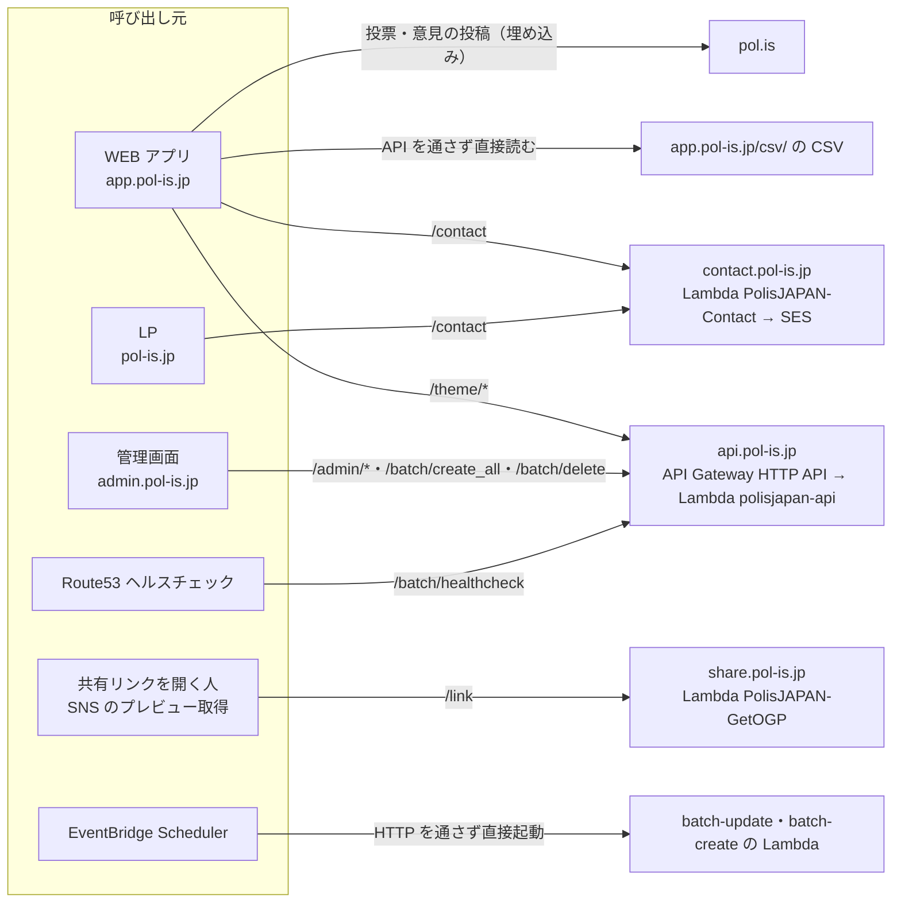
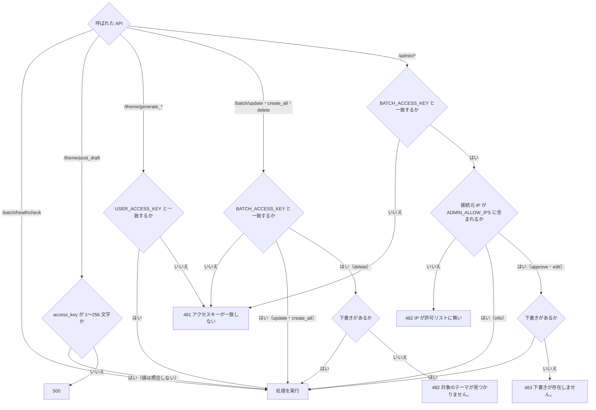
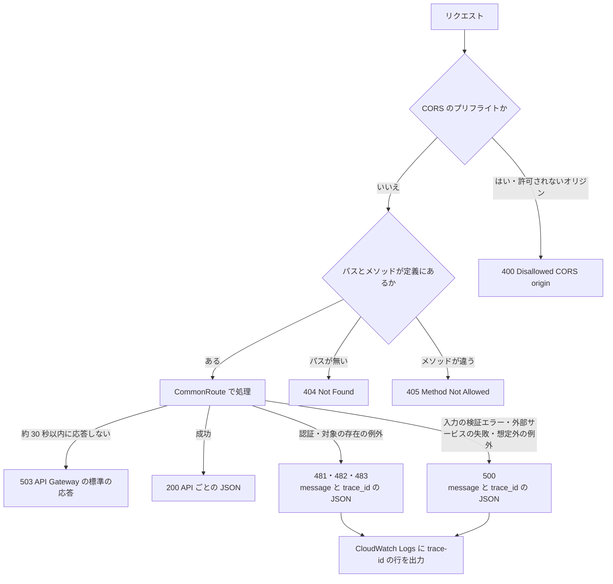
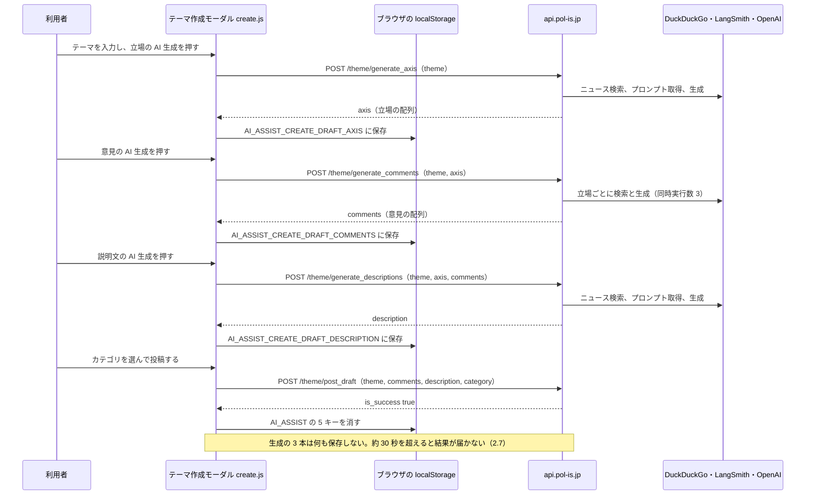
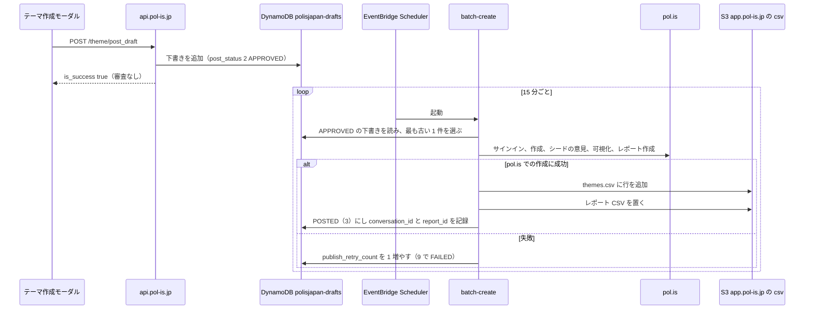
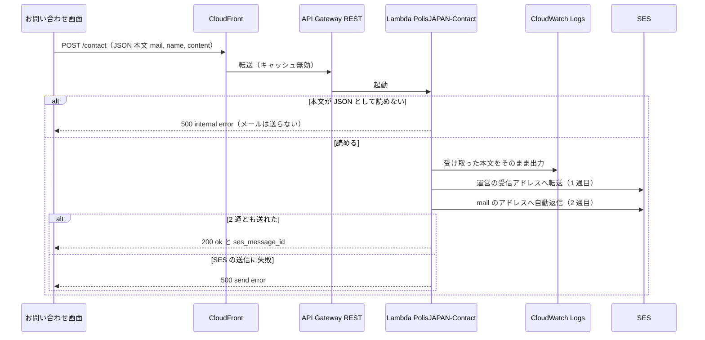

# PolisJAPAN API 仕様

| 項目 | 内容 |
| --- | --- |
| 位置づけ | PolisJAPAN が提供する HTTP API（`api.pol-is.jp`、`contact.pol-is.jp`、`share.pol-is.jp`）の、呼び方・認証・入出力・エラー・副作用を、**実装されているとおりに**記録する |
| 対象の実装 | `Server/web/api/`（FastAPI）、`Server/lambda/contact/`、`Infra/terraform/` |
| 関連文書 | 保存データの形式は `docs/データ仕様.md`、画面ごとの通信は `docs/画面仕様書.md`、障害時の手順は `docs/運用手順書.md`、未対応の問題は `docs/改善バックログ.md` |

---

## 1. API の全体像

| ホスト | 用途 | 実体 | コードの場所 |
| --- | --- | --- | --- |
| `https://api.pol-is.jp/` | テーマ作成（AI 生成・投稿）、下書き管理、バッチの手動実行、死活監視 | API Gateway（HTTP API）→ Lambda `polisjapan-api`（FastAPI を Mangum で動かすコンテナ） | `Server/web/api/` |
| `https://contact.pol-is.jp/contact` | お問い合わせの受付とメール送信 | CloudFront → API Gateway（REST）→ Lambda `PolisJAPAN-Contact` → SES（us-east-1） | `Server/lambda/contact/` |
| `https://share.pol-is.jp/link` | 共有リンク（OGP 付きのページを返し、詳細画面へ移す） | CloudFront → API Gateway（REST）→ Lambda `PolisJAPAN-GetOGP`（us-east-1） | リポジトリ外 |

テーマ一覧や分析結果の CSV は API を通さず、ブラウザが `https://app.pol-is.jp/csv/...` を直接読む（`docs/データ仕様.md`）。投票と意見の投稿は pol.is の埋め込みが pol.is と直接通信し、この API は関与しない。

定期バッチ（batch-update・batch-create）は HTTP を経由せず、EventBridge Scheduler が Lambda を直接起動する（`Server/web/api/lambda_handlers/batch_update.py`、`Server/web/api/lambda_handlers/batch_create.py`）。同じ処理を HTTP で手動実行する入口が `/batch/update` と `/batch/create_all` である。

次の図は、誰がどの API 群を呼ぶか（と、API を通らない通信）を示す。



---

## 2. 共通事項（`api.pol-is.jp`）

### 2.1 ベース URL

- 本番: `https://api.pol-is.jp/`。パスは `/<ルーター名>/<API 名>` の 2 段で、ルーターは `theme`・`batch`・`admin` の 3 つ（`Server/web/api/main.py` の `include_router`）。
- クライアントは、ホスト名が `localhost` のとき `/api/` を宛先にする（`Client/public_html_app/javascript/common.js` の `API_URL`、`Client/public_html_admin/javascript/admin.js` の `API_BASE`）。ローカルの nginx（`Client/nginx_app/default.conf`）が `/api/` を**本番の** `https://api.pol-is.jp` へ中継するので、ローカルの画面から呼んでも本番に作用する。
- ローカルでサーバーを動かす場合は `Server/docker-compose.yml` の nginx（ポート 80）経由で `http://localhost/` が API のベースになる。

### 2.2 リクエスト形式

- **フォーム形式**で送る。全 API のリクエストスキーマが FastAPI の `Form` で項目を受け取る（`Server/web/api/schemas/` の各 `parse`）。`multipart/form-data` と `application/x-www-form-urlencoded` のどちらでも受け付ける。
- **JSON 本文は受け付けない。** JSON で送ると項目が無いものとして扱われ、500 になる（§2.6）。
- クライアントは `fetchJsonPost`（`Client/public_html_app/javascript/common.js`、`Client/public_html_admin/javascript/common.js`）で、オブジェクトを `FormData` に詰めて `multipart/form-data` で POST し、`Accept: application/json` を付ける。
- 必須の文字列項目に空文字を送ると、未指定と同じ扱いになり 500 になる。任意項目（`/admin/edit` の `theme_name` など）に空文字を送ると、未指定（変更しない）として扱われる。
- メソッドは `/batch/healthcheck` だけが GET、ほかはすべて POST。定義と違うメソッドで呼ぶと 405 になる。

### 2.3 共通のリクエスト項目

| 項目 | 型 | 対象 | 内容 |
| --- | --- | --- | --- |
| `access_key` | 文字列（1〜256 文字） | `/batch/healthcheck` 以外の全 API | アクセスキー。どのキーと照合するかは API ごとに違う（§2.5）。`/theme/post_draft` は形式だけを検査し、照合しない |

Cookie やヘッダーによる認証・セッションは使わない（休眠中の `user` ルーターだけが Cookie `session_id` を使う。§7）。

### 2.4 レスポンスの共通形

- 成功時は 200 で JSON を返す。項目は API ごとに決まっている（§4〜§6）。更新系の API は `{"is_success": true}` を返す。
- 失敗時の形は §2.6 を参照。
- 日時は ISO 8601 の文字列で返る。本番の下書きは日本時間の時差（`+09:00`）付きで保存されている（`docs/データ仕様.md`）。

### 2.5 認証

認証は、リクエスト項目の `access_key` を Lambda の環境変数の値と照合する方式と、接続元 IP の許可リストの 2 つだけである。

| キー・リスト | 中身の置き場所 | 秘匿性 |
| --- | --- | --- |
| `USER_ACCESS_KEY` | 本番は SSM Parameter Store から Terraform が Lambda の環境変数へ入れる（`Infra/terraform/environments/production/main.tf`）。クライアントには `Client/public_html_app/javascript/common.js` に同じ値が埋め込まれている | **秘匿されていない。** bot よけとしての運用（`docs/改善バックログ.md` S-5） |
| `BATCH_ACCESS_KEY` | 同上（SSM → Lambda の環境変数）。管理画面では運営者が入力し、Cookie `admin_access_key` に保存される | 運営者だけが知るキー |
| IP 許可リスト `ADMIN_ALLOW_IPS` | CIDR のカンマ区切り。Terraform の変数 `admin_allow_ips` から Lambda の環境変数へ入る | 値は文書に書かない |

| API | アクセスキー | IP 許可リスト | 検査の順 |
| --- | --- | --- | --- |
| `/theme/generate_axis`、`/theme/generate_comments`、`/theme/generate_descriptions` | `USER_ACCESS_KEY` | なし | — |
| `/theme/post_draft` | **照合しない**（`access_key` が 1〜256 文字であることだけ検査） | なし | — |
| `/batch/update`、`/batch/create_all`、`/batch/delete` | `BATCH_ACCESS_KEY` | なし | キー → 対象の存在 |
| `/batch/healthcheck` | なし | なし | — |
| `/admin/info`、`/admin/approve`、`/admin/edit` | `BATCH_ACCESS_KEY` | `ADMIN_ALLOW_IPS` | キー → IP → 対象の存在 |

次の図は、上の表の検査の順と、それぞれで失敗したときに返るコードを示す。



- IP の判定は `Server/web/api/utils/security.py` の `is_allowed_ip` で、Lambda に渡された接続元 IP（API Gateway が受け取った送信元）を許可リストの各 CIDR と比べる。IP として解釈できない値は拒否する。
- 管理画面 `admin.pol-is.jp` 自体も CloudFront Function で同じ許可リストを検査している（設定はインフラ構成.md）。API 側の検査はそれとは別に掛かる。
- 定期バッチの Lambda はアクセスキーを検査しない。起動できるのは IAM で許可された EventBridge Scheduler だけだからである。

### 2.6 エラー

API の処理は `Server/web/api/core/common_route.py` の `CommonRoute` を通る。ここで例外を捕まえ、次の形の JSON に揃える。

```json
{ "message": "アクセスキーが不正です", "trace_id": "<16 桁の 16 進>-<32 桁の 16 進>" }
```

#### ステータスコード

| コード | 意味 | 返す API |
| --- | --- | --- |
| 481 | アクセスキーが一致しない | アクセスキーを照合する全 API |
| 482 | `/admin/*`: 接続元 IP が許可リストに無い | `/admin/info`、`/admin/approve`、`/admin/edit` |
| 482 | `/batch/delete`: 指定した下書きが無い（メッセージ「対象のテーマが見つかりません。」） | `/batch/delete` |
| 483 | 指定した下書きが無い（メッセージ「下書きが存在しません。」） | `/admin/approve`、`/admin/edit` |
| 500 | 入力の検証エラー、想定外の例外。メッセージは常に「サーバー内部で予期しないエラーが発生しました。」 | 全 API |

- 482 と 483 は API によって意味が違う。呼び出し側は、コードと API の組で判断する。
- 「下書きが無い」には、論理削除済み（`status` が 0）の下書きも含まれる。
- **入力の検証エラーも 500 になる。** 必須項目の欠落、型の不一致（数値の項目に文字列）、文字数の超過、数値の範囲外、JSON 本文での送信は、FastAPI が本来返す 422 ではなく、`CommonRoute` が想定外の例外として扱い 500 を返す（`docs/改善バックログ.md` D-10）。
- 外部サービスの失敗（pol.is・OpenAI・LangSmith・S3・DynamoDB の通信エラー）も 500 になる。
- スキーマには定義されているが、現在のコードでは返らないコードがある: `/batch/update` の 482（`PolisReportUnavailableError`）、`/batch/delete` の 483（`DraftNotFoundError`）、共通の 461（`UnknownError`）と 462（`UserAuthError`。休眠中の `user` ルーター用）。

#### `CommonRoute` を通らない応答

次の応答は上の形にならず、FastAPI・Starlette・API Gateway の標準の形で返る。`trace_id` は付かない。

| 状況 | コード | 本文 |
| --- | --- | --- |
| 存在しないパス | 404 | `{"detail": "Not Found"}` |
| メソッドが違う | 405 | `{"detail": "Method Not Allowed"}` |
| アプリのタイムアウト（§2.7） | 504 | `{"detail": "Request processing time excedeed limit"}` |
| API Gateway のタイムアウト（§2.7） | 503 | API Gateway の標準の応答 |
| CORS のプリフライトで許可されないオリジン（§2.8） | 400 | `Disallowed CORS origin` |

次の図は、応答のコードと形がどこで決まるかを示す。



#### `trace_id`

- エラーのたびに生成するランダムな ID（`Server/web/api/utils/error.py`）。同じ値がログにも出る。
- ログは CloudWatch Logs のロググループ `/aws/lambda/polisjapan-api` に、`trace-id -> <値>` の行として、発生 API・エラーコード・メッセージ（想定外の例外ではスタックトレース）と一緒に出力される。問い合わせで `trace_id` を受け取ったら、この値でログを検索する。

### 2.7 タイムアウト

制限は 3 段あり、実際に効くのは最も短い API Gateway の約 30 秒である。

| 段 | 値 | 超えたとき | 設定の場所 |
| --- | --- | --- | --- |
| API Gateway（HTTP API）の統合タイムアウト | 約 30 秒（Terraform で指定しておらず、HTTP API の既定値） | クライアントには 503 が返る。Lambda の処理は続く | `Infra/terraform/modules/api/main.tf` |
| Lambda `polisjapan-api` | 120 秒 | Lambda が打ち切られる | 同上 |
| アプリの `TimeoutMiddleware` | 300 秒 | 504 を返す | `Server/web/api/main.py`、`Server/web/api/core/middleware/timeout_middleware.py` |

AI 生成（`/theme/generate_*`）は外部の検索と OpenAI を呼ぶため、30 秒を超えると、サーバー側は生成を終えていてもクライアントには結果が届かない（`docs/改善バックログ.md` S-9）。

### 2.8 CORS

`Server/web/api/main.py` が Starlette の `CORSMiddleware` を設定する。値は環境ごとに違う。

| 環境 | 許可するオリジン | 資格情報 | メソッド・ヘッダー |
| --- | --- | --- | --- |
| 本番（`APP_ENV=serverless`） | Lambda の環境変数 `CORS_ALLOW_ORIGINS`。Terraform の変数 `cors_allow_origins` の既定値は `https://app.pol-is.jp`、`https://pol-is.jp`、`https://admin.pol-is.jp`（`Infra/terraform/environments/production/variables.tf`） | 許可 | すべて許可 |
| ローカル（`localhost`） | すべて | 許可 | すべて許可 |

許可されていないオリジンからのプリフライトには 400 を返す。ローカルの画面は nginx の `/api/` 経由の同一オリジンで呼ぶので、CORS は関係しない。

### 2.9 Swagger（API ドキュメント画面）

- 本番では無効である。`APP_ENV` が `production` または `serverless` のとき、`/docs`、`/redoc`、`/openapi.json` を作らない（`Server/web/api/main.py` の `create_app`）。本番の Lambda は `serverless` で動くので、これらは 404 になる。
- ローカル（`localhost`・`development`）では有効で、`http://localhost/docs` で見られる。この文書の項目名・型・制約は Swagger に出るスキーマと同じものである。

---

## 3. エンドポイント一覧

| メソッド | パス | 用途 | 認証 | 呼び出し元 |
| --- | --- | --- | --- | --- |
| POST | `/theme/generate_axis` | 対立軸（立場）の AI 生成 | `USER_ACCESS_KEY` | テーマ作成モーダル（AI アシスト） |
| POST | `/theme/generate_comments` | 立場ごとの意見の AI 生成 | `USER_ACCESS_KEY` | 同上 |
| POST | `/theme/generate_descriptions` | 説明文の AI 生成 | `USER_ACCESS_KEY` | 同上 |
| POST | `/theme/post_draft` | テーマの投稿（下書きを承認済みで登録） | なし（照合しない） | テーマ作成モーダル（両モード） |
| POST | `/batch/update` | 投票数・意見数の更新を手動実行 | `BATCH_ACCESS_KEY` | 画面からは呼ばない（手動の curl 用） |
| POST | `/batch/create_all` | 承認済み下書きの pol.is への公開を手動実行 | `BATCH_ACCESS_KEY` | 管理画面の変換欄「更新」 |
| POST | `/batch/delete` | テーマの削除 | `BATCH_ACCESS_KEY` | 管理画面の各下書きの「削除」 |
| GET | `/batch/healthcheck` | 死活監視 | なし | Route53 ヘルスチェック、デプロイのワークフロー |
| POST | `/admin/info` | 下書き一覧の取得 | `BATCH_ACCESS_KEY` + IP | 管理画面の「セット」と、Cookie がある場合の自動読み込み |
| POST | `/admin/approve` | 下書きの承認 | `BATCH_ACCESS_KEY` + IP | 管理画面の各下書きの「承認」 |
| POST | `/admin/edit` | 下書きの内容の編集 | `BATCH_ACCESS_KEY` + IP | 管理画面の各下書きの「更新」 |

管理画面の変換欄「生成」ボタンは、batch ルーターの generate を呼ぶが、このルートはマウントされていないので 404 になり、何も起きない。

---

## 4. テーマ作成（`/theme`）

実装: `Server/web/api/routers/theme.py`、`Server/web/api/schemas/theme.py`、`Server/web/api/services/theme.py`。クライアント: `Client/public_html_app/javascript/create.js`。

複数の値をまとめて 1 項目で送るときは、区切り文字 `###br###`（`Server/web/api/configs/constants.py` の `SPLITTER`）でつなぐ。

次の図は、テーマ作成モーダルの AI アシストで API を呼ぶ順と、入力内容の保存を示す。



### 4.1 AI 生成の共通の仕組み

`/theme/generate_*` の 3 本は次の順に処理する。どれもデータを保存しない。

1. テーマ（タイトル）で DuckDuckGo のニュース検索を行い、見出しと抜粋を背景情報にする。検索に失敗したら背景情報を空にして続ける。
2. LangSmith からプロンプトを取得する。キーは `get_axis_standalone`、`get_comments_standalone`、`get_description_standalone`。
3. OpenAI の `gpt-5-nano`（`reasoning_effort=low`、`verbosity=low`）で生成する。

**副作用**: OpenAI の利用料が呼び出しのたびに発生する。DuckDuckGo と LangSmith への通信が発生する。DynamoDB・S3・pol.is には何もしない。

### 4.2 `/theme/generate_axis`

テーマから対立軸（立場）の候補を生成する。

| リクエスト項目 | 型 | 必須 | 制約・内容 |
| --- | --- | --- | --- |
| `access_key` | 文字列 | ○ | `USER_ACCESS_KEY` と一致すること |
| `theme` | 文字列 | ○ | テーマ（タイトル）。長さの上限は無い |

| レスポンス項目 | 型 | 内容 |
| --- | --- | --- |
| `axis` | 文字列の配列 | 生成結果を 1 行ずつに分け、行頭の `- ` を除いたもの。空の要素が混じることがある（クライアントは空の要素を捨てる） |

エラー: 481、500。

### 4.3 `/theme/generate_comments`

立場ごとに、シードとなる意見を生成する。

| リクエスト項目 | 型 | 必須 | 制約・内容 |
| --- | --- | --- | --- |
| `access_key` | 文字列 | ○ | `USER_ACCESS_KEY` と一致すること |
| `theme` | 文字列 | ○ | テーマ |
| `axis` | 文字列 | ○ | 立場を `###br###` でつないだもの |

| レスポンス項目 | 型 | 内容 |
| --- | --- | --- |
| `comments` | 文字列の配列 | 立場ごとに生成した意見を、立場の順に 1 つの配列へつないだもの。空行は除く。1 つの立場あたりの件数はプロンプト次第で、コードでは決めていない |

立場ごとの生成は並列に行う（同時実行数 3）。立場の数だけ検索と生成を行うので、立場が多いほど時間がかかり、§2.7 の約 30 秒に近づく。

エラー: 481、500。

### 4.4 `/theme/generate_descriptions`

テーマ・立場・意見から説明文を生成する。

| リクエスト項目 | 型 | 必須 | 制約・内容 |
| --- | --- | --- | --- |
| `access_key` | 文字列 | ○ | `USER_ACCESS_KEY` と一致すること |
| `theme` | 文字列 | ○ | テーマ |
| `axis` | 文字列 | ○ | 立場を `###br###` でつないだもの |
| `comments` | 文字列 | ○ | 意見を `###br###` でつないだもの |

| レスポンス項目 | 型 | 内容 |
| --- | --- | --- |
| `description` | 文字列 | 生成した説明文。文字数の上限を掛けない（投稿時の上限 200 文字を超えることがあり、そのときは利用者が直す） |

エラー: 481、500。

### 4.5 `/theme/post_draft`

利用者が作ったテーマを下書きとして登録する。登録時点で承認済み（APPROVED）になり、管理者の操作を経ずに pol.is へ公開される。**審査を挟まずに公開するのは仕様である。**

| リクエスト項目 | 型 | 必須 | 制約・内容 |
| --- | --- | --- | --- |
| `access_key` | 文字列 | ○ | 1〜256 文字。**値は照合しない** |
| `theme` | 文字列 | ○ | タイトル。最大 80 文字（タイトル 80 文字。コードポイント単位で数える） |
| `comments` | 文字列 | ○ | シードの意見を `###br###` でつないだもの。件数・長さの上限は無い |
| `description` | 文字列 | ○ | 説明。最大 200 文字（コードポイント単位） |
| `category` | 整数 | ○ | カテゴリ ID（`docs/データ仕様.md` のカテゴリ ID の表）。**範囲は検査しない**（1〜8 以外の整数も通る） |

| レスポンス項目 | 型 | 内容 |
| --- | --- | --- |
| `is_success` | 真偽値 | 常に `true` |

エラー: 500（文字数超過・型の不一致・欠落を含む）。481 は返らない。

文字数の上限は新規の投稿だけに掛かる。既存のデータ、`/admin/edit` での編集、AI 生成の結果には掛からない。画面側も同じ上限（カウンター、`maxlength`、「次へ」での検査）を持つ（`docs/画面仕様書.md`）。

**副作用**:

- DynamoDB `polisjapan-drafts` に下書きを 1 件追加する。`post_status` は 2（APPROVED）、`title`・`origin_url`・`origin_html` は空文字、`conversation_id`・`report_id` は空文字。id の採番はデータ仕様.md。
- その後、batch-create（15 分間隔）が古い下書きから 1 件ずつ pol.is にテーマを作り、`themes.csv` に追加する。投稿からおおむね 15 分以内に一般公開され、待ちの下書きが多ければその分遅れる。
- S3・pol.is・OpenAI には、この API の中では何もしない。

次の図は、`/theme/post_draft` の呼び出しから pol.is で一般公開されるまでの流れを示す。



本番でこの API を試してはならない（§10）。

---

## 5. バッチ（`/batch`）

実装: `Server/web/api/routers/batch.py`、`Server/web/api/schemas/batch.py`、`Server/web/api/services/batch.py`。

本番の定期実行はこの HTTP の入口を使わない（§1）。HTTP の `/batch/*` は本番でも公開されており、`BATCH_ACCESS_KEY` があればどこからでも実行できる（IP 制限は無い）。

### 5.1 `/batch/update`

全テーマの投票数・意見数を pol.is から取り直し、変化があれば CSV を更新する。batch-update（5 分間隔）と同じ処理（`BatchService.update_themes`）である。

| リクエスト項目 | 型 | 必須 | 制約・内容 |
| --- | --- | --- | --- |
| `access_key` | 文字列 | ○ | `BATCH_ACCESS_KEY` と一致すること |

| レスポンス項目 | 型 | 内容 |
| --- | --- | --- |
| `is_success` | 真偽値 | 常に `true` |

エラー: 481、500（pol.is から 1 テーマでも取得できなければ 500 になり、何も書き込まない）。

**副作用**:

- S3 から `csv/themes.csv` を読み、テーマごとに `https://pol.is/api/v3/reportExport/<report_id>/comment-groups.csv` を取得する（タイムアウトは 10 秒、接続 5 秒）。
- 投票数か意見数が変わったテーマについて、S3 の `csv/report/report_<conversation_id>.csv` を上書きし、`csv/themes.csv` の該当行を更新する。書き込みの詳細（Cache-Control、競合の対策）はデータ仕様.md。
- DynamoDB・OpenAI には何もしない。

テーマの数だけ pol.is へ順に通信するので、テーマが多いと §2.7 の約 30 秒を超え、クライアントに 503 が返ることがある（処理自体は Lambda の 120 秒まで続く）。

### 5.2 `/batch/create_all`

承認済み（APPROVED）の下書きを**全件**、Selenium で pol.is に作成する。batch-create と同じ処理（`BatchService.publish_approved_drafts`）だが、件数の上限が無い。

| リクエスト項目 | 型 | 必須 | 制約・内容 |
| --- | --- | --- | --- |
| `access_key` | 文字列 | ○ | `BATCH_ACCESS_KEY` と一致すること |

| レスポンス項目 | 型 | 内容 |
| --- | --- | --- |
| `is_success` | 真偽値 | 常に `true` |

エラー: 481、500。

**副作用**（成功したとき）: pol.is にテーマを作り（サインイン → 作成 → シードの意見の投入 → 可視化の有効化 → レポートの作成）、`csv/themes.csv` に行を追加し、レポート CSV を置き、下書きを POSTED（3）にして `conversation_id`・`report_id` を記録する。

**本番では成立しない。** 本番の Lambda `polisjapan-api` には Chrome が無く、pol.is のログイン情報も渡していない。呼ぶと最も古い APPROVED の下書きで失敗し、その下書きの `publish_retry_count` が 1 増えて 500 が返る。繰り返すと、正常な下書きが FAILED に隔離される（`docs/データ仕様.md`）。ローカル開発用の入口である。

### 5.3 `/batch/delete`

テーマを一覧から消し、下書きを論理削除する。

| リクエスト項目 | 型 | 必須 | 制約・内容 |
| --- | --- | --- | --- |
| `access_key` | 文字列 | ○ | `BATCH_ACCESS_KEY` と一致すること |
| `t_draft_id` | 整数 | ○ | 下書きの id。1 以上 |

| レスポンス項目 | 型 | 内容 |
| --- | --- | --- |
| `is_success` | 真偽値 | 常に `true` |

エラー: 481、482（下書きが無い、または論理削除済み）、500。

**副作用**（順に実行する）:

1. DynamoDB から下書きを読み、その `conversation_id` を持つ行を `csv/themes.csv` から除いて書き戻す（行が無ければ書かない）。
2. S3 の `csv/report/report_<conversation_id>.csv` があれば削除する。
3. CloudFront（`app.pol-is.jp`）の 2 パス `/csv/report/report_<conversation_id>.csv` と `/csv/themes.csv` を無効化する。環境変数 `CLOUDFRONT_DISTRIBUTION` が空なら行わない。
4. 下書きの `status` を 0 にする（論理削除）。`post_status` は変えない。

- pol.is 上のカンバセーションは削除しない。URL を知っていれば pol.is では引き続き開ける。
- まだ公開されていない下書きを削除すると、batch-create の対象から外れ、公開されない。
- 取り消しの API は無い。
- 管理画面は確認ダイアログを出さずにこの API を呼ぶ。また、管理画面はこの API だけ宛先を `https://api.pol-is.jp/batch/delete` に固定しているので、ローカルの管理画面から押しても本番のテーマが消える。

### 5.4 `/batch/healthcheck`

死活監視用。リクエスト項目は無い。常に 200 で `{"is_success": true}` を返す。

- 呼び出し元: Route53 ヘルスチェック（HTTPS、30 秒間隔、3 回連続の失敗でアラーム。`Infra/terraform/modules/monitoring/main.tf`）と、サーバーのデプロイ後の疎通確認（`docs/運用手順書.md`）。
- Lambda と API Gateway と証明書が生きていることだけを確かめる。DynamoDB・S3・pol.is・OpenAI には通信しないので、それらの障害は検知できない。

---

## 6. 管理（`/admin`）

実装: `Server/web/api/routers/admin.py`、`Server/web/api/schemas/admin.py`。クライアント: `Client/public_html_admin/javascript/admin.js`。

3 本とも、アクセスキー（`BATCH_ACCESS_KEY`）→ 接続元 IP → 対象の下書きの存在、の順に検査する。

### 6.1 下書き（`t_draft`）の返し方

`/admin/*` は下書きを次の形のオブジェクトで返す（`Server/web/api/models/tables.py` の `TDraftModel`）。各項目の意味はデータ仕様.md。

| 項目 | 型 |
| --- | --- |
| `id` | 整数 |
| `title`、`origin_url` | 文字列 |
| `theme_name`、`theme_description`、`theme_comments` | 文字列（`theme_comments` は `###br###` 区切り） |
| `theme_category` | 整数 |
| `conversation_id`、`report_id` | 文字列（公開前は空文字） |
| `post_status` | 整数 |
| `status` | 整数（返るのは常に 1） |
| `create_date`、`update_date` | ISO 8601 の日時文字列 |

`origin_html` と `publish_retry_count` は返さない。リトライ回数を見るには DynamoDB を直接読む（`docs/運用手順書.md`）。

### 6.2 `/admin/info`

論理削除されていない下書きを全件返す。読み取りだけで、何も変更しない。

| リクエスト項目 | 型 | 必須 | 制約・内容 |
| --- | --- | --- | --- |
| `access_key` | 文字列 | ○ | `BATCH_ACCESS_KEY` と一致すること |

| レスポンス項目 | 型 | 内容 |
| --- | --- | --- |
| `t_draft_list` | 下書きの配列 | 投稿済みも含む全件。id の昇順。ページ分割は無い |

エラー: 481、482、500。

**副作用**: DynamoDB を Scan する（件数に比例して読み取りの費用がかかる）。

管理画面は、成功したら入力したキーを Cookie `admin_access_key`（30 日）に保存し、次回から自動でこの API を呼ぶ。

### 6.3 `/admin/approve`

下書きを承認済み（APPROVED）にし、投稿リトライ回数を 0 に戻す。

| リクエスト項目 | 型 | 必須 | 制約・内容 |
| --- | --- | --- | --- |
| `access_key` | 文字列 | ○ | `BATCH_ACCESS_KEY` と一致すること |
| `t_draft_id` | 整数 | ○ | 1 以上 4294967295 以下 |

| レスポンス項目 | 型 | 内容 |
| --- | --- | --- |
| `t_draft` | 下書き | 更新後の下書き |

エラー: 481、482、483、500。

**副作用**: DynamoDB の下書きの `post_status` を 2、`publish_retry_count` を 0 にし、`update_date` を更新する。その後、batch-create（15 分間隔）が pol.is へ公開する。

- **現在の状態を確認しない。** 投稿済み（POSTED）の下書きを承認すると APPROVED に戻り、batch-create が pol.is に**同じテーマをもう一度作る**。管理画面は、未承認（0・1）と投稿失敗（102）の下書きでだけ「承認」を押せるようにしているが、API 自体は止めない。
- 投稿失敗で隔離された下書き（FAILED）を再投稿させる操作がこれである。

### 6.4 `/admin/edit`

下書きの内容を書き換える。

| リクエスト項目 | 型 | 必須 | 制約・内容 |
| --- | --- | --- | --- |
| `access_key` | 文字列 | ○ | `BATCH_ACCESS_KEY` と一致すること |
| `t_draft_id` | 整数 | ○ | 1 以上 |
| `theme_name` | 文字列 | — | 1 文字以上。省略・空文字なら変更しない。上限は無い |
| `theme_description` | 文字列 | — | 同上 |
| `theme_comments` | 文字列 | — | 同上。`###br###` 区切り |
| `theme_category` | 整数 | — | 1 以上。上限は検査しない。省略なら変更しない |

| レスポンス項目 | 型 | 内容 |
| --- | --- | --- |
| `t_draft` | 下書き | 更新後の下書き |

エラー: 481、482、483、500。

**副作用**: DynamoDB の下書きの指定項目と `update_date` を更新する。`post_status` は変えない。

- 公開前の下書きを直せば、その内容で公開される。
- **公開済みのテーマには反映されない。** pol.is のカンバセーションと `themes.csv` の行は書き換えない。
- 管理画面は、編集欄の改行を `###br###` に置き換えて `theme_comments` を送る。

---

## 7. 休眠中の API（`user` ルーター）

`Server/web/api/routers/user.py` と `Server/web/api/schemas/user.py` に、利用者アカウントの API がある。`Server/web/api/main.py` で `include_router` していないので、本番でもローカルでも呼べない（404）。本番にはテーブルも無い（`docs/データ仕様.md`）。

| API 名 | 内容 |
| --- | --- |
| `mail_check` | メールアドレスが未登録かを返す |
| `create` | 利用者を登録する（パスワードは `Server/web/api/utils/security.py` でハッシュ化） |
| `login` | ログインし、Cookie `session_id`（HttpOnly・Secure・SameSite=Lax）を発行する |
| `reload` | ログイン中の利用者情報を返す |
| `edit` | 利用者情報を更新する |
| `delete` | 退会（論理削除）する |

`mail_check`・`create`・`login` 以外は Cookie `session_id` による認証が必要という定義になっている（`Server/web/api/configs/user_auth.py`）。本番（DynamoDB を使う設定）では、この認証は常に 462 で失敗する（`Server/web/api/core/common_route.py`）。

---

## 8. お問い合わせ API（`contact.pol-is.jp`）

実装: `Server/lambda/contact/lambda_function.py`。デプロイ手順と注意は `Server/lambda/contact/README.md`。

### 8.1 呼び方

| 項目 | 内容 |
| --- | --- |
| メソッドとパス | `POST https://contact.pol-is.jp/contact` |
| 形式 | JSON 本文（`Content-Type: application/json`）。`api.pol-is.jp` と違い、フォーム形式ではない |
| 認証 | なし。レート制限も無い |
| 経路 | CloudFront（キャッシュ無効）→ API Gateway（REST、ステージ `production`）→ Lambda `PolisJAPAN-Contact`（us-east-1、Python 3.14、メモリ 128MB、タイムアウト 3 秒）。設定は `Infra/terraform/environments/production/contact_share.tf`、`Infra/terraform/environments/production/cloudfront_legacy.tf` |

| リクエスト項目 | 型 | 内容 |
| --- | --- | --- |
| `mail` | 文字列 | 問い合わせた人のメールアドレス。自動返信の宛先になる |
| `name` | 文字列 | お名前 |
| `content` | 文字列 | お問い合わせ内容 |

サーバー側の入力検査は無い。項目が欠けていれば空文字として扱う。

### 8.2 応答

| 状況 | コード | 本文 |
| --- | --- | --- |
| 2 通とも送れた | 200 | `{"message": "ok", "ses_message_id": "<自動返信の SES メッセージ ID>"}` |
| SES の送信に失敗した | 500 | `{"message": "send error", "error": "<例外の文字列>"}` |
| 本文が JSON として読めないなど | 500 | `{"message": "internal error", "error": "<例外の文字列>"}` |

応答には常に `Access-Control-Allow-Origin: *` が付く（Lambda プロキシ統合のため、実際の応答側にも必要）。プリフライト（OPTIONS）は API Gateway 側の設定で応答している。その設定は Terraform の管理外で、内容は未確認。

### 8.3 副作用

1. SES で運営の受信アドレス（`Server/lambda/contact/lambda_function.py` の `NOTIFY_TO_EMAIL`）へ、名前・メールアドレス・内容を転送する。
2. SES で `mail` のアドレスへ自動返信を送る。

- 1 通目を送ってから 2 通目を送る。`mail` が空や不正で 2 通目が失敗しても、運営宛ての 1 通目は届いており、応答は 500 になる。
- 問い合わせの内容はどこにも保存しない。ただし Lambda が受け取った本文をそのままログに出力するので、CloudWatch Logs `/aws/lambda/PolisJAPAN-Contact` にメールアドレスと内容が残る（`docs/データ仕様.md`）。
- 有効な本文で呼ぶと実際にメールが 2 通送られる。疎通の確認は、JSON でない本文（例外の経路に入り、メールは送られない）で行う（`Server/lambda/contact/README.md`）。

次の図は、お問い合わせの送信の流れと、応答の分かれ方を示す。



### 8.4 呼び出し元

| 画面 | ファイル | 送り方 | 失敗の扱い |
| --- | --- | --- | --- |
| アプリ内のお問い合わせモーダル | `Client/public_html_app/javascript/contact.js` | `fetch` で JSON を POST。送る前に、内容が空でないこと、メールに `@` を含むことを検査する | 2xx 以外・通信失敗なら、確認画面のまま失敗の文言を出す。成功なら下書き（localStorage `contact_draft`）を消して完了画面へ |
| LP のお問い合わせ（`/contact`） | `Client/public_html/javascript/contact.js` | `fetchJsonPostAsJson`（`Client/public_html/javascript/common.js`）で JSON を POST。入力の検査は無い | 結果を待たずに完了画面へ切り替える。失敗しても完了と表示される |

---

## 9. 共有リンク（`share.pol-is.jp`）

Lambda `PolisJAPAN-GetOGP` のコードはリポジトリに無い。ここに書くのは、リポジトリの設定と既存の文書から分かることだけである。

| 項目 | 内容 | 出典 |
| --- | --- | --- |
| URL の形 | `https://share.pol-is.jp/link?conversation_id=<conversation_id>` | `Client/public_html_app/javascript/detail.js`（共有ボタン） |
| 経路 | CloudFront（キャッシュ無効、許可メソッドはすべて）→ API Gateway（REST、ステージ `Production`）→ Lambda `PolisJAPAN-GetOGP`（us-east-1、Python 3.13、メモリ 128MB、タイムアウト 3 秒） | `Infra/terraform/environments/production/cloudfront_legacy.tf`、`Infra/terraform/environments/production/contact_share.tf` |
| 応答 | 200 で OGP 付きの HTML を返す。`og:url` は `https://app.pol-is.jp/detail/?conversation_id=<conversation_id>` で、ブラウザでは最終的にその詳細画面が表示される | `docs/本番定期テストケース.md` TC-DT09（本番での実測） |
| 認証 | なし | 同上（誰でも開けるリンクとして配っている） |

- 呼び出し元: 詳細画面の共有モーダルが、このリンクと、それを含む SNS 用の文面をクリップボードへコピーする。アプリは share への通信をしない。リンクを開くのは、リンクを受け取った人のブラウザと、SNS のプレビュー取得である。
- 未確認: OGP のタイトル・説明・画像をどこから作っているか（`themes.csv` を読むのか、pol.is を読むのか）、詳細画面へ移す方法（meta refresh か JavaScript か）、`conversation_id` が無い・存在しないときの応答、Lambda のコードの置き場所と更新手順。
- Lambda のコードは Terraform の管理外（`ignore_changes`）で、コンソールからデプロイされたものが動いている。

---

## 10. 注意: 本番で試してはならない API

| API | 理由 |
| --- | --- |
| `/theme/post_draft` | **本番にテスト送信してはならない。** アクセスキーを照合していないので、送れば必ず登録され、審査なしで約 15 分以内に pol.is に実際のテーマが作られ、一般に公開される。審査なしの公開は仕様であり、止める仕組みは無い。公開されたテーマは `/batch/delete` で一覧から消せるが、pol.is 上のカンバセーションは残る |
| `/batch/create_all` | 本番では必ず失敗し、そのたびに最も古い承認済み下書きのリトライ回数が増える。繰り返すと正常な下書きが隔離される |
| `/batch/delete` | 取り消しができない。確認なしで実行される |
| `/admin/approve` | 投稿済みの下書きに使うと、同じテーマが pol.is にもう一度作られる |
| `/theme/generate_*` | 呼ぶたびに OpenAI の利用料が発生する |
| `contact.pol-is.jp/contact`（有効な本文） | 実際にメールが 2 通送られる |

本番で状態を変えずに確かめられるのは、`/batch/healthcheck`、誤ったアクセスキーでの呼び出し（481 が返ることの確認）、`share.pol-is.jp` のリンクを開くこと、JSON でない本文でのお問い合わせ、である。テストの手順は `docs/本番定期テストケース.md` にある。

`api.pol-is.jp` へのテスト送信は、ローカルの画面からでも本番に届く（§2.1）。ローカルで AI 生成や投稿を試すときは、サーバーもローカルで動かす。
