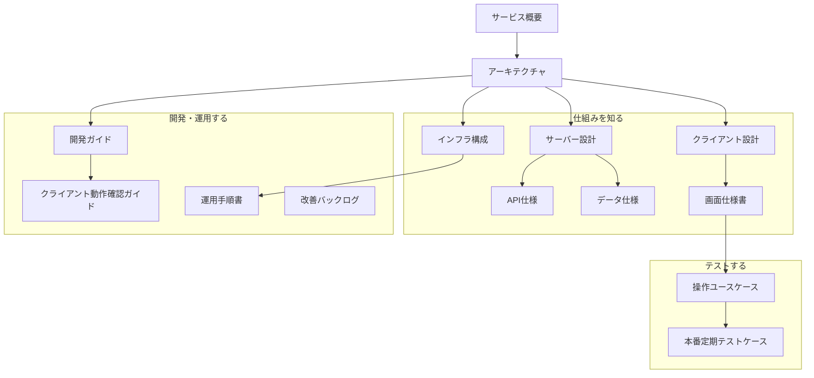

# PolisJAPAN ドキュメント

`docs/` には、**現在の状態**を記述する文書だけを置く。過去の経緯や作業計画は置かない（履歴は git にある）。

## 文書一覧

これらの文書が、このシステムの正本である。上から順に読むと全体が分かる。

文書どうしの関係を示す。矢印は読み進める順である。



### 全体を知る

| 文書 | 内容 |
| --- | --- |
| [サービス概要.md](サービス概要.md) | 何をするサービスか、機能の一覧、用語、利用している外部サービス |
| [アーキテクチャ.md](アーキテクチャ.md) | 全体の構成、主な処理の流れ、リポジトリの構成、設計判断の理由 |

### 仕組みを知る

| 文書 | 内容 |
| --- | --- |
| [インフラ構成.md](インフラ構成.md) | AWS のリソース、ドメインと DNS、IAM、監視、Terraform との対応 |
| [API仕様.md](API仕様.md) | API ごとの入出力、認証、エラー |
| [データ仕様.md](データ仕様.md) | CSV、DynamoDB、ブラウザに保存するデータの定義と状態遷移 |
| [サーバー設計.md](サーバー設計.md) | サーバーの実装の構成、AI テーマ生成、バッチの処理 |
| [クライアント設計.md](クライアント設計.md) | 3 つのサイトの実装の構成、スタイルのビルド、お知らせの追加 |
| [画面仕様書.md](画面仕様書.md) | 画面ごとの要素（セレクタ）、操作、通信、保存データ |

### 開発・運用する

| 文書 | 内容 |
| --- | --- |
| [開発ガイド.md](開発ガイド.md) | 環境の準備、変更の流れ、文書の更新 |
| [クライアント動作確認ガイド.md](クライアント動作確認ガイド.md) | 本番に反映せずにローカルで画面を確認する方法と注意 |
| [運用手順書.md](運用手順書.md) | 本番への反映、監視、障害対応の手順 |
| [改善バックログ.md](改善バックログ.md) | 未対応の不具合・リスク・要望 |

### テストする

| 文書 | 内容 |
| --- | --- |
| [操作ユースケース.md](操作ユースケース.md) | 利用者と運営者の操作の一覧と、本番で試してよいかの区分 |
| [本番定期テストケース.md](本番定期テストケース.md) | 利用者に影響を与えずに本番で実行できる画面テスト |

`docs/` の外にある文書は、その場所で作業するための短い手引きである。内容の正本は上の文書にある。

| 文書 | 内容 |
| --- | --- |
| `README.md` | リポジトリの入口 |
| `CLAUDE.md` | Claude Code がこのリポジトリで作業するときの規則 |
| `Client/README.md` | SCSS のビルド、クライアントの手動デプロイのコマンド |
| `Infra/terraform/README.md` | Terraform の構成と管理対象 |
| `Server/lambda/contact/README.md` | お問い合わせ Lambda |

## 書き方の規則

1. **現在の状態だけを書く。** 「以前は〜だった」「〜から移行した」という経緯は、今の判断に必要な理由に限って書く。
2. **計画書・検討書・作業記録を置かない。** 作業中の設計メモや実装計画は `docs/superpowers/` に作ってよいが、コミットしない（`.gitignore` 対象）。決まったことは、実装と同じコミットで上の文書に書き込む。
3. **未対応のことは `改善バックログ.md` に集める。** 対応したら、その項目を消して、該当する文書に現状を書く。
4. **すぐ変わる数値や日付を書かない。** リソースの総数、件数、「最終更新日」などは書かない。必要な値はコマンドで確認する方法を書く。
5. **同じことを 2 か所に書かない。** 詳細は 1 つの文書に書き、ほかからは参照する。
6. **コード上の名前は `バッククォート` で書く。** パス、API、セレクタ、設定値は検査の対象になる（下記）。
7. **図は Mermaid で書く。** 種類は flowchart、sequenceDiagram、stateDiagram-v2 を使う。ノードの ID は半角英数字、ラベルは二重引用符で囲む（`a["ラベル"]`）。図の中にバッククォートと `#` を書かない。図に載せるのは、本文かコードで確認できることだけにする。

## 文書を実装に追従させる仕組み

コードを変えたら、同じコミットで対応する文書を更新する。これを `scripts/check_docs.py` が検査する。

### 検査の内容

| 検査 | 内容 |
| --- | --- |
| 索引 | `docs/` の全文書がこの README に載っている。許可されていない文書（計画書など）が `docs/` に無い |
| パス | 文書に書いたリポジトリ内のパスとリンクが実在する |
| API | `API仕様.md` に書いた API と、実際にマウントされているルートが一致する |
| セレクタ | 画面仕様書・テストケース・ユースケースに書いたセレクタの id と class が、クライアントのコードに存在する |
| 設定値 | Chrome のバージョン、リトライ上限、バッチの間隔、アラーム名、文字数上限などの現在値が文書に書かれている |
| 図 | Mermaid の図が、描画できない書き方（種類の指定なし、引用符で囲んでいないラベル、`subgraph` と `end` の不一致など）になっていない |
| 連動 | コードを変更したコミット（またはプルリクエスト）に、対応する文書の変更が含まれている |

コードと文書の対応、検査する設定値は `docs/docmap.json` で定義する。機能や文書を増やしたときはここに足す。

### 実行される場面

| 場面 | 動作 |
| --- | --- |
| コミット時 | `.githooks/commit-msg` が検査し、問題があればコミットを止める |
| `main` への push、プルリクエスト | `.github/workflows/check-docs.yml` が検査し、問題があればワークフローが失敗する |
| 手動 | `python3 scripts/check_docs.py` |

コミット時の検査は、クローンごとに一度だけ有効化が必要である。

```sh
git config core.hooksPath .githooks
```

### 文書に影響しない変更のとき

リファクタリングや誤字修正のように文書を変える必要がない変更は、コミットメッセージに理由を書いて連動の検査を通す。

```
Docs: 変更不要（内部のリファクタリングで、外から見た動作は変わらない）
```

理由の無い `Docs: 変更不要` は通らない。静的な検査（索引・パス・API・セレクタ・設定値）は、この行があっても省略されない。

### 検査で分からないこと

検査が確かめるのは、名前や値の一致と、文書が一緒に更新されたかどうかである。説明文の内容が正しいかどうかは確かめられない。本番環境の実際の状態（AWS 上の設定、稼働状況）とも照合しない。変更のたびに、該当する節を読み直して直すこと。
