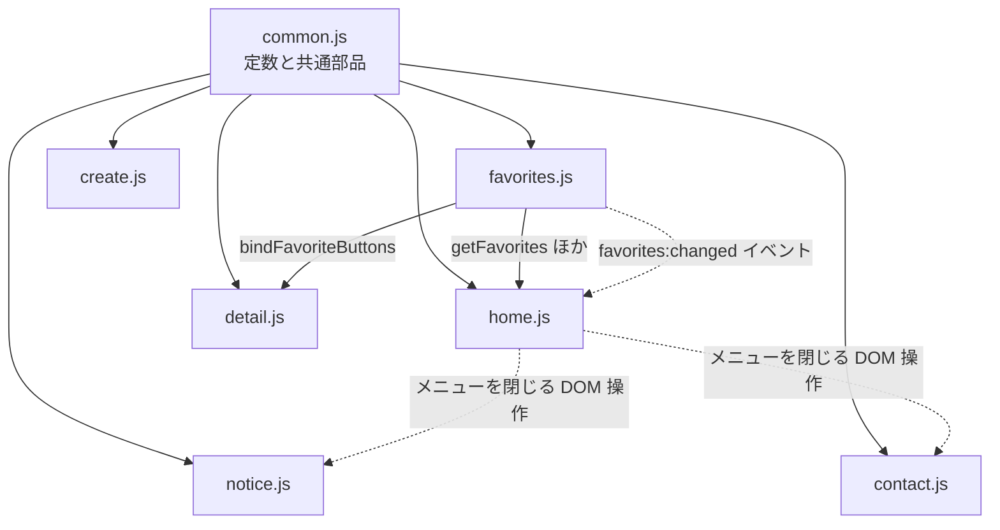
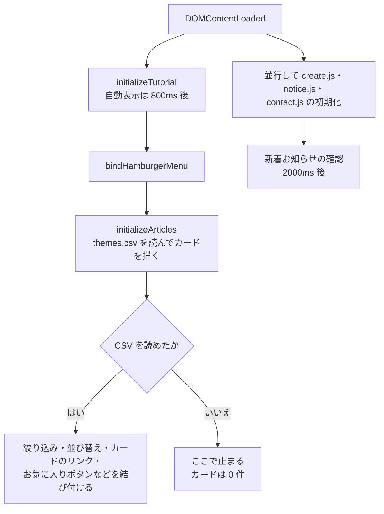
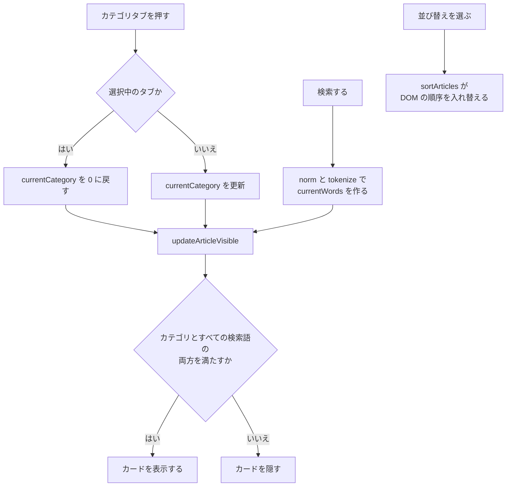
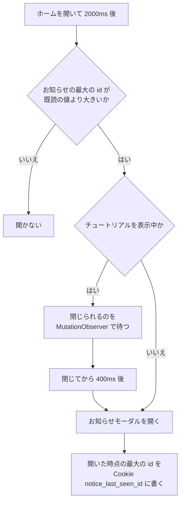
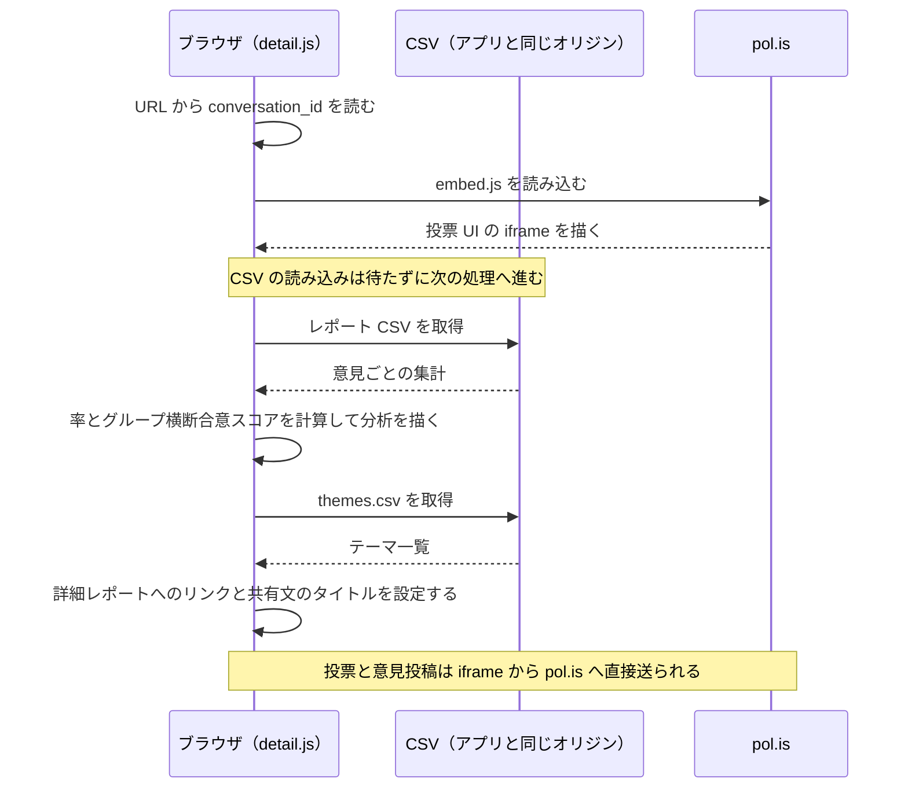
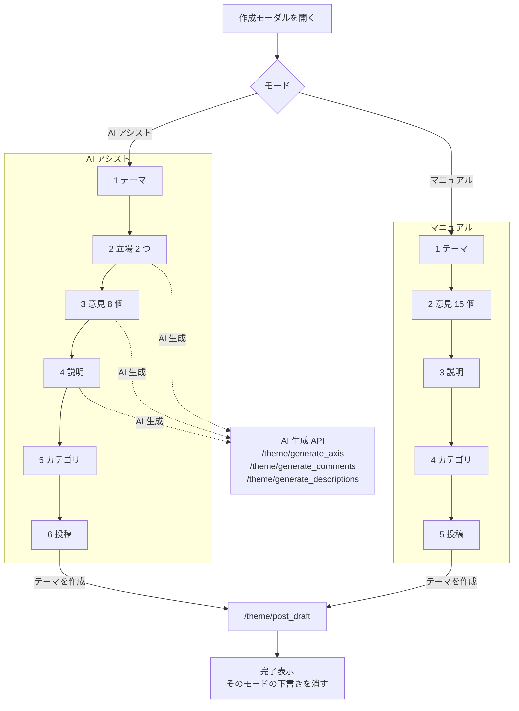
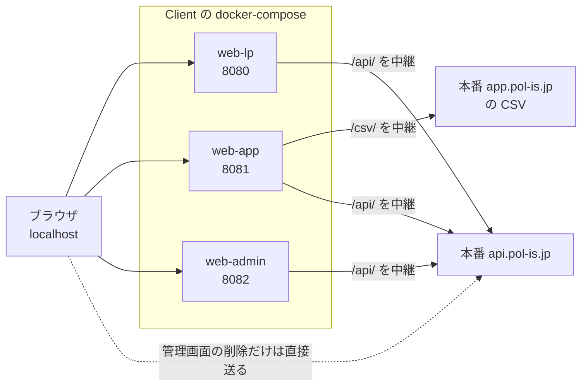

# PolisJAPAN クライアント設計

LP・WEB アプリ・管理画面の 3 つの静的サイトについて、実装の全体の作りを記述する。画面ごとの要素（セレクタ）・操作・通信・保存データの細部は `docs/画面仕様書.md` が担当し、この文書はその手前の「どのファイルが何を担当し、どう組み上がっているか」を書く。ローカルでの確認手順は `docs/クライアント動作確認ガイド.md`、本番への反映は `docs/運用手順書.md` を参照する。

---

## 1. 3 つのサイト

| サイト | 役割 | 公開 URL | ソース | 配信 |
| --- | --- | --- | --- | --- |
| LP | サービスの紹介、規約類、お問い合わせフォーム、プライベート版の案内 | https://pol-is.jp/ | `Client/public_html/` | S3 バケット `pol-is.jp`（静的ウェブサイト）+ CloudFront |
| WEB アプリ | テーマの一覧・詳細（pol.is の埋め込みと分析表示）・テーマ作成。PWA としてホーム画面に追加できる | https://app.pol-is.jp/ | `Client/public_html_app/` | S3 バケット `app.pol-is.jp`（静的ウェブサイト）+ CloudFront |
| 管理画面 | 運営者がテーマの下書きを確認・編集・承認・削除する | https://admin.pol-is.jp/ | `Client/public_html_admin/` | 非公開 S3 バケット + CloudFront（OAC）。CloudFront Function による IP 制限付き |

次の図は、3 つのサイトと、各サイトの JS が通信する先の関係を示す（通信先の一覧は §7.1）。

```mermaid
flowchart LR
  user["利用者のブラウザ"]
  opr["運営者のブラウザ"]
  subgraph sg1["S3 + CloudFront で配信"]
    lp["LP<br/>pol-is.jp"]
    app["WEB アプリ<br/>app.pol-is.jp"]
    adm["管理画面<br/>admin.pol-is.jp<br/>IP 制限付き"]
    csv["CSV<br/>/csv/themes.csv ほか"]
  end
  api["API<br/>api.pol-is.jp"]
  contact["お問い合わせ受付<br/>contact.pol-is.jp"]
  polis["pol.is<br/>embed.js と iframe"]
  share["share.pol-is.jp<br/>URL の組み立てのみ"]
  user --> lp
  user --> app
  opr --> adm
  app -->|"GET"| csv
  app -->|"テーマ作成の POST"| api
  adm -->|"/admin/* ほかの POST"| api
  app -->|"JSON の POST"| contact
  lp -->|"JSON の POST"| contact
  app -->|"埋め込み"| polis
  app -.-> share
```



配信基盤の詳細は `docs/インフラ構成.md` を参照する。

### 1.1 技術

- **フレームワークもビルドツールも使わない素の HTML・JavaScript・CSS である。** npm の依存も、バンドラも、トランスパイラも無い。JS は ES モジュールではなく、`<script defer>` で読み込む通常のスクリプトで、関数とクラスはグローバルに定義される。
- ビルドが要るのはスタイルだけで、`Client/scss/` の SCSS を Dart Sass で CSS にコンパイルする（§8）。
- 外部から読み込むライブラリは、アイコンフォントの Bootstrap Icons（jsDelivr の CDN、`bootstrap-icons@1.13.1`）と Google Fonts（Inter、Noto Sans JP）だけである。グラフ（円グラフ・帯グラフ）は CSS の `conic-gradient` と幅指定で描いており、グラフ用ライブラリは使っていない。
- 投票・意見投稿の UI は、本家 pol.is の埋め込みスクリプト（`https://pol.is/embed.js`）が描画する。
- データベースに当たるものは S3 上の CSV で、ブラウザが直接読み込む（§7）。

---

## 2. ディレクトリ構成

### 2.1 `Client/` 直下

| パス | 内容 |
| --- | --- |
| `Client/public_html/` | LP のソース。そのまま S3 に同期される |
| `Client/public_html_app/` | WEB アプリのソース。そのまま S3 に同期される（`csv/` を除く） |
| `Client/public_html_admin/` | 管理画面のソース。そのまま S3 に同期される |
| `Client/scss/` | 3 サイト共通のスタイルのソース（§8） |
| `Client/docker-compose.yml` | ローカル開発用。サイトごとの nginx 3 つと、SCSS を監視してコンパイルする sass コンテナを起動する（§11） |
| `Client/nginx/default.conf` | LP 用 nginx の設定（ポート 8080） |
| `Client/nginx_app/default.conf` | WEB アプリ用 nginx の設定（ポート 8081）。本番の CSV と API への中継を含む |
| `Client/nginx_admin/default.conf` | 管理画面用 nginx の設定（ポート 8082）。本番の API への中継を含む |
| `Client/README.md` | ローカル環境の起動、SCSS の規則、手動アップロード（GitHub Actions が使えないときの代替手順） |

このほか、エディタの設定フォルダ（.vscode）がローカルにあるが、git の管理対象外である。

### 2.2 LP（`Client/public_html/`）

| パス | 内容 |
| --- | --- |
| `Client/public_html/index.html` | トップページ |
| `Client/public_html/private/` | プライベート版についてのページと、その説明画像（`img/`） |
| `Client/public_html/contact/`、`Client/public_html/terms/`、`Client/public_html/policy/`、`Client/public_html/license/` | お問い合わせ、利用規約、プライバシーポリシー、ライセンスの各ページ |
| `Client/public_html/javascript/` | LP の JS（§5.2） |
| `Client/public_html/images/` | ロゴ、ヒーロー画像、OGP 画像など |
| `Client/public_html/style.css` | SCSS のビルド成果物（§8） |
| `Client/public_html/favicon.ico` | ファビコン |
| `Client/public_html/google36d725e3dc7f1a01.html` | Google Search Console の所有権確認ファイル。消さない |

### 2.3 WEB アプリ（`Client/public_html_app/`）

| パス | 内容 |
| --- | --- |
| `Client/public_html_app/index.html` | ホーム（テーマ一覧）。テーマ作成・お知らせ・お問い合わせ・チュートリアルのモーダルもこの HTML に含まれる |
| `Client/public_html_app/detail/index.html` | テーマ詳細（投票と分析） |
| `Client/public_html_app/javascript/` | アプリの JS（§5.2）と Service Worker |
| `Client/public_html_app/notice/` | お知らせの本文（HTML 断片）と、本文で使う画像（`Client/public_html_app/notice/img/`）。§12 |
| `Client/public_html_app/images/` | 共通画像（`common/`）、分析表示の人物アイコン（`report/`）、チュートリアル画像（`tutorial/`）、PWA のアイコンとスプラッシュ画像（`Client/public_html_app/images/pwa/`） |
| `Client/public_html_app/manifest.json` | PWA のマニフェスト（§10） |
| `Client/public_html_app/csv/` | 本番 CSV の古いスナップショット。**デプロイ対象外**で、ローカルでも通常は使われない（§9.3、§11） |
| `Client/public_html_app/style.css` | SCSS のビルド成果物 |
| `Client/public_html_app/favicon.ico` | ファビコン |

### 2.4 管理画面（`Client/public_html_admin/`）

| パス | 内容 |
| --- | --- |
| `Client/public_html_admin/index.html` | 管理画面の唯一のページ |
| `Client/public_html_admin/javascript/admin.js` | 管理画面の処理すべて |
| `Client/public_html_admin/javascript/common.js` | アプリの `common.js` から定数と localStorage ヘルパーを除いたもの |
| `Client/public_html_admin/style.css` | SCSS のビルド成果物 |
| `Client/public_html_admin/manifest.json` | マニフェスト。ただし `index.html` から参照されていない |
| `Client/public_html_admin/images/` | アプリと同じ画像のコピー。管理画面の HTML・JS からは参照されていない |

### 2.5 `Server/admin/` との関係

`Server/admin/` には管理画面の古いコピーがある。**正は `Client/public_html_admin/` であり、本番に配信されるのもこちらだけである**（`.github/workflows/deploy-client.yml`）。

`Server/admin/` は、サーバーのローカル開発環境（`Server/docker-compose.yml` と `Server/nginx/default.conf`）が `/dashboard/` として配信するためにだけ参照されている。中身は古く、次の点で `Client/public_html_admin/` と異なる。

- API の宛先が `https://api.pol-is.jp/` に固定されている（ローカルの中継を使わない）
- 投稿失敗（FAILED）の表示が無い
- アセットのバージョン付け（`?v=__ASSET_VERSION__`）が無い
- `style.css` が古い

管理画面を変更するときは `Client/public_html_admin/` だけを編集する。

---

## 3. ページの一覧

URL のパスは、S3 の静的ウェブサイトホスティングにより、ディレクトリ名の末尾 `/` で各ディレクトリの `index.html` が返る。

### 3.1 LP

| URL パス | HTML | `body` の id | 読み込む JS |
| --- | --- | --- | --- |
| `/` | `Client/public_html/index.html` | `top` | `common.js`、`script.js` |
| `/private/` | `Client/public_html/private/index.html` | `private` | `common.js`、`terms.js` |
| `/contact/` | `Client/public_html/contact/index.html` | `contact` | `common.js`、`contact.js` |
| `/terms/` | `Client/public_html/terms/index.html` | `terms` | `common.js`、`terms.js` |
| `/policy/` | `Client/public_html/policy/index.html` | `policy` | `common.js`、`terms.js` |
| `/license/` | `Client/public_html/license/index.html` | `license` | `common.js`、`terms.js` |

JS はすべて `Client/public_html/javascript/` にある。

### 3.2 WEB アプリ

| URL パス | HTML | `body` の id | 読み込む JS（読み込み順） |
| --- | --- | --- | --- |
| `/` | `Client/public_html_app/index.html` | `home` | `common.js`、`favorites.js`、`home.js`、`create.js`、`notice.js`、`contact.js` |
| `/detail/?conversation_id=<id>` | `Client/public_html_app/detail/index.html` | `detail` | `common.js`、`favorites.js`、`detail.js` |

JS はすべて `Client/public_html_app/javascript/` にある。両ページとも `<head>` 内のインラインスクリプトで Service Worker を登録する（§10）。

### 3.3 管理画面

| URL パス | HTML | `body` の id | 読み込む JS |
| --- | --- | --- | --- |
| `/` | `Client/public_html_admin/index.html` | `admin` | `common.js`、`admin.js` |

`<meta name="robots" content="noindex, nofollow">` を指定している。

### 3.4 HTML の共通事項

- すべて `<html lang="ja">`。`<head>` には OGP・Twitter Card・JSON-LD（`WebSite` 型）の記述がある（管理画面を除く）。
- CSS と JS の参照には `?v=__ASSET_VERSION__` が付いており、デプロイ時に置き換えられる（§9.1）。
- `body` の id はスタイルの適用範囲を分けるために使う（§8.2）。

---

## 4. 画面の構造の考え方

- **画面遷移は 2 ページだけである。** アプリの機能の多く（テーマ作成、お知らせ、お問い合わせ、チュートリアル、共有）は、ページを移らずに `.slide-modal` などのモーダルを開閉して見せる。モーダルの DOM は HTML に最初から書かれていて、JS は `.show` クラスの付け外しで表示を切り替える。
- **表示状態はクラスで表す。** JS が付けるのは `.show`、`.active`、`.open` などのクラスで、見た目の変化（アニメーション、表示・非表示）は CSS が担う。
- **データから作る部分だけを JS で組み立てる。** テーマカード、分析の意見リスト、管理画面の下書き一覧、お知らせの一覧は、テンプレートリテラルで HTML 文字列を作って `innerHTML` に入れる。
- **ページ遷移の前にローディングを見せる。** テーマカード、改善要望のメニュー、詳細画面の「戻る」は、`#loading-overlay` を表示してから 500ms 後に `window.location` を書き換える。ブラウザの「戻る」でキャッシュから復元された場合（`pageshow` の `persisted`）は、`bindPageReturn` がローディングを消す。

---

## 5. JavaScript の構成

### 5.1 読み込みと初期化の約束

- 各ページは `common.js` を最初に読み、続いて機能別のファイルを読む。すべて `defer` なので、HTML の記載順に実行される。
- 各ファイルは末尾で `document.addEventListener("DOMContentLoaded", …)` を登録し、その中で自分の初期化関数を呼ぶ。ファイル間で初期化の順序を明示的に制御する仕組みは無く、DOMContentLoaded の登録順（＝読み込み順）で実行される。
- ファイル間の受け渡しはグローバルの関数・定数を直接呼ぶ形で行う。唯一のイベントによる連携は、`favorites.js` が発火する `favorites:changed`（`document` に対するカスタムイベント）を `home.js` が受け取るものである。

### 5.2 ファイルごとの責務

**WEB アプリ（`Client/public_html_app/javascript/`）**

| ファイル | 責務 | 主に読むデータ・通信先 |
| --- | --- | --- |
| `Client/public_html_app/javascript/common.js` | 定数（API の宛先・アクセスキー）と共通部品（§5.3） | — |
| `Client/public_html_app/javascript/home.js` | ホーム: テーマカードの描画、カテゴリ絞り込み、検索、並び替え、ハンバーガーメニュー、チュートリアルの起動 | `/csv/themes.csv` |
| `Client/public_html_app/javascript/favorites.js` | お気に入りの保存と星ボタン（ホームと詳細で共用） | localStorage |
| `Client/public_html_app/javascript/create.js` | テーマ作成モーダル（AI アシストとマニュアルの 2 モード）、下書きの自動保存、投稿 | `/theme/generate_axis`、`/theme/generate_comments`、`/theme/generate_descriptions`、`/theme/post_draft` |
| `Client/public_html_app/javascript/notice.js` | お知らせの一覧（`NOTICES`）、本文の取得、既読管理、自動表示 | `Client/public_html_app/notice/` の HTML |
| `Client/public_html_app/javascript/contact.js` | アプリ内のお問い合わせモーダル（入力・確認・完了）と下書き | contact.pol-is.jp |
| `Client/public_html_app/javascript/detail.js` | 詳細: タブ切替、pol.is の埋め込み、分析表示、グループのツールチップ、共有、詳細レポートへのリンク、お気に入りボタン | `/csv/report/report_<conversation_id>.csv`、`/csv/themes.csv`、pol.is、share.pol-is.jp |
| `Client/public_html_app/javascript/service-worker.js` | 画像などのプリキャッシュ（§10） | — |

**LP（`Client/public_html/javascript/`）**

| ファイル | 責務 |
| --- | --- |
| `Client/public_html/javascript/common.js` | アプリの `common.js` とほぼ同じ内容のコピー。違いは、`API_URL` がローカルでも本番を向くことと、JSON を POST する `fetchJsonPostAsJson` があること。LP で実際に使うのは `fetchJsonPostAsJson` 程度である |
| `Client/public_html/javascript/script.js` | トップページの演出: 起動時のローディング（`bindLoading`）、スクロールでのフェードイン（`bindScroll`、`.scroll-fade-in`）、メニューの表示切替とページ内スクロール、「解決する問題」節のアニメーション |
| `Client/public_html/javascript/terms.js` | サブページ用。スクロールでのフェードイン（`bindScroll`）だけ |
| `Client/public_html/javascript/contact.js` | お問い合わせフォーム（入力・確認・完了の切替と送信） |

**管理画面（`Client/public_html_admin/javascript/`）**

| ファイル | 責務 |
| --- | --- |
| `Client/public_html_admin/javascript/common.js` | アプリの `common.js` から定数（`API_URL`、`USER_ACCESS_KEY`）と localStorage ヘルパーを除いたもの |
| `Client/public_html_admin/javascript/admin.js` | 認証キーの保存、下書き一覧の取得と描画、承認・編集・削除（§14） |

**3 つの `common.js` は別々のファイルで、自動で同期する仕組みは無い。** 共通部品を直すときは、必要なサイトの分をそれぞれ直す。

### 5.3 共通ライブラリ（`Client/public_html_app/javascript/common.js`）

| 分類 | 名前 | 内容 |
| --- | --- | --- |
| 定数 | `API_URL` | API の宛先。ホスト名が `localhost` なら `/api/`、それ以外は `https://api.pol-is.jp/` |
| 定数 | `USER_ACCESS_KEY` | テーマ作成 API に付けるアクセスキー（ロボット避け）。§7.2 |
| Cookie | `getCookie`、`setCookie`、`deleteCookie` | `setCookie` は既定 365 日、`path=/`、`SameSite=Lax`（Secure なし） |
| localStorage | `getLocalStorage`、`setLocalStorage`、`deleteLocalStorage` | 例外（プライベートブラウズ等）を握りつぶして `null` を返す |
| 数値・日付 | `toInt`、`toNum`、`getRandomInt`、`formatIsoToJapaneseDate`、`getLogicalDayId` | `getLogicalDayId` は午前 4 時を日付の区切りとした `YYYYMMDD` を返す（チュートリアルの「1 日 1 回」に使う） |
| 通信 | `fetchJsonPost` | `FormData`（multipart）で POST し、JSON を返す。HTTP エラーは例外にする。API 呼び出しはすべてこれを使う |
| CSV | `loadCsvAsJson`、`parseCSV`、`splitLine` | CSV を取得してヘッダーをキーにしたオブジェクトの配列にする。URL に 5 分ごとに変わる `_v` を付ける（§9.3）。パーサはクォート内の区切り・改行、`""` のエスケープ、BOM、区切り文字の自動判定（`,` タブ `;`）に対応し、列数の過不足は空文字で埋める・切り捨てる |
| クリップボード | `copyText`、`legacyCopy` | Clipboard API が使えなければ `textarea` と `execCommand('copy')` で代替する |
| 表示 | `setThemeColor` | `<meta name="theme-color">` を書き換える（チュートリアル表示中のステータスバー色など） |
| 表示 | `autoResizeTextareas`、`syncTextareas` | `textarea.auto-resize` の高さを内容に合わせる |
| 表示 | `setLoadingOverlay`、`setGrobalLoading`、`bindPageReturn` | API 通信中の `#loading-block-overlay`、ページ遷移時の `#loading-overlay` の表示切替 |
| 表示 | `BindHorizontalScroll` | `.scroll-horizontal` の要素で、マウスホイールの縦回転を横スクロールに変える（カテゴリタブ） |
| フォーム | `getMultiInputValues`、`setMultiInputValues` | 複数の入力欄の値をまとめて読み書きする（テーマ作成の対立軸・意見） |
| クラス | `TutorialManager` | チュートリアルの表示制御。§6.10 |
| クラス | `ModalManager` | モーダルの開閉。`init` で閉じるボタンと背景クリックに閉じる処理を付け、`showModal`／`closeModal` で `.show` を付け外しする。`bindShowButton` で開くボタンを結び付けられる。Esc キーには対応していない |
| クラス | `CustomSelectManager` | ボタンを並べた独自のセレクト。選択中のボタンに `.active` を付け、`data-*` の値を返す。`addOnChange` で変更時の処理を複数登録できる（テーマ作成のカテゴリ選択） |

### 5.4 依存関係

```
common.js ─┬─ favorites.js ─┬─ home.js（getFavorites, bindFavoriteButtons）
           │                └─ detail.js（bindFavoriteButtons）
           ├─ home.js（loadCsvAsJson, TutorialManager, setGrobalLoading, BindHorizontalScroll, bindPageReturn）
           ├─ create.js（API_URL, USER_ACCESS_KEY, fetchJsonPost, ModalManager, CustomSelectManager, localStorage ヘルパー）
           ├─ notice.js（ModalManager, getCookie/setCookie）
           ├─ contact.js（ModalManager）
           └─ detail.js（loadCsvAsJson, TutorialManager, ModalManager, copyText, toInt/toNum など）
```

次の図は、上の依存関係を矢印で表したもの（矢印の先が元を使う。実線は関数の呼び出し、点線はイベントと DOM を介した連携）。



- `notice.js` と `contact.js` は、ハンバーガーメニューのボタンから開くとき、`home.js` が管理する `#hamburger-menu` と `#bottom-menu` のクラスを直接外してメニューを閉じる。
- `notice.js` は、チュートリアルの表示中（`#tutorial` に `.show`）かどうかを DOM で見て、自動表示の時期をずらす。
- `home.js` と `detail.js` は同じ名前の関数（`hideLoading`、`initializeTutorial`、`buildTopicInnerHTML`、`initializeArticles`）を別々に定義している。両者は同じページで読み込まれないので衝突しない。

### 5.5 ページごとの初期化の流れ

**ホーム（`home.js` ほか）**

1. `initializeTutorial` — `TutorialManager` を作り、自動表示の判定をする（表示は 800ms 後）
2. `bindHamburgerMenu` — CSV の読み込みを待たずに有効にする
3. `initializeArticles` — `/csv/themes.csv` を読み、カードを描画する（ここで待つ）
4. `bindCategoryFilter`、`bindSort`、`sortArticles`（既定は更新順）、`updateArticleVisible`、`BindHorizontalScroll`、`bindArticleLink`、`bindPageReturn`、`bindFavoriteButtons`
5. 並行して、`create.js` の `bindCreateModal`、`notice.js` の `initializeNotice`（新着の確認は 2000ms 後）、`contact.js` の `initializeContactModal` が走る

CSV の読み込みに失敗すると 3 で止まり、4 は実行されない（画面の挙動は `docs/画面仕様書.md` §3.4）。

次の図は、ホームの初期化の流れと、CSV の読み込みに失敗したときに止まる位置を示す。



**詳細（`detail.js`）**

`bindTabs` → `hideLoading`（2 秒後に `#app-loading` を消す）→ `initializeTutorial` → `initializePolisIframe` → `bindClipBoardCopy` → `initializeArticles`（レポート CSV）→ `initializeLink`（`themes.csv`）→ `bindDetailLink` → `bindPageReturn` → `initializeFavoriteButton` → 500ms 後に `bindAccordionToggle`。非同期の処理（CSV の読み込み）は待たずに次へ進む。

---

## 6. 機能ごとの実装

各機能の画面要素・操作・保存データの細部は、括弧内の `docs/画面仕様書.md` の節を参照する。

### 6.1 ホームの一覧・絞り込み・検索・並び替え（画面仕様書 §3）

- **担当**: `Client/public_html_app/javascript/home.js`
- **データ**: `/csv/themes.csv`。使う列は `id`、`title`、`description`、`category`、`conversation_id`、`comments`、`votes`、`commented_at`、`updated_at`（CSV の定義は `docs/データ仕様.md`）
- **描画**: `buildTopicInnerHTML` が行ごとに `.article-item` を作り、`.article-container` に入れる。カテゴリ・投票数・日時・conversation_id は `data-*` 属性に持たせ、絞り込みと並び替えはこの属性を読む。カテゴリ名は `CATEGORY_LABELS`（1〜8）で引く。タイトルは `esc` でエスケープし、長いものは切り詰める。
- **絞り込みと検索**: 状態を `currentCategory`（`0` は全件、`"fav"` はお気に入り）と `currentWords` に持ち、`updateArticleVisible` が両方の条件（AND）を満たすカードにだけ `.show` を付ける。検索語は `norm`（NFKC 正規化と小文字化）と `tokenize`（全角・半角空白で分割）で整え、すべての語を含むカードを残す。サーバーには問い合わせない。
  - 検索対象は、索引 `data-searchtext` があればそれ、無ければカード全体のテキストである。索引を作る `indexArticlesForSearch` は DOMContentLoaded の後に登録されるため実行されず、実際にはカード全体のテキスト（「更新」「意見」「投票」の文言や件数を含む）が対象になる。
  - 選択中のカテゴリをもう一度押すと全件に戻る（`updateTab`）。
- **並び替え**: `sortArticles` が DOM の順序を入れ替える。種類は `updated`（既定）、`commented`、`new`、`old`、`popular`。日時は文字列の降順で、空の行は末尾に回し、同じ値は `id` の降順にする（規則は画面仕様書 §3.3）。
- **カードを押したとき**: `bindArticleLink` がローディングを出して `/detail/?conversation_id=<id>` へ移る。カードは `<a>` ではなく `href` 属性を持つ `<button>` である。

次の図は、カテゴリ絞り込み・検索・並び替えの処理の流れを示す（すべてブラウザ内で完結し、サーバーには問い合わせない）。



### 6.2 お気に入り（画面仕様書 §2.3、§3）

- **担当**: `Client/public_html_app/javascript/favorites.js`（ホームと詳細で共用）
- **保存先**: localStorage の `favorite_conversations`（conversation_id の JSON 配列）。サーバーには送らない。
- `bindFavoriteButtons` が `[data-favorite-cid]` を持つ要素に一度だけクリック処理を付ける（`data-favorite-bound` で二重登録を防ぐ）。押すと `toggleFavorite` で保存し、同じ conversation_id のボタンの星をすべて同期し、`favorites:changed` を発火する。ホームはお気に入りタブの表示中にこれを受けて一覧を絞り直す。
- 初回の追加時だけ注意ダイアログ（`showFavoriteNoticeOnce`、既読は localStorage の `favorite_notice_shown`）、2 回目以降はトースト（`showFavoriteToast`）を出す。
- localStorage が使えない環境では、例外を握りつぶして機能が無効になる。

### 6.3 お知らせ（画面仕様書 §2.4）

- **担当**: `Client/public_html_app/javascript/notice.js`
- **データ**: 一覧は JS 内の配列 `NOTICES`（`{id, date, title, path}`）、本文は `Client/public_html_app/notice/` の HTML 断片。
- `renderNoticeList` が配列の記載順に一覧を描き、先頭の 1 件だけ開いた状態にする（アコーディオン）。本文は `fetchNoticeBody` が `?v=<id>` を付け、`cache: "no-store"` で並列に取得して流し込む。取得に失敗した項目だけ「読み込めませんでした」と出す。
- 既読は Cookie `notice_last_seen_id` に、開いた時点の最大の `id` を書いて管理する。`checkAndAutoOpenNotice` は、最大の `id` が既読の値より大きければ自動で開く。チュートリアルの表示中なら `MutationObserver` で閉じられるのを待ち、400ms 後に開く。
- 一覧・タイトル・本文はリポジトリで管理する自前のコンテンツなので、サニタイズしない。追加の手順は §12。

次の図は、お知らせを自動で開くかどうかの判定の流れを示す。



### 6.4 ハンバーガーメニュー（画面仕様書 §3）

- **担当**: `home.js` の `bindHamburgerMenu`。ホームにだけある。
- 開閉状態は `#hamburger-menu` の `.open` と `#bottom-menu` の `.hamburger-open` で表し、トリガーの `aria-expanded` を同期する。閉じ方は、トリガー、背面（`.hamburger-backdrop`）、パネル外のクリック、Esc キー。見た目はすべて `Client/scss/pages/home/_hamburger.scss` が担う。
- 項目: お知らせ（`notice.js` が開く）、改善要望（実在するテーマの詳細ページへ遷移する。改善要望の収集にも pol.is のテーマを使っている）、プライベート版について（LP の `/private/`）、お問い合わせ（`contact.js` が開く）、利用規約・プライバシーポリシー（LP のページ）。

### 6.5 お問い合わせ（画面仕様書 §6、§7.1）

- **アプリ**: `Client/public_html_app/javascript/contact.js`。`#contact-modal` の中で入力・確認・完了を切り替える（`showContactStep`）。内容と、`@` を含むメールアドレスが必須（`validateContactInput`）。確認画面への転記は `textContent` で行う。送信は `fetch` で JSON を POST し、成功（2xx）したときだけ下書きを消して完了に進む。失敗したらエラーを出して確認画面に留まる。入力は 300ms のデバウンスで localStorage の `contact_draft` に保存し、ページを開いたときに復元する。
- **LP**: `Client/public_html/javascript/contact.js`。入力の検査は無く、送信は結果を待たずに完了画面へ切り替える（失敗しても完了と表示される）。
- 送信先はどちらも同じ（§7.1）。受け付ける Lambda は `Server/lambda/contact/` にある（`docs/サーバー設計.md`）。

### 6.6 テーマ詳細と pol.is の埋め込み（画面仕様書 §4）

- **担当**: `Client/public_html_app/javascript/detail.js`
- `getConversationId` が URL の `conversation_id` を読む。`initializePolisIframe` がそれを `.polis` 要素の `data-conversation_id` に入れ、`https://pol.is/embed.js` を `<script async>` で動的に読み込む。embed.js がこの要素を見つけて投票 UI の iframe を描く。投票・意見投稿は pol.is が直接受け付け、このシステムのサーバーを通らない。
- 画面は「テーマ」と「分析」のタブで切り替える（`bindTabs`、`switchTabs`）。`#app` と `.tab-select` のクラスを `on-<タブ名>` に付け替え、表示の切替は CSS が担う。
- `initializeLink` が `/csv/themes.csv` から同じ conversation_id の行を探し、本家の詳細レポート（`https://pol.is/report/<report_id>`）へのリンクを `#detail-report-button` に設定する。この行は共有文のタイトルにも使う。

次の図は、詳細画面を開いたときの pol.is の埋め込みと CSV の読み込みの流れを示す（§6.7 の分析表示を含む）。



### 6.7 分析表示とグループ横断合意スコア（画面仕様書 §4.3）

- **担当**: `detail.js` の `initializeArticles` 以下。分析は pol.is のレポートを iframe で見せるのではなく、レポート CSV からこの画面で描いている。
- **データ**: `/csv/report/report_<conversation_id>.csv`。1 行が 1 意見で、`comment`、`comment-id`、`total-agrees`／`total-disagrees`／`total-passes`／`total-votes` と、意見グループごとの `group-<a〜z>-agrees`／`-disagrees`／`-passes`／`-votes` 列を持つ（定義は `docs/データ仕様.md`）。
- **加工**: `getDisplayDataFromCSVJSON` が全体の賛成・反対・パスの率を計算し、`extractGroups` が存在するグループの列（`hasGroup` で判定）を集めて、グループごとの率を `buildGroupObject` で計算する。グループの投票数は CSV の `votes` 列を使わず、賛成・反対・パスの合計で数え直す。
- **並び順**:
  - 「みんなが賛成した意見」は、グループが 2 つ以上なら `sortByConsensusScore`（グループ横断合意スコアの降順）、1 つ以下なら `sortByTotalAgreeRate`（全体の賛成率の降順）。
  - グループ横断合意スコアは `getGroupConsensusScore` が計算する。各グループの平滑化した賛成率 `(賛成+1)/(投票+2)` の積で、投票の無いグループは 0.5（中立）になる。グループのデータが無い行は、全体の賛成率から 1 を引いた値で代用して末尾に回す。同点は総投票数の多い順。スコアは並び順にだけ使い、画面には出さない。
  - 「グループ X が賛成した意見」は `sortByGroupAgreeRate`（そのグループの賛成率の降順、同率はそのグループの投票数の多い順）。
- **描画**: 各リストは先頭 5 件を表示し、6 件目以降は「もっと見る」で開くアコーディオンに入れる（`bindAccordionToggle`、`adjustTargetAcordion`）。グループ別の円グラフは `conic-gradient` で描く。円グラフを押すと、`GroupTooltip` がそのグループの代表的な意見（賛成率の上位 3 件）をツールチップで出す。意見の横の人物アイコンは `COMMENT_ICON_LIST` からランダムに選ぶ。
- 意見本文はエスケープせずに `innerHTML` に入る（`docs/改善バックログ.md` S-3）。

### 6.8 共有（画面仕様書 §4.2）

- **担当**: `detail.js` の `bindClipBoardCopy`
- 共有ボタンを押すと、`#copy-complete-modal` を開き、2 種類の文字列を入力欄に入れる: 共有リンク `https://share.pol-is.jp/link?conversation_id=<id>` と、テーマ名・リンク・ハッシュタグを並べた SNS 用の文。それぞれのコピーボタンで `copyText` を呼ぶ。
- share.pol-is.jp は OGP 付きのページを返してアプリの詳細へ転送する外部の仕組みで、クライアントは URL を組み立てるだけである（`docs/インフラ構成.md`）。

### 6.9 テーマ作成（AI アシスト／マニュアル）と下書き保存（画面仕様書 §5）

- **担当**: `Client/public_html_app/javascript/create.js`
- **2 つのモード**: `#ai-mode-button`／`#manual-mode-button` で切り替える（`switchMode`）。各モードのフォームは JS 内の HTML 文字列 `aiAssistModeHtml`／`manualModeHtml` で、切り替えるたびに `renderFormMode` がフォーム全体を差し替え、`findElements` 以下の結び付けをやり直す。AI アシストは「テーマ → 対立軸 → 意見 → 説明 → カテゴリ → 投稿」、マニュアルは対立軸の段が無い。
- **ステップの進行**: 各段は `.modal-stepper`（`data-control-no` で順番を持つ）で、`updateSteppers` が現在の段より前を完了、現在を開いた状態、後ろを隠す。入力の充足は `.target-input`（空白以外の値）と `.target-select`（カテゴリが選ばれているか）で判定し、`syncStepperInputValidation` が「次へ」・AI 生成・投稿ボタンの活性を切り替える。開いたときは `seekCurrentControlNo` が入力済みの段を飛ばして、最初の未入力の段から始める。
- **AI 生成**: 3 つのボタンがそれぞれ `requestThemeGenerateAxisAPI`（`/theme/generate_axis`）、`requestThemeGenerateCommentsAPI`（`/theme/generate_comments`）、`requestThemeGenerateDescriptionsAPI`（`/theme/generate_descriptions`）を呼び、結果を入力欄に入れる。通信中は `#loading-block-overlay` と入力欄のスケルトン表示（`.skeleton-loading`）を出す。失敗はコンソールに出すだけで、画面には出さない。
- **投稿**: `requestThemePostDraftAPI` が `/theme/post_draft` に送る。成功したら完了表示を出し、`clearModal` で入力とそのモードの下書きを消す。複数の値（対立軸・意見）は `###br###` で連結して 1 つの文字列にする。
- **送る値**: どの API にも `access_key`（`USER_ACCESS_KEY`）を付け、`fetchJsonPost` で multipart の form として送る。入出力の定義は `docs/API仕様.md`。
- **文字数の上限**: `THEME_TITLE_MAX`（タイトル）と `THEME_DESCRIPTION_MAX`（説明）。`countChars` がコードポイント単位で数え、カウンター表示（`updateCharCounter`）、「次へ」での検査（`getLengthError`）、投稿直前の検査で使う。`textarea` の `maxlength` も同じ値を書いている。
- **下書き保存**: 入力のたびに localStorage の `<モード>_CREATE_DRAFT_<項目>` に保存し（`bindDraftRecorder`）、モードを開くたびに復元する（`restoreDraft`）。モード（`AI_ASSIST`／`MANUAL`）ごとに別々に保存される。

次の図は、テーマ作成の 2 つのモードのステップと、各ステップから呼ぶ API を示す（点線は AI 生成ボタンを押したときだけ）。



### 6.10 チュートリアル（画面仕様書 §2.4）

- **担当**: `common.js` の `TutorialManager`。ホームと詳細が、それぞれの `initializeTutorial` でセレクタと保存キーを渡して作る。
- ルート `#tutorial` の中の `.tutorial-window` を順に表示し、各ウィンドウの `.next-button` で次へ進む。最後の次で閉じる。`.help-button` で手動で開き、`.skip-button` で閉じる。
- 自動表示は、Cookie `tutorial_optout` が `1` でなく、Cookie `tutorial_last_shown` が今日（午前 4 時区切り）でないときに、800ms 後に行う。「次回から表示しない」のチェック（`#hidden-checkbox`）が `tutorial_optout` を書く。
- 表示中は `setThemeColor` でステータスバーの色を変える（詳細画面は表示中と非表示で色を変えている）。
- チュートリアルの画像は `Client/public_html_app/images/tutorial/` にあり、Service Worker がプリキャッシュする。

### 6.11 LP の演出

`script.js` の `bindLoading` が起動時に `#loading` の中の文字を順に出し、`bindScroll` が `.scroll-fade-in` の要素を `IntersectionObserver` で見えたときに表示する。遅延と時間は要素の `data-delay`／`data-dur` を CSS 変数（`--delay`、`--dur`）に渡して決める。

---

## 7. 外部との通信と埋め込み設定値

### 7.1 通信先

| 通信先 | 使う場所 | 方式 | 内容 |
| --- | --- | --- | --- |
| `/csv/themes.csv`（アプリと同じオリジン） | `home.js`、`detail.js` | GET（`loadCsvAsJson`） | テーマ一覧 |
| `/csv/report/report_<conversation_id>.csv`（同上） | `detail.js` | GET（`loadCsvAsJson`） | テーマごとの集計 |
| `Client/public_html_app/notice/` の HTML（同上） | `notice.js` | GET | お知らせの本文 |
| api.pol-is.jp（ローカルでは `/api/`） | `create.js` | POST（multipart form） | `/theme/generate_axis`、`/theme/generate_comments`、`/theme/generate_descriptions`、`/theme/post_draft` |
| api.pol-is.jp（ローカルでは `/api/`） | `admin.js` | POST（multipart form） | `/admin/info`、`/admin/approve`、`/admin/edit`、`/batch/create_all`。`/batch/delete` だけはローカルでも本番の URL を直接呼ぶ（§14） |
| contact.pol-is.jp の `/contact` | アプリと LP の `contact.js` | POST（JSON） | お問い合わせ（`mail`、`name`、`content`） |
| `https://pol.is/embed.js` と pol.is の iframe | `detail.js` | スクリプト読み込み | 投票・意見投稿の UI |
| pol.is のレポートページ | 詳細画面のリンク | リンクのみ | 本家の詳細レポート |
| share.pol-is.jp の `/link` | `detail.js` | URL の組み立てのみ | 共有リンク |
| Google Fonts、jsDelivr（Bootstrap Icons） | 全ページの `<head>` | CSS 読み込み | フォントとアイコン |

- CSV は CloudFront 経由で S3 から直接読む。CSV を書くのはサーバー側のバッチで、クライアントは読むだけである（`docs/サーバー設計.md`）。
- テーマ作成の API が受け付けるオリジンは本番の 3 ドメインだけで、`localhost` はローカルの nginx を経由して同一オリジンに見せる（§11）。contact.pol-is.jp はすべてのオリジンを受け付ける。
- アクセス解析やエラー収集のための外部通信は無い。

### 7.2 クライアントに埋め込まれている設定値

ビルド時の差し込みや環境変数の仕組みは無く、値はソースに直接書かれている。値はここには書かない。

| 名前 | ファイル | 用途 |
| --- | --- | --- |
| `API_URL` | アプリ・LP の `common.js` | API の宛先。アプリはホスト名で切り替える |
| `API_BASE` | `Client/public_html_admin/javascript/admin.js` | 管理画面の API の宛先。ホスト名で切り替える |
| `USER_ACCESS_KEY` | アプリ・LP の `common.js` | テーマ作成 API のアクセスキー。ソースに書かれていて誰でも読めるため、秘密ではなく、機械的なアクセスを減らすためだけのもの。サーバー側の対応する値の管理は `docs/サーバー設計.md` |
| `CONTACT_API_URL` | `Client/public_html_app/javascript/contact.js` | お問い合わせの送信先（LP の `contact.js` は関数内に直接書いている） |
| `POST_STATUS` | `admin.js` | 下書きの状態の数値。サーバーの `PostStatus` と対応させており、変えるときは両方を直す |
| `THEME_TITLE_MAX`、`THEME_DESCRIPTION_MAX` | `create.js` | 文字数の上限。サーバー側の検査と同じ値にする |
| `NOTICES` | `notice.js` | お知らせの一覧 |
| `CATEGORY_LABELS` | `home.js` | カテゴリ番号と名前の対応。ホームの HTML のカテゴリタブ、`create.js` のカテゴリ選択、`admin.js` のカテゴリ選択にも同じ対応が別々に書かれている |
| `FAVORITES_STORAGE_KEY` ほか保存キー | `favorites.js`、`contact.js`、`notice.js`、`create.js`、`common.js` | ブラウザに保存するデータのキー（一覧は `docs/画面仕様書.md` §2.3） |
| 改善要望のテーマの conversation_id | `Client/public_html_app/index.html` | ハンバーガーメニューの「改善要望」の遷移先 |
| デモテーマの conversation_id | `Client/public_html/index.html` | LP のデモカードの遷移先 |

管理画面のアクセスキーはソースに書かれておらず、運営者が画面に入力する（§14）。

---

## 8. スタイル（SCSS）

### 8.1 構成

エントリは `Client/scss/style.scss` の 1 つで、`Client/scss/_index.scss` を経由して `common` と `pages` を読み込む。パーシャルは `@forward` で束ね、各ページのファイルは `@use "../../common" as common;` で共通の mixin を使う。`style.scss` 以外のファイル名は `_` で始める。

| パス | 内容 |
| --- | --- |
| `Client/scss/common/_reset.scss` | リセット |
| `Client/scss/common/_color.scss` | 色の CSS 変数（`:root` の `--color-main`、`--color-accent`、`--color-bg-gray` など） |
| `Client/scss/common/_font.scss` | フォントの変数（`--basic-font-family`、`--inter-font-family`）と文字の大きさ・太さの mixin とクラス |
| `Client/scss/common/_layout.scss` | 重なり順の変数（`--z-index-grobal-*`）と、配置・余白・幅の mixin（同名のユーティリティクラスも出力する） |
| `Client/scss/common/_animation.scss` | アニメーション |
| `Client/scss/common/_common.scss` | `html`、`body`、`header`、`main` などの基本スタイル |
| `Client/scss/common/_components.scss` | ボタン、入力欄、モーダルなどの部品 |
| `Client/scss/pages/top/` | LP（トップとサブページ） |
| `Client/scss/pages/home/` | アプリのホーム（一覧、テーマ作成、ハンバーガー、お知らせ、お気に入り、お問い合わせ） |
| `Client/scss/pages/detail/` | アプリの詳細（タブ、メニュー、分析） |
| `Client/scss/pages/admin/` | 管理画面 |

### 8.2 書き方の決まり

- **ページの区別は `body` の id で行う。** アプリと管理画面のスタイルは `body#home`、`body#detail`、`body#admin` の中に書く。3 サイトとも同じ 1 つの CSS を読み込むので、この囲みが他サイトへの影響を防いでいる。
- **変数は CSS のカスタムプロパティを使う。** SCSS の変数はほとんど使っておらず、例外はカテゴリの配色だけである。
- **カテゴリ色**: `Client/scss/pages/home/_app.scss` の SCSS マップ `$category-gradients` がカテゴリ番号 1〜8 ごとのグラデーションを定義し、カードの `.cat-1`〜`.cat-8` に当てる。`$category-buttons-colored` を `true` にするとカテゴリタブのボタンにも同じ色が付く（現在は `false`）。LP のデモカードの色は `Client/scss/pages/top/_demo.scss` に同じ値が別に書かれている。
- **分析グラフの色**: `Client/scss/pages/detail/_report.scss` の `--color-graph-positive`／`--color-graph-negative`／`--color-graph-neutral`。`detail.js` が円グラフを描くときもこの変数を参照する。
- **ブレークポイント**: `max-width: 1024px`（タブレット以下）と `max-width: 768px`（スマートフォン）が主で、`min-width: 1025px`／`769px` の指定も一部にある。ハンバーガーメニューと詳細画面のメニューには、狭い画面向けの `479px`／`359px`／`339px` の指定がある。
- PWA としてホーム画面から起動したときの余白の調整を `@media (display-mode: standalone)` で、ノッチのある端末の余白を `env(safe-area-inset-*)` で行っている。

### 8.3 ビルド

- コンパイラは Dart Sass の `sass@1.79.5`（npm パッケージ）。`Client/docker-compose.yml` の `sass` コンテナ（`node:20-alpine`）が `npx` で実行する。
- `docker-compose up` で起動すると、`Client/scss/style.scss` を監視（`--watch --poll`）し、変更のたびに次の 3 つへ同じ内容を出力する。ソースマップは出さない（`--no-source-map`）。
  - `Client/public_html/style.css`
  - `Client/public_html_app/style.css`
  - `Client/public_html_admin/style.css`
- 監視せずに 1 回だけビルドするための定義（npm scripts など）は無い。コンテナを使わずにビルドする場合は、同じバージョンの sass で `Client/scss/style.scss` を 3 か所へ出力すれば同じ結果になる。
- **ビルドした `style.css` はコミットする。** デプロイ（`.github/workflows/deploy-client.yml`）は SCSS をビルドせず、リポジトリにある `style.css` をそのまま S3 に送る。また、デプロイが動くのは `Client/public_html/`、`Client/public_html_app/`、`Client/public_html_admin/` の変更だけなので、SCSS だけを変えて CSS を更新しないと本番には何も反映されない。
- 3 つの `style.css` は同じ内容になる。コミットされている 3 つの `style.css` が現在の SCSS からビルドした結果と一致しているかは、この文書では未確認である。

---

## 9. キャッシュ対策

### 9.1 CSS・JS（アセットのバージョン付け）

- HTML が CSS と JS を参照するときは、URL に `?v=__ASSET_VERSION__` を付けて書く。新しく CSS・JS を読み込むタグを足すときも同じように書く。
- デプロイ時に、ワークフローが全 HTML の `__ASSET_VERSION__` をコミット SHA の先頭 8 文字に置き換える（`sed`）。ブラウザは URL ごとにキャッシュするので、デプロイのたびに新しい CSS・JS を取りに行く。
- ローカルでは置き換えが行われず、文字列 `__ASSET_VERSION__` のまま配信される。ローカルの nginx はキャッシュを無効にしているので問題にならない。
- 手動で S3 に同期すると置き換えが行われない（`Client/README.md` の注意書き）。
- 画像には版の付与が無い。同じファイル名のまま画像を差し替えると、利用者のブラウザに古い画像が残る場合がある。お知らせの画像は、本文の HTML で `?v=<お知らせの id>` を付けて参照している。

### 9.2 HTML

- デプロイは 2 段階で同期する。1 段目で HTML 以外を、2 段目で HTML だけを `Cache-Control: no-cache` を付けて送る。ブラウザは HTML を毎回再検証するので、新しい SHA 付きの URL がすぐに行き渡る。HTML 以外のファイルには `Cache-Control` を付けていない。
- 同期の後、3 つの CloudFront ディストリビューションのキャッシュをすべて（`/*`）無効化する。CloudFront の既定のキャッシュポリシー（CachingOptimized）はクエリ文字列をキャッシュキーに含めないため、エッジで新しい内容に切り替わるのはこの無効化による。
- お知らせの本文は `.html` なので `no-cache` で配信される。加えて、`notice.js` が `?v=<id>` と `cache: "no-store"` を付けて取得する。

### 9.3 CSV

- `loadCsvAsJson` が URL に `_v=<Math.floor(Date.now() / 300000)>` を付け、`cache: "no-store"` で取得する。値は 5 分ごとに変わるので、同じ 5 分間は全利用者が同じ URL を読み、エッジのキャッシュに当たる。5 分ごとに URL が変わり、最新の CSV が取りに行かれる。
- CloudFront の `/csv/*` には、`_v` だけをキャッシュキーに含める専用のキャッシュポリシー（`polisjapan-csv-versioned`、TTL 最大 300 秒）が当たっている（`Infra/terraform/environments/production/cloudfront_app.tf`）。CSV の更新を無効化ではなく TTL で反映する理由は §15。
- **`csv/` はデプロイで同期しない。** 本番の CSV はサーバーのバッチが S3 に直接書いており、デプロイの `--delete` で消したり上書きしたりしないよう、ワークフローで除外している。`Client/public_html_app/csv/themes.csv` は古いスナップショットで、本番には送られない。

---

## 10. PWA

- **マニフェスト**: `Client/public_html_app/manifest.json`。`display: standalone`、`start_url` と `scope` は `/`。アイコンは `Client/public_html_app/images/pwa/` の 192px と 512px（`any` と `maskable` の両方に同じ画像を使う）。
- **iOS 向け**: ホームの `index.html` に `apple-mobile-web-app-capable` と、端末の画面サイズ・向きごとのスプラッシュ画像（`apple-touch-startup-image`、ダークモード用）が書かれている。詳細ページにはスプラッシュ画像の指定が無い。`apple-touch-icon` は `/images/polis-icon.png` を指している。
- **Service Worker**: `Client/public_html_app/javascript/service-worker.js`。インストール時に、チュートリアル画像、分析表示の人物アイコン、Google Fonts の CSS をキャッシュ `img-cache-v1` に入れ、これらへのリクエストにはキャッシュを優先して返す（無ければ取得してキャッシュする）。HTML・CSS・JS・CSV はキャッシュしないので、オフラインでは動かない。キャッシュの中身を変えるときは `CACHE_NAME` を変える（有効化時に他の名前のキャッシュを消す）。
  - 登録は `navigator.serviceWorker.register('/javascript/service-worker.js')` で、`scope` を指定していない。この場合の既定のスコープはスクリプトの置き場所 `/javascript/` になるので、`/` と `/detail/` のページは Service Worker の制御下に入らず、`fetch` の処理は働かないとコードからは読める。実際のブラウザでどう動いているかは未確認である。
- **アイコンとスプラッシュ画像の生成**: `Asset/PWA/generate.zsh` が、`Client/public_html_app/images/polis-icon.png` を元に `pwa-asset-generator`（`Asset/PWA/package.json`）でアイコンとスプラッシュ画像を作る。出力先は `Asset/PWA/` の下の output フォルダ（git の管理対象外）で、同時に `Asset/PWA/index.html`（スプラッシュ画像の `<link>` の見本）と `Client/public_html_app/manifest.json` を書き換える。できた画像を `Client/public_html_app/images/pwa/` に置き、`<link>` をアプリの `index.html` に写し、パスを `/images/pwa/` に合わせる作業はスクリプトに含まれていない。この写し替えの手順は記録が無く、未確認である。
- 管理画面にも `manifest.json` があるが、`index.html` から読み込まれていない。

---

## 11. ローカル開発環境

```sh
cd Client
docker-compose up
```

| サービス | イメージ | ポート | 配信するもの | 設定 |
| --- | --- | --- | --- | --- |
| `web-lp` | `nginx:1.27-alpine` | 8080 | `Client/public_html/` | `Client/nginx/default.conf` |
| `web-app` | `nginx:1.27-alpine` | 8081 | `Client/public_html_app/` | `Client/nginx_app/default.conf` |
| `web-admin` | `nginx:1.27-alpine` | 8082 | `Client/public_html_admin/` | `Client/nginx_admin/default.conf` |
| `sass` | `node:20-alpine` | — | SCSS の監視とコンパイル（§8.3） | `Client/docker-compose.yml` の `command` |

- サイトのフォルダは読み取り専用でマウントされるので、HTML・JS を編集してブラウザを再読み込みすればすぐ反映される。nginx は `Cache-Control: no-store` などを付けてブラウザのキャッシュを無効にしている。
- **本番の CSV と API を使う。** アプリの nginx は `/csv/` を `https://app.pol-is.jp` へ、3 つの nginx はいずれも `/api/` を `https://api.pol-is.jp` へ中継する（`/api/xxx` を `/xxx` に書き換える）。JS はホスト名が `localhost` のときだけ `/api/` を向く（アプリの `API_URL`、管理画面の `API_BASE`）。本番の API は `localhost` からの CORS を許可していないため、同一オリジンに見せる必要がある。
- 中継先の IP アドレスは変わるため、nginx は `resolver 127.0.0.11 valid=30s` と変数を使った `proxy_pass` で、宛先を毎回引き直す。
- 管理画面の API（`/admin/*`）の IP 制限は、中継を通しても開発者の回線の IP で判定される。
- `/csv/` の中継があるため、ローカルの `Client/public_html_app/csv/` は使われない。手元の CSV で確かめたいときの切り替え方、ローカルからでも本番に影響する操作、トラブルの対処は `docs/クライアント動作確認ガイド.md` に書いてある。必ず読むこと。

次の図は、ローカル環境の nginx が本番の CSV と API へ中継する仕組みを示す。



---

## 12. お知らせの追加手順

1. `Client/public_html_app/notice/<id 3 桁>-<slug>.html` を作る。中身は `<html>` や `<body>` を含まない HTML の断片で、次の要素に既製のスタイルが当たる（`Client/scss/pages/home/_notice.scss`）: `h3`、`p`、`ul`／`ol`、`li`、`a`、`strong`、`img`、`div.notice-box`（囲み）、`a.notice-button`（ボタン風のリンク）。Bootstrap Icons の `<i class="bi …">` も使える。
2. 画像を使うときは `Client/public_html_app/notice/img/` に置き、本文から `./notice/img/<ファイル名>?v=<id>` の形で参照する（本文はホームの `/` に流し込まれるので、パスはホームからの相対になる）。
3. `Client/public_html_app/javascript/notice.js` の `NOTICES` 配列に `{id, date, title, path}` を足す。
   - `id` は既読の判定に使うので、**必ず過去のどれよりも大きい値にする**。小さい値を使うと、未読でも自動表示されない。
   - 一覧は配列に書いた順に並ぶ（`id` の順ではない）。通常は先頭に足す。先頭の 1 件が開いた状態で表示される。
   - `path` は `./notice/<ファイル名>` の形で書く。
4. ローカルのアプリ（ポート 8081）で表示を確かめる。Cookie `notice_last_seen_id` が新しい `id` より小さければ、ホームを開いたときに自動で表示される。
5. `main` に反映すると、GitHub Actions が配信する。S3 への手動アップロードは要らない。

本文はリポジトリで管理する自前のコンテンツなので、表示時にサニタイズしない。外部から受け取った文章をそのまま貼らないこと。

---

## 13. 対応ブラウザ・アクセシビリティ・レスポンシブ

### 13.1 対応ブラウザ

- 対応ブラウザを定めた記述（browserslist など）は無い。どのブラウザ・バージョンで動作確認しているかは未確認である。
- JS はトランスパイルせずにそのまま配信しており、クラスフィールド（`init = () => {}` の形）、`?.`、`??`、`async`／`await`、`IntersectionObserver`、`MutationObserver` などを使う。これらに対応していない古いブラウザでは動かない。ポリフィルは無い。
- Clipboard API が使えない環境（http 接続など）では `execCommand('copy')` に切り替える。localStorage が使えない環境では、お気に入りと下書きの保存が黙って無効になる。

### 13.2 アクセシビリティ

コードから読み取れる対応は次のとおり。体系的な基準（WCAG の適合レベルなど）は定めていない。

- すべてのページが `lang="ja"`。
- ハンバーガーメニューのトリガーに `aria-label` と `aria-expanded`、お知らせの見出しボタンに `aria-expanded` と `aria-controls`、星ボタンに `aria-label` と `aria-pressed`、お気に入りの注意ダイアログとグループのツールチップに `role="dialog"` を付けている。分析の円グラフは `role="button"` と `tabindex="0"` を持つが、押したときの処理はクリックとタッチだけで、キーボード操作には対応していない。
- ハンバーガーメニューとお知らせのアニメーションは `prefers-reduced-motion: reduce` で止める。
- モーダルは Esc キーで閉じない（ハンバーガーメニューは閉じる）。フォーカスの移動や閉じ込めの制御は無い。
- アプリと管理画面と LP の全ページが、`<meta name="viewport">` に `user-scalable=no` を指定しており、ピンチでの拡大ができない。
- アプリの `` にはすべて `alt` がある。LP のトップページには `alt` の無い画像がある。

### 13.3 レスポンシブ

- アプリはスマートフォンでの利用を主に想定した作りで、画面下部のメニュー（`#bottom-menu`）と PWA 用の指定を持つ。ブレークポイントは §8.2。
- `viewport-fit=cover` と `env(safe-area-inset-*)` で、ノッチのある端末の表示領域に合わせる。
- ステータスバーは `apple-mobile-web-app-status-bar-style` を `black-translucent` に指定し、`setThemeColor` で画面に応じて `theme-color` を変える。

---

## 14. 管理画面の作り

- **構成**: `Client/public_html_admin/index.html` の 1 ページと `Client/public_html_admin/javascript/admin.js` だけで動く。ログイン画面やセッションの仕組みは無い。
- **アクセスの制限は 2 段**:
  1. CloudFront Function が、閲覧者の IP を許可リストと照合し、合わなければ 403 を返す。IPv6 は常に 403（`Infra/terraform/modules/admin-site/ip_check.js.tftpl`）。許可リストの管理は `docs/インフラ構成.md`。
  2. API 側でも、`/admin/*` はアクセスキーと許可 IP を検査する（`docs/API仕様.md`）。
  画面の HTML と JS 自体には秘密が含まれていないので、守るべきものは API 側の検査である。
- **認証キー**: 運営者が `#identify-html-textarea` にアクセスキーを入れて「セット」を押すと、`requestAdminInfoAPI` が `/admin/info` を呼ぶ。成功したらキーを Cookie `admin_access_key` に 30 日保存する。次に開いたときは、Cookie があれば入力欄に戻して自動で一覧を読む（`bindIdentifyButton`）。
- **一覧**: `/admin/info` が返す `t_draft_list` を `tDraftList` に持ち、`buildThemeInnerHTML` が id の降順で `.theme-container` に描く。各下書きのタイトル・カテゴリ・説明・意見は、その場で編集できる入力欄として出す。意見は `###br###` 区切りを改行に直して 1 つの `textarea` に入れ、送るときに戻す。`POST_STATUS` の `FAILED` の下書きには「投稿失敗」の表示を付け、承認済み以上（FAILED を除く）の承認ボタンは無効の見た目にする。
- **操作**: 各下書きの「更新」は `requestAdminEditAPI`（`/admin/edit`）、「承認」は `requestAdminApproveAPI`（`/admin/approve`、成功後にページを再読み込み）、「削除」は `requestBatchDeleteAPI`（`/batch/delete`、確認ダイアログなし、成功後に再読み込み）。変換欄の「生成」は API 側に無いパス（batch/generate）を呼ぶため動かず、「更新」は `/batch/create_all` を呼ぶが本番では成立しない。各操作の結果と注意は `docs/画面仕様書.md` §7.2。
- **宛先**: 一覧・更新・承認・変換欄は `API_BASE`（ローカルでは `/api/` の中継）を使うが、削除の `requestBatchDeleteAPI` だけは `https://api.pol-is.jp/batch/delete` を直接書いている。このため `localhost` から削除を押すと中継を通らず、本番の API に直接送られる。CORS で拒否されるかどうかは未確認である。
- 下書きの内容はエスケープせずに描画している（`docs/改善バックログ.md` S-2）。
- 通信の失敗はコンソールに出すだけで、画面には何も表示しない。

---

## 15. クライアントに関わる設計判断とその理由

| 判断 | 理由 |
| --- | --- |
| フレームワークもビルドも使わない静的サイトにする | 画面が少なく、S3 と CloudFront に置くだけで配信でき、サーバーを持たずに済むため。スタイルだけは分割管理のために SCSS を使う |
| 一覧と分析は API を使わず、S3 上の CSV をブラウザが直接読む | サーバーの処理を AI 生成と下書きの受け付けだけに絞り、閲覧の負荷を CloudFront で受けるため |
| CSV の URL に 5 分ごとに変わる `_v` を付ける | CloudFront の無効化を 5 分ごとに行うと無料枠を超えて費用がかかるため。URL を 5 分単位で揃えればオリジンへの取得は 5 分に 1 回で済み、エッジごとの TTL のばらつきにも左右されない |
| CSS・JS にはデプロイ時にコミット SHA を付け、HTML は `no-cache` で配信する | ブラウザが URL 単位でキャッシュするため。HTML を毎回再検証させれば、新しい URL がすぐに行き渡る |
| ローカルでは nginx が本番の CSV と API へ中継する | 本番の API は `localhost` からの CORS を許可しておらず、また最新の本番データで画面を確かめられるため |
| お気に入りは localStorage に保存する | ログイン機能が無く、端末内の保存で足りるため。Cookie は容量が小さく、全リクエストに付いて送られるので使わない。キーは詳細画面の URL にある `conversation_id` |
| お知らせの本文は HTML ファイルで持つ | CSV と Markdown では表現力が足りなかったため |
| ホームの既定の並び順は更新順 | カードに表示する日時（`updated_at`）と並び順を一致させるため |
| 詳細画面の意見は、グループ横断の合意スコア順に並べる | 利用者の要望「異なるグループ間で賛成の多い意見こそ合意として示すべき」に応えるため。平滑化した賛成率の積を使い、票の少ないグループの極端な値を抑える。スコアは並び順にだけ使い、画面には表示しない |
| お問い合わせはアプリ内のモーダルで完結させる | LP のフォームへ移動すると、アプリに戻る導線が切れるため |
| ハンバーガーメニューはホーム画面だけに置く | 「使い方」「テーマを作成」とは別に、補助的な項目の受け皿として設けたため |

---

## 16. 未確認の事項

この文書を書く時点で、コードと設定だけからは確かめられなかったこと。

- Service Worker のスコープが `/javascript/` になり、ページを制御していないかどうかの実ブラウザでの挙動（§10）
- PWA のアイコンとスプラッシュ画像を、生成先から `Client/public_html_app/images/pwa/` と `index.html` へ写す手順（§10）
- コミットされている `style.css` が現在の SCSS のビルド結果と一致しているか（§8.3）
- 動作確認の対象としているブラウザとそのバージョン（§13.1）
- 管理画面の削除を `localhost` から押したときに、CORS で拒否されるかどうか（§14）
- HTML 以外のファイル（画像など）を、ブラウザがどれだけキャッシュしているか。デプロイは HTML 以外に `Cache-Control` を付けておらず、本番の実際の応答ヘッダーは確かめていない（§9.1、§9.2）
