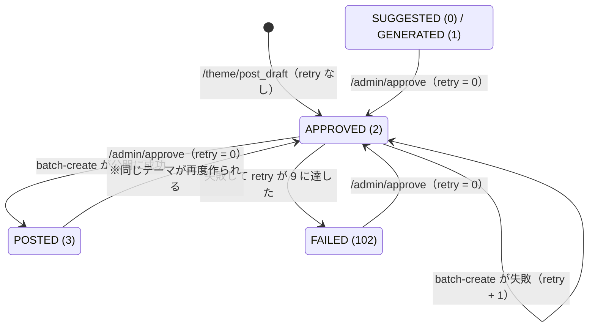

# PolisJAPAN データ仕様

| 項目 | 内容 |
| --- | --- |
| 位置づけ | PolisJAPAN が保存するデータの置き場所・形式・書き手と読み手・更新の規則を、**実装されているとおりに**記録する |
| 対象の実装 | `Server/web/api/`（サービス・リポジトリ・モデル・Lambda ハンドラ）、`Client/` の JS、`Infra/terraform/` |
| 関連文書 | データを読み書きする API は `docs/API仕様.md`、画面ごとの保存データの使い方は `docs/画面仕様書.md`、バケットやテーブルの設定の詳細は `docs/インフラ構成.md`、復旧などの手順は `docs/運用手順書.md` |

---

## 1. データの置き場所の全体像

このシステムは RDB を持たない。テーマの公開情報は S3 上の CSV、テーマの下書きは DynamoDB の 1 テーブル、投票と意見の実体は pol.is にある。

| データ | 置き場所 | 書く | 読む |
| --- | --- | --- | --- |
| テーマ一覧 | S3 `app.pol-is.jp` の `csv/themes.csv` | batch-create（行の追加）、batch-update（件数と日時の更新）、`/batch/delete`（行の削除） | ホーム・詳細画面（CloudFront 経由）、batch-update、batch-create、`/batch/delete` |
| テーマ別の集計 | S3 `app.pol-is.jp` の `csv/report/report_<conversation_id>.csv` | batch-create（作成時）、batch-update（変化があったとき）、`/batch/delete`（削除） | 詳細画面の分析タブ（CloudFront 経由） |
| テーマの下書き | DynamoDB `polisjapan-drafts` | `/theme/post_draft`（追加）、`/admin/approve`・`/admin/edit`（更新）、`/batch/delete`（論理削除）、batch-create（公開結果・リトライ回数） | `/admin/info`、batch-create、投稿滞留の監視 |
| 投票・意見・意見グループ | pol.is（外部サービス） | 利用者（詳細画面の埋め込み）、batch-create（テーマとシードの意見の作成） | 詳細画面の埋め込み、batch-update と batch-create（レポートの CSV エクスポート） |
| 利用者の端末の状態 | ブラウザの Cookie・localStorage・Cache Storage | 各画面の JS | 各画面の JS（サーバーへは送らない） |
| 投稿滞留のメトリクス | CloudWatch の名前空間 `PolisJAPAN/Batch` | batch-create | CloudWatch アラーム |
| シークレット | SSM Parameter Store `/polisjapan/*` | 運用者 | Terraform（Lambda の環境変数へ入れる） |
| 保全用のアーカイブ | S3 `polisjapan-archive` | 運用者（手作業） | 通常は読まない（§7） |
| ローカル開発の下書き | MySQL（Docker） | ローカルの API | ローカルの API（§6） |

テーマ一覧の `id` と下書きの `id` は別の番号である。両者をつなぐのは `conversation_id` だけで、下書きには公開後に `conversation_id` が記録される。

お問い合わせの内容はどこにも保存しない。ただし、お問い合わせの Lambda が受け取った本文（メールアドレス・名前・内容）をそのままログに出力するので、CloudWatch Logs `/aws/lambda/PolisJAPAN-Contact` に残る。このロググループの保持期間は無期限（`retention_in_days = 0`、`Infra/terraform/environments/production/contact_share.tf`）である。

---

## 2. S3 `app.pol-is.jp` の `csv/` 配下

バケット `app.pol-is.jp` は WEB アプリの静的ファイルの置き場で、その中の `csv/` だけがデータである。

- `csv/` はバッチの Lambda と API が書く。GitHub Actions のデプロイは `csv/*` を同期の対象から外している（`.github/workflows/deploy-client.yml`）ので、アプリをデプロイしても CSV は消えない。
- バケットはバージョニングが有効で、上書き・削除された古い版は 7 日後に消える（`Infra/terraform/environments/production/s3_static.tf`）。誤って壊した CSV は 7 日以内なら前の版に戻せる。
- リポジトリにある `Client/public_html_app/csv/themes.csv` は古い写しで、本番にもローカルにも使われない。ローカルの画面の `/csv/` は、nginx が本番の `https://app.pol-is.jp` へ中継する（`Client/nginx_app/default.conf`）。
- API と Lambda が読み書きするバケット名は環境変数 `CSV_BUCKET`（未設定なら `app.pol-is.jp`）で決まる（`Server/web/api/core/common_service.py`）。

### 2.1 `csv/themes.csv`（テーマ一覧）

公開中のテーマ 1 件が 1 行になる。ホーム画面の一覧と、詳細画面のタイトル・説明・詳細レポートへのリンクの元になる。

| 列 | 意味 | 形式 | 書く処理 |
| --- | --- | --- | --- |
| `id` | テーマの通し番号 | 整数の文字列 | batch-create が、既存の行を `id` で並べた最後の値に 1 を足して付ける |
| `category` | カテゴリ ID（§4） | 整数の文字列 | batch-create（下書きの `theme_category`） |
| `title` | タイトル | 文字列 | batch-create（下書きの `theme_name`） |
| `description` | 説明 | 文字列。改行を含むことがある（引用符で囲む） | batch-create（下書きの `theme_description`） |
| `conversation_id` | pol.is のカンバセーション ID。詳細画面の URL、埋め込み、レポート CSV のファイル名に使う | 英数字の文字列 | batch-create（pol.is で作った結果） |
| `report_id` | pol.is のレポート ID。レポートの取得と、詳細画面の「詳細レポート」のリンク（`https://pol.is/report/<report_id>`）に使う | 英数字の文字列 | batch-create（pol.is で作った結果） |
| `votes` | 総投票数 | 整数の文字列 | batch-create が `0` で作る。batch-update がレポートの `total-votes` の合計で更新する |
| `comments` | 意見の数 | 整数の文字列 | batch-create がシードの意見の数で作る。batch-update がレポートの行数で更新する |
| `create_date` | 作成日時（日本時間） | `YYYY-MM-DD HH:MM:SS` | batch-create |
| `created_at` | 作成日時（日本時間、分単位） | `YYYY-MM-DD HH:MM` | batch-create |
| `commented_at` | 最後に意見の数が増えた日時。ホームの「意見順」に使う | `YYYY-MM-DD HH:MM` | batch-create が作成時刻で作る。batch-update が、意見の数が増えたときに更新する |
| `updated_at` | 最後に投票数か意見の数が変わった日時。ホームの「更新順」（既定の並び）とカードの日時表示に使う | `YYYY-MM-DD HH:MM` | batch-create が作成時刻で作る。batch-update が、投票数か意見の数が変わったときに更新する |

- 列の並びは `Server/web/api/services/batch.py` の `THEME_HEADERS` で決まる。列を足すときは、ここと読む側（`Client/public_html_app/javascript/home.js`、`Client/public_html_app/javascript/detail.js`）を合わせて変える。
- 日時の 3 列は、そのまま画面に出せて、文字列の比較で並べ替えられる形にしている。新しいテーマは 3 列とも作成時刻で始まるので、どの並びでも先頭に来る。
- 日時の列ができる前からある行は、`created_at`・`commented_at`・`updated_at` が空のことがある。画面は空なら日時を表示しない。
- `id` は「最後の行に 1 を足す」ので、最大の `id` の行を削除すると、次に作るテーマに同じ番号が付く。`id` を外部から参照しないこと（参照には `conversation_id` を使う）。
- 行を消すのは `/batch/delete` だけで、そのとき下書きも論理削除する。
- タイトル・説明を管理画面で編集しても、公開済みの行は変わらない（`docs/API仕様.md` の `/admin/edit`）。

### 2.2 `csv/report/report_<conversation_id>.csv`（テーマ別の集計）

pol.is のレポートの CSV エクスポート（`https://pol.is/api/v3/reportExport/<report_id>/comment-groups.csv`）を、**加工せずにそのまま**置いたものである。1 行が 1 つの意見になる。

| 列 | 意味 |
| --- | --- |
| `comment-id` | pol.is の意見 ID |
| `comment` | 意見の本文 |
| `total-votes`、`total-agrees`、`total-disagrees`、`total-passes` | 全体の投票数・賛成・反対・パス |
| `group-<a,b,…>-votes`、`group-<a,b,…>-agrees`、`group-<a,b,…>-disagrees`、`group-<a,b,…>-passes` | 意見グループごとの同じ集計。グループの数は pol.is の分析結果で変わる（0 個のこともある） |

- コードが列名を参照しているのは、サーバーの `total-votes`（`votes` の集計）と、詳細画面の `group-<文字>-agrees`・`-disagrees`・`-passes`・`-votes` と意見の本文・全体の集計である。列の並びと上の表のそれ以外の列名は pol.is の仕様に従い、このリポジトリでは決めていない。
- 意見の数（`themes.csv` の `comments`）は、この CSV の行数である。
- 置くのは、batch-create がテーマを作ったときと、batch-update が投票数か意見の数の変化を見つけたときだけである。変化が無ければ書き直さない。
- 分析の表示規則（並び順の式など）は `docs/画面仕様書.md` にある。

### 2.3 鮮度を 5 分に保つ仕組み

CSV は CloudFront 経由で配信し、更新は CloudFront の無効化ではなく、キャッシュの有効期限（TTL）で反映する。5 分ごとに無効化すると無効化の無料枠を超えて費用がかかるためである。次の 3 つを組み合わせて、鮮度を 5 分に保つ。

| 仕組み | 内容 | 場所 |
| --- | --- | --- |
| オブジェクトの Cache-Control | バッチと API は CSV を書くたびに `Cache-Control: max-age=300` と `Content-Type: text/csv` を付ける | `Server/web/api/services/batch.py` の `CSV_CACHE_CONTROL` |
| CloudFront のキャッシュポリシー | `app.pol-is.jp` の CloudFront は、`/csv/*` に専用のキャッシュポリシー `polisjapan-csv-versioned` を当てる。TTL は最小 0・既定 300・最大 300 秒、キャッシュキーに含めるクエリは `_v` だけ。ほかのパスは AWS 管理の `Managed-CachingOptimized` | `Infra/terraform/environments/production/cloudfront_app.tf` |
| クライアントの `_v` | 画面は CSV の URL に `?_v=<Math.floor(Date.now() / 300000)>` を付け、`cache: 'no-store'` で取得する。値は 5 分ごとに変わり、同じ 5 分間は全員が同じ URL になる | `Client/public_html_app/javascript/common.js` の `loadCsvAsJson` |

- `_v` が変わると CloudFront では別のキャッシュになるので、5 分ごとに全エッジで確実に新しい CSV へ切り替わる。同じ 5 分間はキャッシュに当たるので、オリジン（S3）への取得は `_v` の値ごとに 1 回で済む。
- batch-update も 5 分間隔なので、投票が画面に出るまでには最大で約 10 分かかる（バッチの間隔 + キャッシュの区切り）。
- `_v` の値は利用者の端末の時計で決まる。端末の時計がずれていても、取得する CSV がずれるだけで、表示が壊れることは無い。

### 2.4 書き込みの競合の対策（ETag／If-Match）

`csv/themes.csv` は、batch-update（5 分間隔）と batch-create（15 分間隔）の両方が「読む → 直す → 書く」で更新する。素朴に上書きすると、片方が追加・更新した行を、もう片方が古い内容で消してしまう。これを S3 の条件付き書き込みで防ぐ（`Server/web/api/services/batch.py` の `write_themes_csv`）。

1. `csv/themes.csv` を読み、そのときの ETag を覚える。
2. 変更を加える。batch-update は「`id` が同じ行を差し替える」、batch-create は「新しい行を末尾に足す」。
3. `If-Match: <覚えた ETag>` を付けて書く。その間に誰かが書いていれば S3 が拒否する（412）。
4. 拒否されたら 1 からやり直す。最大 3 回で、それでも書けなければ例外で終わる（次の起動で再試行される）。

- やり直しでは手順 2 を最新の内容に対してかけ直すので、手順 2 の処理は何度かけても結果が同じになるように書く。
- レポート CSV は、テーマごとに 1 つのファイルで、書くのは同じ内容の取り直しだけなので、条件付き書き込みを使わない。
- `/batch/delete` は `csv/themes.csv` を条件なしで上書きする。バッチの書き込みと重なると、どちらかの変更が失われうる。また、batch-update は変化のあった行を「`id` が同じ行の差し替え、無ければ追加」で書くので、batch-update の実行中に削除すると、削除した行がその回の書き込みで戻ることがある。いずれもコードから読み取れる挙動で、本番で起きたかどうかは未確認。削除は、削除後に一覧から消えたことを確かめる。

### 2.5 削除のときだけ CloudFront を無効化する

削除は TTL では反映できない（消したオブジェクトは Cache-Control を持たないので、キャッシュに残った古い版がそのまま返り続ける）。そのため `/batch/delete` だけが、対象の 2 パス `/csv/report/report_<conversation_id>.csv` と `/csv/themes.csv` を無効化する（`Server/web/api/routers/batch.py`）。

- 無効化するのは CloudFront のディストリビューション `app.pol-is.jp`（環境変数 `CLOUDFRONT_DISTRIBUTION`）で、無効化の権限を持つのは API の Lambda `polisjapan-api` だけである。バッチの Lambda には無い。
- 削除は管理の操作で頻度が低く、無効化の費用はほとんどかからない。

### 2.6 バッチの書き込みの規則

batch-update と batch-create の処理の流れは `docs/サーバー設計.md` にある。ここではデータに関わる規則だけを書く。

- batch-update は、1 テーマでも pol.is からの取得に失敗すると、その回は全体を中断し、何も書き込まない（次の起動で再試行する）。
- batch-update は、レポート CSV を先に書き、`themes.csv` を後に書く。
- batch-create は、pol.is でテーマを作ったあと、`themes.csv` への追加 → レポート CSV の作成 → 下書きを POSTED にする、の順に書く。pol.is での作成に成功したあとで CSV や DynamoDB への書き込みに失敗すると、下書きは APPROVED のまま残り、次の起動で pol.is に同じテーマがもう一度作られる。

---

## 3. テーマの下書き（DynamoDB `polisjapan-drafts`）

利用者が投稿したテーマは、pol.is に公開されるまで、そして公開後も、下書きとしてこのテーブルに残る。アクセスは `Server/web/api/repositories/draft_store_dynamo.py`（DraftStore の DynamoDB 実装）を通す。テーブル名は環境変数 `DRAFTS_TABLE`（未設定なら `polisjapan-drafts`）で決まる。

### 3.1 テーブルの構成

| 項目 | 内容 |
| --- | --- |
| パーティションキー | `id`（数値） |
| ソートキー | なし |
| GSI | `post_status-index`（パーティションキー `post_status`、全属性を射影） |
| 課金 | オンデマンド |
| バックアップ | ポイントインタイムリカバリ（PITR）有効 |
| 削除の保護 | Terraform の `prevent_destroy`（`Infra/terraform/modules/data/main.tf`） |

- GSI は、batch-create の「APPROVED の一覧」と、投稿滞留の監視の「APPROVED と FAILED の件数」に使う。管理画面の一覧（`/admin/info`）は Scan である。
- どの読み出しも `status` が 1 の項目だけを返す（論理削除済みは除く）。
- Scan と Query の結果は順序が決まらないので、アプリが `id` の昇順に並べ直す。そのため batch-create は古い下書きから順に処理する。
- Lambda の IAM ロールには `DeleteItem` の権限が無い。項目を物理的に消すのは運用者の手作業だけである。

### 3.2 属性

| 属性 | 型 | 内容 |
| --- | --- | --- |
| `id` | 数値 | 下書きの ID（§3.3） |
| `title` | 文字列 | 元記事のタイトル。利用者の投稿では空文字 |
| `origin_url` | 文字列 | 元記事の URL。利用者の投稿では空文字 |
| `origin_html` | 文字列 | 元記事の HTML。利用者の投稿では空文字。API は返さない |
| `theme_name` | 文字列 | テーマのタイトル |
| `theme_description` | 文字列 | テーマの説明 |
| `theme_comments` | 文字列 | シードの意見を `###br###` でつないだもの |
| `theme_category` | 数値 | カテゴリ ID（§4） |
| `conversation_id` | 文字列 | 公開後の pol.is のカンバセーション ID。公開前は空文字 |
| `report_id` | 文字列 | 公開後の pol.is のレポート ID。公開前は空文字 |
| `post_status` | 数値 | 投稿の状態（§3.4） |
| `publish_retry_count` | 数値 | pol.is への公開の連続失敗回数（§3.5）。失敗するか承認されるまで属性が無く、無ければ 0 とみなす |
| `status` | 数値 | 1 = 有効、0 = 論理削除済み（§3.6） |
| `create_date` | 文字列 | 作成日時。ISO 8601。アプリが作った項目は日本時間の時差 `+09:00` 付き |
| `update_date` | 文字列 | 最終更新日時。形式は `create_date` と同じ。属性を変えるたびに更新する |

- `title`・`origin_url`・`origin_html` は、記事からテーマを自動で作る機能（休眠中）のための属性である。
- MySQL から移した古い項目は、`origin_html` を移していない。日時は時差の無い ISO 8601 である（`Server/web/scripts/migrate_drafts_to_dynamodb.py`）。

### 3.3 `id` の採番

- 新しい下書きの `id` は、作成時刻の UNIX 時間（秒）である（`int(time.time())`）。
- `id` が存在しないことを条件に書き込み（`ConditionExpression: attribute_not_exists(id)`）、同じ秒の下書きと重なったら 1 を足して書き直す。最大 20 回で、それでも書けなければ例外になり、`/theme/post_draft` は 500 を返す。
- そのため `id` の大小は作成順とほぼ一致する。MySQL から移した古い下書きは、小さい連番の `id` を持つ。

### 3.4 `post_status` の値と状態の移り変わり

値の定義は `Server/web/api/models/types.py` の `PostStatus`。

| 値 | 名前 | 意味 | 現在のコードで設定するか |
| --- | --- | --- | --- |
| 0 | SUGGESTED | 提案済み | しない |
| 1 | GENERATED | 生成済み | しない（休眠中の機能用） |
| 2 | APPROVED | 承認済み。batch-create の公開待ち | する |
| 3 | POSTED | pol.is に公開済み | する |
| 101 | REJECTED | 却下済み | しない（却下の機能は無い） |
| 102 | FAILED | 公開の失敗が続き、隔離された | する |

本番のデータに 0・1・101 の項目が残っているかは未確認。

図の `retry` は `publish_retry_count`。どの状態からも `/batch/delete` で論理削除（`status` = 0）になるが、`post_status` は変わらないので図には描いていない。

| 操作 | 変わる属性 | 前の状態の制限 |
| --- | --- | --- |
| `/theme/post_draft` | 新しい項目を `post_status` = 2、`status` = 1 で作る | — |
| batch-create の成功 | `post_status` = 3、`conversation_id`、`report_id`、`update_date` | APPROVED の項目だけが対象 |
| batch-create の失敗 | `publish_retry_count` + 1。9 に達したら `post_status` = 102 | 同上 |
| `/admin/approve` | `post_status` = 2、`publish_retry_count` = 0 | **確かめない**。どの状態からでも APPROVED になる |
| `/admin/edit` | `theme_name`・`theme_description`・`theme_comments`・`theme_category` のうち指定したもの | 確かめない。`post_status` は変わらない |
| `/batch/delete` | `status` = 0 | 確かめない。`post_status` は変わらない |

- どの操作も `update_date` を更新する。
- POSTED の下書きを承認すると、batch-create が pol.is に同じテーマをもう一度作る。管理画面は、`post_status` が 0・1・102 の下書きでだけ「承認」を押せるようにしている（`Client/public_html_admin/javascript/admin.js`）。
- 却下の操作は無い。不要な下書きは `/batch/delete` で論理削除する。

### 3.5 `publish_retry_count` と隔離

batch-create（15 分間隔、1 回の起動で 1 件）は、APPROVED の最も古い下書きを pol.is に公開する。失敗し続ける下書きが先頭に居座ると、後ろの下書きがいつまでも公開されない。これを防ぐため、失敗を数えて隔離する（`Server/web/api/services/batch.py` の `_record_publish_failure`）。

- 数えるのは pol.is でのテーマ作成（Selenium の操作とレポートの取得）の失敗だけである。その後の CSV や DynamoDB への書き込みの失敗は、下書きの内容と関係が無いので数えない。
- 失敗のたびに `publish_retry_count` を 1 増やす。上限は `Server/web/api/configs/constants.py` の `PUBLISH_RETRY_LIMIT`（9）で、9 回連続で失敗すると `post_status` を 102（FAILED）にする。FAILED は batch-create の対象から外れるので、次の起動から後ろの下書きが処理される。
- 「連続」は、成功で回数を 0 に戻すという意味ではない。回数を 0 に戻すのは `/admin/approve` だけである。成功すれば POSTED になり、回数は以後使われない。
- batch-create は 1 回のスケジュールにつき最大 3 回試行される（EventBridge Scheduler の再試行は 0 回だが、Lambda の非同期呼び出しの再試行が 2 回ある）。9 回はおよそ 3 回分のスケジュールに当たり、pol.is の 30 分程度の一時的な障害では正常な下書きを隔離しない。
- FAILED の下書きが残っている間は、アラームが鳴り続け、毎朝リマインドのメールが届く（`Server/web/api/lambda_handlers/backlog_monitor.py`、`docs/運用手順書.md`）。原因を直してから管理画面で「承認」すると、回数が 0 に戻り、再び公開を試みる。
- `/admin/info` は `publish_retry_count` を返さない。回数を見るには DynamoDB を直接読む（`docs/運用手順書.md`）。
- ローカルの MySQL には `publish_retry_count` の列が無い。MySQL ではメモリ上で数えるだけで、隔離は起きない（`Server/web/api/repositories/draft_store_mysql.py`）。

### 3.6 論理削除

- `/batch/delete` は項目を消さず、`status` を 0 にする。読み出しはすべて `status` が 1 の項目に限るので、論理削除した下書きは管理画面にも batch-create にも現れない。
- 論理削除した項目を元に戻す API は無い。戻すには DynamoDB で `status` を 1 にする（`themes.csv` の行とレポート CSV は戻らない）。
- 論理削除した項目に有効期限（DynamoDB の TTL）は無く、残り続ける。

---

## 4. カテゴリ ID

`themes.csv` の `category` と下書きの `theme_category` に入る値である。名前は画面側だけが持ち、サーバーは数値として扱う。

| ID | 名前 |
| --- | --- |
| 1 | 社会・政治 |
| 2 | お金・資産 |
| 3 | 男女・性別 |
| 4 | 外国人問題 |
| 5 | テクノロジー |
| 6 | 医療・福祉 |
| 7 | 生活 |
| 8 | その他 |

- 名前の定義は 3 か所にある。ホームのタブ（`Client/public_html_app/index.html`）と表示用の対応表（`Client/public_html_app/javascript/home.js` の `CATEGORY_LABELS`）、作成モーダルの選択肢（`Client/public_html_app/javascript/create.js`）、管理画面の選択肢（`Client/public_html_admin/javascript/admin.js`）。カテゴリを増やすときは、すべてと、カードの配色（`Client/scss/`）を合わせて変える。
- ホームの絞り込みでは、ほかに `0`（全て）と `fav`（お気に入り）を使うが、これはデータには入らない。
- サーバーは範囲を検査しない。`/theme/post_draft` は任意の整数、`/admin/edit` は 1 以上の整数を受け付ける。範囲外の値が入ると、カードのカテゴリ名が空になる。

---

## 5. ブラウザに保存するデータ

サーバーに利用者を識別する情報を送る仕組み（ログイン、アナリティクス）は無い。利用者ごとの状態は、すべてその端末のブラウザの中にある。sessionStorage は使っていない。

### 5.1 WEB アプリ（`app.pol-is.jp`）

| 種類 | キー | 値 | 書くとき | 消えるとき | 書く場所 |
| --- | --- | --- | --- | --- | --- |
| Cookie | `tutorial_last_shown` | 最後にチュートリアルを自動表示した論理日付 `YYYYMMDD`（午前 4 時で日付が変わる） | チュートリアルを自動表示したとき | 365 日後 | `Client/public_html_app/javascript/common.js` の `TutorialManager`（ホームと詳細で共用） |
| Cookie | `tutorial_optout` | `1` | 「次回から表示しない」を ON にしたとき | OFF にしたとき、または 365 日後 | 同上 |
| Cookie | `notice_last_seen_id` | 既読にしたお知らせの最大 ID | お知らせのモーダルを開いたとき | 365 日後 | `Client/public_html_app/javascript/notice.js` |
| localStorage | `favorite_conversations` | お気に入りにした `conversation_id` の JSON 配列 | ☆／★ を押したとき | 期限なし | `Client/public_html_app/javascript/favorites.js` |
| localStorage | `favorite_notice_shown` | `1` | お気に入りの初回の注意ダイアログを出したとき | 期限なし | 同上 |
| localStorage | `contact_draft` | `{"mail", "name", "content"}` の JSON | お問い合わせの入力のたび（300ms のデバウンス） | 送信に成功したとき | `Client/public_html_app/javascript/contact.js` |
| localStorage | `<モード>_CREATE_DRAFT_<項目>`。モードは `AI_ASSIST` と `MANUAL`、項目は `THEME`・`AXIS`・`COMMENTS`・`DESCRIPTION`・`CATEGORY` | 入力内容。`AXIS` と `COMMENTS` は `###br###` 区切り、`CATEGORY` はカテゴリ ID | テーマ作成の入力時と AI 生成の完了時 | 投稿に成功したとき、そのモードの 5 キーだけ | `Client/public_html_app/javascript/create.js` |
| Cache Storage | `img-cache-v1` | チュートリアルなどの画像 | Service Worker の登録時と、対象画像の取得時 | 名前が変わったとき（古い名前のキャッシュを消す） | `Client/public_html_app/javascript/service-worker.js` |

- Cookie は `Client/public_html_app/javascript/common.js` の `setCookie` で書く。属性は `path=/`、`SameSite=Lax`、有効期限は書いた時点から 365 日。`Secure` と `HttpOnly` は付けない。値は `encodeURIComponent` で符号化する。
- localStorage を使えない環境（プライベートブラウズなど）では、各機能は保存を黙って諦め、保存なしで動く。
- お気に入りは、詳細画面の URL にある `conversation_id` で覚える。`themes.csv` の `id` は使わない。
- pol.is の埋め込み（iframe）が pol.is のドメインで保存するデータは、このアプリの管理外で、内容は未確認。

### 5.2 管理画面（`admin.pol-is.jp`）

| 種類 | キー | 値 | 書くとき | 消えるとき |
| --- | --- | --- | --- | --- |
| Cookie | `admin_access_key` | 入力したアクセスキー（`BATCH_ACCESS_KEY`）の平文 | 「セット」で `/admin/info` が成功したとき | 30 日後 |

- 書く場所は `Client/public_html_admin/javascript/admin.js`、Cookie の属性は `Client/public_html_admin/javascript/common.js` の `setCookie`（`path=/`、`SameSite=Lax`、`Secure`・`HttpOnly` なし）。
- 次に開いたとき、この Cookie があれば入力欄に戻して自動で一覧を読む。
- `Client/public_html_admin/javascript/common.js` にはチュートリアルや localStorage の関数もあるが、管理画面では使っていない。

### 5.3 LP（`pol-is.jp`）

Cookie も localStorage も使わない。`Client/public_html/javascript/common.js` には Cookie・localStorage・チュートリアルの関数があるが、LP の画面からは呼んでいない。

### 5.4 画面仕様書との関係

`docs/画面仕様書.md` のアプリ共通の「ブラウザに保存するデータ」と管理画面の節は、上の表と同じ内容を画面の観点でまとめている。画面の動作の説明は画面仕様書、キーと値の形式・期限はこの文書を正とする。

---

## 6. ローカル開発の MySQL

ローカルで API を動かすと、下書きは DynamoDB ではなく MySQL に保存する。設定 `DATA_BACKEND` が `mysql` のとき MySQL、`dynamodb` のとき DynamoDB を使い、本番（`APP_ENV=serverless`）だけが `dynamodb` になる（`Server/web/api/configs/constants.py`、`Server/web/api/configs/serverless/constants.py`、`Server/web/api/repositories/draft.py`）。

| 項目 | 内容 |
| --- | --- |
| 実体 | `Server/docker-compose.yml` の `db` サービス（MySQL 8.0）。データベース名 `app_db` |
| 接続設定 | `Server/web/api/configs/localhost/database.py`（環境変数で上書きできる） |
| テーブル定義 | `Server/web/api/models/tables.py`（SQLAlchemy） |
| アクセス | `Server/web/api/repositories/draft_store_mysql.py` が `Server/web/api/cruds/t_draft.py` に委ねる |

### 6.1 本番（DynamoDB）との違い

| 点 | MySQL（ローカル） | DynamoDB（本番） |
| --- | --- | --- |
| テーブル | `t_draft` | `polisjapan-drafts` |
| `id` | 自動増分の連番 | 作成時刻の UNIX 時間（秒） |
| `publish_retry_count` | 列が無い。メモリ上で数えるだけで、FAILED への隔離は起きない | 属性として保存し、9 回連続の失敗で隔離する |
| 日時 | `DATETIME` 型 | ISO 8601 の文字列 |
| 変更の確定 | リクエストの最後に commit、失敗時は rollback | 書いた時点で確定（commit・rollback は何もしない） |
| `origin_html` | `LONGTEXT` | 文字列（利用者の投稿では空） |

- ローカルでも CSV は S3 を読み書きする。バケットは環境変数 `CSV_BUCKET` で変えられる。ローカルから本番のバケットに書かないよう、ローカルの `/batch/*` を実行するときはバケットと AWS の認証情報を確かめる。
- テーブルを作る手順（SQL やマイグレーション）はリポジトリに無い。ローカルのテーブルをどう作っているかは未確認。

### 6.2 休眠中のテーブル

利用者アカウントの機能（`user` ルーター、未マウント。`docs/API仕様.md`）のためのテーブルが、MySQL 用の定義だけある。本番には対応するテーブルもデータも無い。

| テーブル | 内容 |
| --- | --- |
| `t_user` | 利用者の公開情報（名前、プロフィール、最終ログイン日時） |
| `t_account` | 認証情報（メールアドレス、ハッシュ化したパスワード、セッション ID） |
| `t_user_add` | 利用者本人だけが見る情報（ユーザープロンプト） |

3 つとも `status`（1 = 有効、0 = 論理削除）、`create_date`、`update_date` を持つ。

---

## 7. アーカイブ用 S3（`polisjapan-archive`）

- 保全用のバケットで、Terraform の定義のコメントでは、MySQL の全量ダンプと `Server/` 一式の保全先とされている（`Infra/terraform/modules/data/main.tf`）。中身の一覧は未確認。
- アプリとバッチは読み書きしない。運用者が手作業で置き、普段は読まない。
- 非公開・暗号化・バージョニング有効で、Terraform からは削除できない。90 日後に S3 Glacier Instant Retrieval へ移る。設定の詳細は `docs/インフラ構成.md`。

---

## 8. 関連する値の一覧

文書の検査（`scripts/check_docs.py`）が照合する値と、データの鮮度に関わる値をまとめる。

| 値 | 現在値 | 定義の場所 |
| --- | --- | --- |
| 投稿リトライの上限 | 9 回連続の失敗で隔離 | `Server/web/api/configs/constants.py` の `PUBLISH_RETRY_LIMIT` |
| batch-update の起動間隔 | 5 分 | `Infra/terraform/modules/batch/main.tf` |
| batch-create の起動間隔 | 15 分 | 同上 |
| CSV の Cache-Control | `max-age=300`（5 分） | `Server/web/api/services/batch.py` の `CSV_CACHE_CONTROL` |
| CloudFront の CSV の TTL | 最大 300 秒（5 分） | `Infra/terraform/environments/production/cloudfront_app.tf` |
| クライアントの `_v` の区切り | 300000 ミリ秒（5 分） | `Client/public_html_app/javascript/common.js` |
| `themes.csv` の書き込みの再試行 | 最大 3 回 | `Server/web/api/services/batch.py` の `write_themes_csv` |
| 下書き `id` の採番の再試行 | 最大 20 回 | `Server/web/api/repositories/draft_store_dynamo.py` の `ID_ALLOCATE_MAX_RETRY` |
| S3 `app.pol-is.jp` の古い版の保持 | 7 日 | `Infra/terraform/environments/production/s3_static.tf` |
