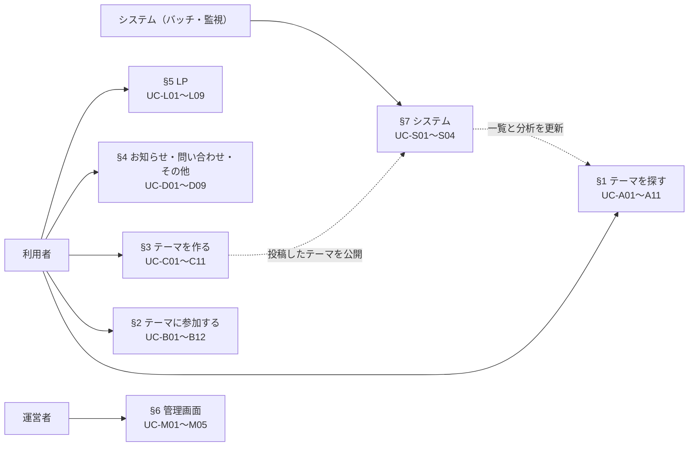
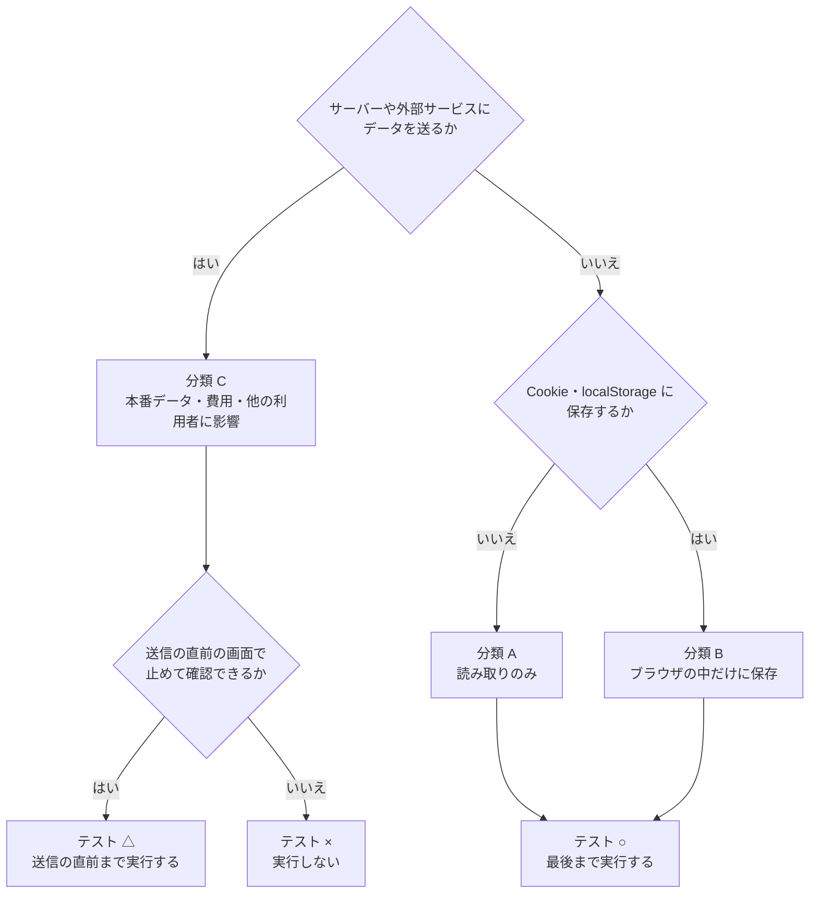

# PolisJAPAN 操作ユースケース一覧

| 項目 | 内容 |
| --- | --- |
| 文書名 | PolisJAPAN 操作ユースケース一覧 |
| 位置づけ | 利用者・運営者が画面で行う操作を洗い出したもの。各操作の画面要素と動きは `docs/画面仕様書.md`、本番で定期実行するテストは `docs/本番定期テストケース.md` を参照 |

## 読み方

- **分類**は、その操作が本番に与える影響を表す（`docs/画面仕様書.md` §1）。
  - **A**: 読み取りのみ
  - **B**: そのブラウザの中だけに保存する
  - **C**: サーバーや外部サービスにデータを送る（本番データ・費用・他の利用者に影響する）
- **テスト**は、本番の定期テストで扱えるかを表す。
  - **○**: 最後まで実行できる
  - **△**: 送信の直前まで実行できる（最後の 1 操作だけ実行しない）
  - **×**: 実行しない
- アクターは「利用者」（アプリ・LP を使う一般の人）と「運営者」（管理画面を使う人）、「システム」（バッチ）の 3 つ。

次の図は、3 つのアクターと、この文書の §1〜§7 のユースケース群の関係を示す。

次の図は、操作の分類（A・B・C）と、本番の定期テストでの扱い（○・△・×）を決める流れを示す（PWA の追加と管理画面、例外として実行する UC-C04・UC-D07 は、表の値に従う）。

---

## 1. アプリ：テーマを探す

| ID | ユースケース | 手順の要点 | 期待する結果 | 分類 | テスト |
| --- | --- | --- | --- | --- | --- |
| UC-A01 | アプリを開いてテーマ一覧を見る | `https://app.pol-is.jp/` を開く | テーマカードが更新順で並ぶ。各カードにカテゴリ、更新日時、タイトル、意見数、投票数が出る | A | ○ |
| UC-A02 | 初めて開いたときに使い方を見る | 開いて待つ | チュートリアルが自動で出る。「次へ」で 5 枚進み、最後で閉じる | B | ○ |
| UC-A03 | 使い方をもう一度見る | 「使い方」を押す | チュートリアルが 1 枚目から出る | A | ○ |
| UC-A04 | 使い方を今後表示しないようにする | 「次回から表示しない」にチェックして閉じる | 次に開いたとき自動で出ない | B | ○ |
| UC-A05 | キーワードでテーマを探す | 検索欄に語を入れて検索する | すべての語を含むカードだけが残る。空にすると全件に戻る | A | ○ |
| UC-A06 | カテゴリで絞り込む | カテゴリタブを押す | そのカテゴリのカードだけが残る。もう一度押すと「全て」に戻る | A | ○ |
| UC-A07 | 並び順を変える | ソートを開いて選ぶ | 更新順／意見順／新着順／古い順／人気順で並び替わる | A | ○ |
| UC-A08 | テーマをお気に入りに入れる | カードの ☆ を押す | ★ になる。初回は注意ダイアログ、2 回目以降はトーストが出る | B | ○ |
| UC-A09 | お気に入りだけを見る | 「お気に入り」タブを押す | 登録したカードだけが出る。0 件なら案内文が出る | A | ○ |
| UC-A10 | お気に入りを外す | ★ を押す | ☆ に戻り、お気に入りタブから消える | B | ○ |
| UC-A11 | テーマを開く | カードを押す | そのテーマの詳細画面へ移る | A | ○ |

## 2. アプリ：テーマに参加する

| ID | ユースケース | 手順の要点 | 期待する結果 | 分類 | テスト |
| --- | --- | --- | --- | --- | --- |
| UC-B01 | テーマの意見を読む | 詳細画面を開く | 「テーマ」タブに pol.is の投票画面が出る | A | ○（埋め込みが表示されることまで） |
| UC-B02 | 意見に投票する | 埋め込み内で賛成／反対／パスを押す | 投票が記録され、次の意見が出る | **C** | × |
| UC-B03 | 自分の意見を投稿する | 埋め込み内で意見を書いて送る | 意見が記録され、他の人の投票対象になる | **C** | × |
| UC-B04 | みんなの意見（分析）を見る | 「みんなの意見」タブを押す | 意見グループと、賛成の多い意見の一覧が出る | A | ○ |
| UC-B05 | 意見をもっと見る | 「もっと見る」を押す | 6 件目以降が開く。もう一度押すと閉じる | A | ○ |
| UC-B06 | グループの代表的な意見を見る | 円グラフを押す | そのグループの代表的な意見が吹き出しで出る | A | ○ |
| UC-B07 | 詳細なレポートを見る | 「詳細レポート」を押す | pol.is のレポートページが別ウィンドウで開く | A | ○（リンク先の確認まで） |
| UC-B08 | 分析から投票画面へ戻る | 「投稿画面へ」を押す | 「テーマ」タブに切り替わる | A | ○ |
| UC-B09 | 詳細画面でお気に入りに入れる | ★ を押す | お気に入りに入り、ホームの一覧にも反映される | B | ○ |
| UC-B10 | テーマを共有する | 「共有」を押し、コピーを押す | 共有リンクまたは SNS 用の文面がコピーされる | B | ○ |
| UC-B11 | 共有リンクから開く | `https://share.pol-is.jp/link?conversation_id=<id>` を開く | OGP（SNS でのプレビュー）付きのページが返り、そのテーマの詳細画面へ自動で移る | A | ○ |
| UC-B12 | 一覧へ戻る | 「戻る」を押す | ホームへ戻る | A | ○ |

## 3. アプリ：テーマを作る

| ID | ユースケース | 手順の要点 | 期待する結果 | 分類 | テスト |
| --- | --- | --- | --- | --- | --- |
| UC-C01 | 作成画面を開く | 「テーマを作成」を押す | 作成モーダルが AI アシストモードで開く | A | ○ |
| UC-C02 | 作成方法を切り替える | 「マニュアル」／「AI アシスト」を押す | そのモードのフォームに替わる。モードごとの下書きが復元される | A | ○ |
| UC-C03 | テーマ名を入力する | タイトルを入れて「次へ」 | 文字数カウンターが増える。80 文字を超えると進めずエラーが出る | B | ○ |
| UC-C04 | AI に立場を考えてもらう | 立場の AI 生成ボタンを押す | 立場が 2 つ入る | **C**（費用） | ○（例外として 1 日 1 回実行する） |
| UC-C05 | AI に意見を考えてもらう | 意見の AI 生成ボタンを押す | 意見が 8 つ入る | **C**（費用） | × |
| UC-C06 | AI に説明を考えてもらう | 説明の AI 生成ボタンを押す | 説明文が入る | **C**（費用） | × |
| UC-C07 | 立場・意見・説明を自分で書く | 各欄を手入力して「次へ」 | すべて埋めると次へ進める。説明は 200 文字まで | B | ○ |
| UC-C08 | カテゴリを選ぶ | カテゴリを 1 つ押して「次へ」 | 投稿ステップへ進み、「テーマを作成」が押せるようになる | B | ○ |
| UC-C09 | テーマを投稿する | 「テーマを作成」を押す | 完了画面が出る。約 15 分以内に一覧へ公開される | **C**（公開） | △（押せる状態の確認まで） |
| UC-C10 | 途中でやめて、あとで続ける | モーダルを閉じて開き直す、またはページを再読み込みする | 入力した内容が残っている | B | ○ |
| UC-C11 | 投稿したテーマが一覧に出る | 投稿後しばらくしてホームを開く | 投稿したテーマのカードが出る | —（UC-C09 の結果） | × |

## 4. アプリ：お知らせ・問い合わせ・その他

| ID | ユースケース | 手順の要点 | 期待する結果 | 分類 | テスト |
| --- | --- | --- | --- | --- | --- |
| UC-D01 | 新しいお知らせを受け取る | 未読のお知らせがある状態で開く | お知らせが自動で開く（チュートリアルが先に出る場合は、その後） | B | ○ |
| UC-D02 | お知らせを読み返す | メニュー →「お知らせ」 | 一覧が開き、先頭の 1 件が開いた状態で出る。見出しを押すと開閉する | B | ○ |
| UC-D03 | 改善要望を送る | メニュー →「改善要望」 | 改善要望テーマの詳細画面へ移る（そこで投票・投稿するのは UC-B02／B03） | A | ○（遷移まで） |
| UC-D04 | プライベート版の案内を読む | メニュー →「プライベート版について」 | LP の案内ページへ移る | A | ○ |
| UC-D05 | 利用規約・プライバシーポリシーを読む | メニュー → 各リンク | LP の各ページへ移る | A | ○ |
| UC-D06 | 問い合わせを書く | メニュー →「お問い合わせ」→ 入力 →「確認する」 | 確認画面に入力内容が出る。内容やメールが不正ならエラーが出る | B | ○ |
| UC-D07 | 問い合わせを送る | 確認画面で「送信する」 | 完了画面が出る。運営と本人にメールが届く | **C**（メール） | ○（例外として定型文で送信する） |
| UC-D08 | 問い合わせを書き直す | 確認画面で「戻る」 | 入力画面へ戻る。内容は残っている | A | ○ |
| UC-D09 | アプリをホーム画面に追加する（PWA） | ブラウザの機能で追加する | アイコンから単独のアプリとして開ける | B | ×（ブラウザの機能のため。manifest の配信確認のみ ○） |

## 5. LP

| ID | ユースケース | 手順の要点 | 期待する結果 | 分類 | テスト |
| --- | --- | --- | --- | --- | --- |
| UC-L01 | サービスの紹介を読む | `https://pol-is.jp/` を開いてスクロールする | 各セクションが表示される | A | ○ |
| UC-L02 | メニューで目的の箇所へ移る | メニューの項目を押す | そのセクションまでスクロールする | A | ○ |
| UC-L03 | スクロール後にメニューを開く | 下へスクロールしてハンバーガーを押す | オーバーレイメニューが開く | A | ○ |
| UC-L04 | アプリを使い始める | 「使ってみる」を押す | アプリのホームへ移る | A | ○ |
| UC-L05 | デモのテーマを開く | デモのテーマカードを押す | そのテーマの詳細画面へ移る | A | ○ |
| UC-L06 | プライベート版の案内を読む | 「プライベート版について」を押す | 案内ページが出る | A | ○ |
| UC-L07 | 利用規約・プライバシーポリシー・ライセンスを読む | 各リンクを押す | 各ページが出る。「戻る」でトップへ戻る | A | ○ |
| UC-L08 | 問い合わせを書く | `/contact` で入力 →「お問い合わせ内容の確認」 | 確認画面に入力内容が出る | A | ○ |
| UC-L09 | 問い合わせを送る | 確認画面で「お問い合わせ送信」 | 完了画面が出る。運営と本人にメールが届く | **C**（メール） | △（確認画面まで） |

## 6. 管理画面（運営者）

管理画面は許可された IP からしか開けず、操作のほとんどが本番データを書き換える。定期テストでは、許可外の場所から「開けないこと」だけを確認する。

| ID | ユースケース | 手順の要点 | 期待する結果 | 分類 | テスト |
| --- | --- | --- | --- | --- | --- |
| UC-M01 | 管理画面を開く | 許可された回線から `https://admin.pol-is.jp/` を開く | 画面が出る。許可外の回線では 403 | A | ○（許可外から 403 になること） |
| UC-M02 | アクセスキーを設定して一覧を見る | キーを入力して「セット」 | 下書きの一覧が新しい順に出る | A | × |
| UC-M03 | 下書きを編集する | 内容を直して「更新」 | 下書きが書き換わる | **C** | × |
| UC-M04 | 投稿に失敗した下書きを再投稿する | 「投稿失敗」タグの下書きの「承認」を押す | 承認済みに戻り、15 分以内に再投稿される | **C** | × |
| UC-M05 | テーマを削除する | 「削除」を押す | 一覧から消える（確認は出ない） | **C** | × |

## 7. システム（バッチ・監視）

画面操作ではないが、利用者から見える結果に関わるもの。

| ID | ユースケース | 動き | 利用者から見える結果 | テスト |
| --- | --- | --- | --- | --- |
| UC-S01 | 投票数・意見数を更新する | 5 分ごとに pol.is から集計を取り、CSV を更新する | カードの投票数・意見数・更新日時、分析の内容が新しくなる | ○（更新日時の鮮度で確認） |
| UC-S02 | 投稿されたテーマを公開する | 15 分ごとに、承認済みの下書きを 1 件ずつ pol.is へ投稿する | 新しいテーマが一覧に出る | ○（滞留が無いことをアラームで確認） |
| UC-S03 | 投稿の失敗を知らせる | 9 回連続で失敗した下書きを隔離し、アラームと毎朝のメールで知らせる | — | ○（アラームの状態で確認） |
| UC-S04 | API の停止を知らせる | 30 秒ごとに `/batch/healthcheck` を確認する | — | ○ |

---

## 8. 集計

| 範囲 | 件数 | ○ | △ | × |
| --- | --- | --- | --- | --- |
| アプリ：テーマを探す | 11 | 11 | 0 | 0 |
| アプリ：テーマに参加する | 12 | 10 | 0 | 2 |
| アプリ：テーマを作る | 11 | 7 | 1 | 3 |
| アプリ：お知らせ・問い合わせ・その他 | 9 | 8 | 0 | 1 |
| LP | 9 | 8 | 1 | 0 |
| 管理画面 | 5 | 1 | 0 | 4 |
| システム | 4 | 4 | 0 | 0 |
| **計** | **61** | **49** | **2** | **10** |

× と △ の理由は、すべて「本番データ・費用・メールに影響するから」である（PWA の追加だけはブラウザの機能のため）。対立軸の AI 生成（UC-C04）とアプリのお問い合わせの送信（UC-D07）は分類 C だが、止まっていることに気づく手段がほかに無いため、例外として実行する（`docs/本番定期テストケース.md` §1.2）。残りを最後まで確認するには、本番とは別の検証環境が必要になる（同 §6）。
