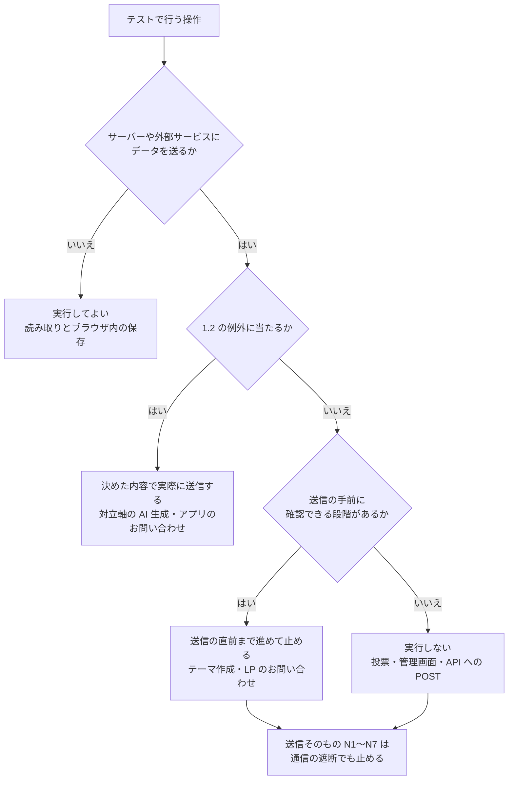
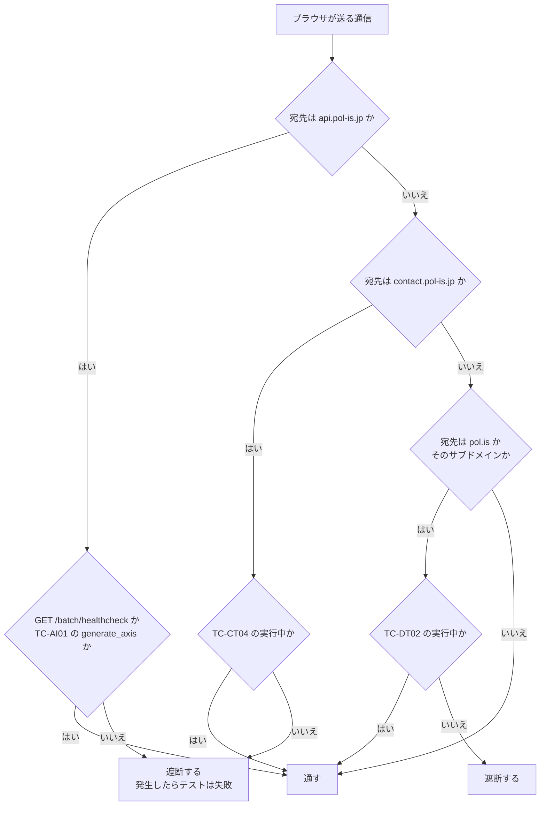
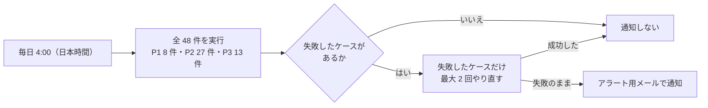

# PolisJAPAN 本番定期テストケース

| 項目 | 内容 |
| --- | --- |
| 文書名 | PolisJAPAN 本番定期テストケース（ユーザーに影響しない画面テスト） |
| 目的 | 本番環境（pol-is.jp／app.pol-is.jp）を画面から定期的に操作し、利用者に影響を与えずにアプリが正常に動いていることを確認する |
| 関連 | 画面の要素と動きは `docs/画面仕様書.md`、操作の一覧は `docs/操作ユースケース.md` |
| 状態 | 実装済み。テストコードは `tests/e2e/`、定期実行は `.github/workflows/e2e-production.yml`（§7） |

---

## 1. 方針

1. **読み取りと、ブラウザ内の保存だけで完結する操作を基本とする。** サーバーや外部サービスにデータを送る操作は、§1.2 の 2 つの例外を除いて実行しない。
2. **送信を伴う機能は、送信の直前まで確認する。** テーマ作成は「テーマを作成」が押せる状態まで進める。お問い合わせは、アプリからは定型文で実際に送信し（§1.2）、LP からは確認画面まで進める。
3. **毎回、まっさらなブラウザで実行する。** Cookie と localStorage が空の状態から始め、終わったら捨てる。テストが残した下書きやお気に入りを次回に持ち越さない。
4. **禁止操作は、手順で避けるだけでなく、通信の段階でも止める**（§2.2）。

### 1.1 実行してはいけない操作

次の操作は、本番データ・費用・メール・他の利用者に影響するため、テストでは実行しない。N2 と N4 には、§1.2 の例外がある。

| # | 操作 | セレクタ | 実行すると起きること |
| --- | --- | --- | --- |
| N1 | pol.is 埋め込み内のクリック・入力 | `#app .polis` 内の iframe | 実テーマに投票・意見が記録され、全利用者の分析表示が変わる |
| N2 | AI 生成ボタン（TC-AI01 の対立軸の生成を除く） | `.ai-generate-button` | OpenAI の費用が発生する |
| N3 | テーマを作成 | `#post-stepper .post-button` | 約 15 分以内に実テーマが一般公開される |
| N4 | お問い合わせの送信（アプリ。TC-CT04 の定型文での送信を除く） | `#contact-send-button` | 運営と入力アドレスに実メールが送られる |
| N5 | お問い合わせの送信（LP） | `/contact` 確認画面の「お問い合わせ送信」 | 同上 |
| N6 | 管理画面のあらゆる操作 | — | 下書きの書き換え・公開・削除 |
| N7 | API への直接の POST（特に `/theme/post_draft`） | — | `post_draft` はアクセスキーが違っていても登録され、公開される |

次の図は、テストで行う操作が実行してよい範囲に入るかを判定する流れを示す。

### 1.2 例外として実際に送信する操作

次の 2 つは、止まっていることに気づく手段がほかに無いため、内容を決めたうえで実際に送信する。

| 操作 | テストケース | 送信する内容 | 影響 |
| --- | --- | --- | --- |
| 対立軸の AI 生成 | TC-AI01 | テーマ欄に「【自動テスト】在宅勤務を標準の働き方にすべきか」を入れ、対立軸のステップで `.ai-generate-button` を 1 回押す。意見と説明の生成は実行しない | 1 回につき OpenAI の費用が 1 回分かかる。課金や API キーの問題で AI 生成が止まっていることを検知する |
| アプリのお問い合わせの送信 | TC-CT04 | お名前「【自動テスト】PolisJAPAN 定期テスト」、内容「【自動テスト】これは定期テストによる自動送信です。対応は不要です。」。メールアドレスは、受信できるテスト用のアドレスを GitHub のシークレットから読む（文書とコードには書かない） | 運営と、入力したアドレスに、1 回につき 1 通ずつメールが届く。運営側は本文の「【自動テスト】」を目印に振り分ける |

やり直し（§7）が起きた回は、費用とメールがその回数分だけ増える。

---

## 2. 前提条件

### 2.1 実行環境

| 項目 | 内容 |
| --- | --- |
| ブラウザ | Chromium 系のヘッドレスブラウザ。毎回新しいプロファイル（コンテキスト）で起動する |
| 画面幅 | スマートフォン幅（390×844）を基本とする。LP のメニューは PC 幅（1280×800）でも確認する |
| 対象 URL | `https://app.pol-is.jp/`、`https://pol-is.jp/`、`https://admin.pol-is.jp/`、`https://api.pol-is.jp/batch/healthcheck` |
| 実行場所 | 管理画面の許可 IP **以外**の場所（TC-SM06 が 403 を期待するため） |

### 2.2 安全装置（通信の遮断）

テストを実行するブラウザに、次の通信ルールを必ず設定する。`api.pol-is.jp` と `contact.pol-is.jp` で遮断の対象になった通信が 1 件でも発生したら、そのテストは失敗とする。`pol.is` の遮断は、発生しても失敗にしない（詳細画面を開けば必ず発生するため）。

| 対象 | ルール |
| --- | --- |
| `https://api.pol-is.jp/` への POST | すべて遮断する。TC-AI01 でのみ `/theme/generate_axis` を許可する（GET `/batch/healthcheck` は常に許可） |
| `https://contact.pol-is.jp/` | 既定で遮断する。TC-CT04 でのみ許可する |
| `https://pol.is/` と、そのサブドメイン | 既定で遮断する。TC-DT02 でのみ許可する |

次の図は、テスト中のブラウザが送る通信を、上の表のルールで通すか遮断するかを判定する流れを示す。

`pol.is` を既定で遮断するのは、詳細画面を開いただけで pol.is 側に参加者データが作られるかどうかが、こちらのコードからは確認できないためである。遮断しても、分析タブ・共有・お気に入りなど、アプリ側の表示は確認できる。

### 2.3 オーバーレイへの対処

アプリは開いた直後にチュートリアル（800ms 後）とお知らせ（2000ms 後）を自動で表示し、これらが他の操作を遮る。

- チュートリアルとお知らせ自体を確認するテスト（TC-HM02、TC-NT01）以外では、ページを開く前に次の Cookie を設定する。
  - `tutorial_optout=1`（ドメイン `app.pol-is.jp`、パス `/`）
  - `notice_last_seen_id=999`（同上）
- 以下、この設定を「**オーバーレイ抑止**」と呼ぶ。

### 2.4 テスト対象のテーマ

- 詳細画面のテストは、ホームの一覧の**先頭のカード**（最も新しく更新されたテーマ）を使う。テーマを固定しないのは、特定のテーマが削除されるとテストが壊れるためである。
- 先頭のカードの `data-cid` を読み取り、以降の手順で使う。

### 2.5 待ち方

- カードの表示は `.article-item.show` が 1 件以上現れるまで待つ。
- 分析の表示は `.report-list-container .comment-wrapper` が現れるまで待つ。
- 画面遷移はローディング表示のあと 500ms 遅れて始まる。遷移後の URL で待つ。

---

## 3. 優先度と実行頻度

すべてのテストケースを、1 日 1 回、深夜（日本時間 4:00）にまとめて実行する。優先度は、失敗したときの影響の大きさを示す。

| 優先度 | 意味 | 件数 |
| --- | --- | --- |
| **P1** | 止まると利用者がサービスを使えない | 8 |
| **P2** | 主要な機能が正しく動かない | 27 |
| **P3** | 補助的な機能・表示 | 13 |

1 日 1 回のため、サイトが開けなくなってからこのテストで気づくまでは、最長で 1 日かかる。API の死活は、Route53 のヘルスチェックが 30 秒ごとに見ている（`docs/運用手順書.md`）。

---

## 4. テストケース

「確認内容」は、そのケースで確かめたいことを一文で示す。「UC」は `docs/操作ユースケース.md` の ID。特に断りが無いかぎり、オーバーレイ抑止を設定して始める。

### 4.1 疎通（ブラウザ不要・HTTP のみ）

| ID | 優先度 | 確認内容 | 手順 | 期待する結果 |
| --- | --- | --- | --- | --- |
| TC-SM01 | P1 | アプリが配信されている | `GET https://app.pol-is.jp/` | 200。HTML に `id="search-input"` を含む |
| TC-SM02 | P1 | LP が配信されている | `GET https://pol-is.jp/` | 200。`<title>` が「Polis JAPAN \| 分断をなくすSNS」 |
| TC-SM03 | P1 | API が動いている | `GET https://api.pol-is.jp/batch/healthcheck` | 200。本文が `{"is_success":true}` |
| TC-SM04 | P1 | テーマ一覧のデータが配信されている | `GET https://app.pol-is.jp/csv/themes.csv` | 200。1 行目に `id`、`conversation_id`、`updated_at` の列がある。データ行が 1 行以上ある |
| TC-SM05 | P2 | テーマ一覧のデータが更新され続けている（UC-S01） | TC-SM04 の CSV から `updated_at` の最大値を取る | 現在時刻から 24 時間以内。超えていたら**警告**（投票が無い日もあり得るため、失敗にはしない） |
| TC-SM06 | P2 | 管理画面が外部から開けない（UC-M01） | `GET https://admin.pol-is.jp/` | 403 |
| TC-SM07 | P3 | PWA の定義が配信されている（UC-D09） | `GET https://app.pol-is.jp/manifest.json` | 200。`name` が「PolisJAPAN」、`display` が `standalone` |

### 4.2 ホーム画面

| ID | 優先度 | 確認内容 | UC | 手順 | 期待する結果 |
| --- | --- | --- | --- | --- | --- |
| TC-HM01 | P1 | ホームを開くとテーマの一覧が表示される | A01 | 1. ホームを開く | `.article-item.show` が 1 件以上表示される。先頭のカードに、タイトル（`.article-title`、空でない）、カテゴリ（`.category-label`、`#` で始まる）、意見数・投票数（数字）がある。`.sort-label` が「更新順」 |
| TC-HM02 | P2 | 初回にチュートリアルが出て最後まで進められ、同じ日や「今後表示しない」のあとは出ない | A02, A04 | オーバーレイ抑止を**設定せず**に始める。1. ホームを開き、`#tutorial.show` を待つ 2. 「次へ」を 5 回押す 3. ページを再読み込みして 3 秒待つ 4. Cookie を消して開き直し、`#hidden-checkbox` をチェックして `.skip-button` で閉じる 5. 再読み込みして 3 秒待つ | 1 で 1 枚目（`data-number="1"`）が表示される。2 で 1 回押すごとに次の番号へ進み、5 回目で `#tutorial` から `.show` が外れる。3 では同じ日のためチュートリアルが出ない。4 のあと Cookie `tutorial_optout` が `1` になる。5 でチュートリアルが出ない |
| TC-HM03 | P3 | ヘルプボタンからチュートリアルを開き直せる | A03 | 1. `.help-button` を押す 2. `.skip-button` を押す | 1 で `#tutorial.show` になる（抑止していても出る）。2 で閉じる |
| TC-HM04 | P2 | キーワード検索で一覧を絞り込め、解除すると元に戻る | A05 | 1. 先頭のカードのタイトルの先頭 4 文字を読み取る 2. `#search-input` に入れて Enter 3. 一致するはずのない文字列（例 `zzqqxxテスト不一致`）を入れて Enter 4. 欄を空にして Enter | 2 で表示中のカードが 1 件以上あり、すべてのカードの文字に入力した語が含まれる。3 で表示中のカードが 0 件になる。4 で 1 と同じ件数に戻る |
| TC-HM05 | P2 | カテゴリのタブで一覧を絞り込め、もう一度押すと解除される | A06 | 1. 表示中のカード数を数える 2. `.category-button[data-category="1"]` を押す 3. 同じタブをもう一度押す | 2 でそのタブが `.active` になり、表示中のカードの `data-category` がすべて `1` になる。3 で「全て」タブが `.active` になり、件数が 1 に戻る |
| TC-HM06 | P2 | 並び替えの 5 種類が、それぞれ正しい順にカードを並べる | A07 | 1. `.sort-button` を押す 2. `.select-element[data-value="popular"]` を押す 3. 同様に `new`、`old`、`commented`、`updated` を選ぶ | 1 で `.sort-select.show` になる。2 で `.sort-label` が「人気順」になり、カードの `data-population` が先頭から降順に並ぶ。3 で、`new` は `data-id` の降順、`old` は昇順、`commented` は `data-commented` の降順（空は末尾）、`updated` は `data-updated` の降順（空は末尾）になる |
| TC-HM07 | P2 | お気に入りの登録・解除ができ、お気に入りタブに反映され、再読み込みしても残る | A08, A09, A10 | 1. `.category-button[data-category="fav"]` を押す 2. 「全て」に戻し、先頭のカードの `.favorite-toggle` を押す 3. `.favorite-notice-ok` を押す 4. 2 枚目のカードの `.favorite-toggle` を押す 5. 「お気に入り」タブを押す 6. 表示中の 1 枚の `.favorite-toggle` を押す 7. ページを再読み込みして「お気に入り」タブを押す | 1 で `.favorites-empty.show` が出て、カードは 0 件。2 で詳細画面へ遷移せず、`.favorite-notice-overlay` が出て、星が `bi-star-fill` になる。3 でダイアログが消える。4 でダイアログではなく `.favorite-toast.show`（「お気に入りに追加しました」）が出る。5 でカードが 2 件だけ表示される。6 でそのカードが一覧から消え、1 件になる。7 で 1 件のまま（保存されている） |
| TC-HM08 | P1 | カードを押すと、そのテーマの詳細画面へ移動する | A11 | 1. 先頭のカードの `data-cid` を読み取る 2. カードを押す | `#loading-overlay.show` が出たあと、URL が `/detail/?conversation_id=<1 で読んだ値>` になる |
| TC-HM09 | P2 | メニューが開き、お知らせの一覧を読み込んで開閉できる | D02 | 1. `.hamburger-trigger` を押す 2. `#notice-menu-button` を押す 3. 2 番目の `.notice-header` を押す 4. `#notice-modal .modal-close-button` を押す | 1 で `#hamburger-menu.open`、`aria-expanded="true"`。メニューに、お知らせ・改善要望・プライベート版について・お問い合わせ・利用規約・プライバシーポリシーの 6 項目がある。2 でメニューが閉じ、`#notice-modal.show` になる。`.notice-item` が 1 件以上あり、先頭だけ `.open`。本文に「読み込めませんでした」が無い。3 で 2 番目が `.open` になる。4 でモーダルが閉じる |
| TC-HM10 | P3 | メニューの各リンクと「改善要望」が正しい行き先を指している | D03, D04, D05 | 1. メニューを開く 2. 各リンクの `href` を読み取る 3. `#feedback-menu-button` を押す | 2 で、プライベート版は `https://pol-is.jp/private/`、利用規約は `https://pol-is.jp/terms/`、プライバシーポリシーは `https://pol-is.jp/policy/`。3 で URL が `/detail/?conversation_id=9knucbecnr` になる（遷移先では何も操作しない） |
| TC-HM11 | P3 | メニューを Esc キーと背景のクリックで閉じられる | A01 | 1. メニューを開く 2. Esc を押す 3. もう一度開き、`.hamburger-backdrop` を押す | 2、3 とも `#hamburger-menu` から `.open` が外れる |

### 4.3 お知らせの自動表示

| ID | 優先度 | 確認内容 | UC | 手順 | 期待する結果 |
| --- | --- | --- | --- | --- | --- |
| TC-NT01 | P3 | 未読のお知らせがあると自動で開き、一度見たあとは開かない | D01 | Cookie は `tutorial_optout=1` だけ設定して始める。1. ホームを開いて 3 秒待つ 2. モーダルを閉じて再読み込みし、3 秒待つ | 1 で `#notice-modal.show` が自動で出る。Cookie `notice_last_seen_id` に数値が入る。2 では出ない |

### 4.4 テーマ詳細画面

既定で `pol.is` への通信を遮断する（§2.2）。TC-DT02 だけ許可する。

| ID | 優先度 | 確認内容 | UC | 手順 | 期待する結果 |
| --- | --- | --- | --- | --- | --- |
| TC-DT01 | P1 | 詳細画面の「みんなの意見」タブで分析（意見と集計）が表示される | B04 | 1. ホームの先頭のカードの `data-cid` で `/detail/?conversation_id=<cid>` を開く 2. `.tab[data-tab="reports"]` を押す 3. 分析の表示を待つ | 2 でそのタブが `.active` になり、`#app` に `on-reports` が付く。3 で `.report-list-container .comment-wrapper` が 1 件以上、`.comments-item` が 1 件以上表示される。意見の本文が空でない |
| TC-DT02 | P2 | pol.is の投票画面が詳細画面に埋め込まれ、投票と意見投稿の画面が出ている | B01 | `pol.is` への通信を**許可して**始める。1. 詳細画面を開く 2. 10 秒待つ 3. iframe の中の表示を読み取る | `#app .polis` の中に `iframe` が 1 つあり、`src` のホストが `pol.is` である。3 で、iframe の中に賛成・反対・パスのボタンと、意見の入力欄が表示されている。**iframe の中は読み取るだけで、クリックも入力もしない**（N1）。pol.is 側の不調があり得るため、失敗は警告として扱う（§7） |
| TC-DT03 | P2 | 意見の一覧の「もっと見る」を開閉できる | B05 | 1. 「みんなの意見」タブを開く 2. 先頭の `.accordion-button` を押す 3. もう一度押す | 意見が 6 件以上あるテーマの場合、2 で `data-target` の要素に `.show` が付き、ボタンの文言が「閉じる」になる。3 で元に戻る。6 件未満のテーマでは変化しない（スキップ扱い）。分析の CSV の読み込みを 1.5 秒遅らせた状態で確かめる（ボタンは読み込みのあとに作られるため） |
| TC-DT04 | P3 | 意見グループの図を押すと説明が出て、閉じられる | B06 | 1. 「みんなの意見」タブを開く 2. `.graph-circle` があれば 1 つ押す 3. `.group-tooltip-close` を押す | グループがあるテーマの場合、2 で `.group-tooltip` が表示され、3 で消える。グループが無いテーマではスキップ |
| TC-DT05 | P2 | 本家の詳細レポートへのリンクが正しく作られている | B07 | 1. 「みんなの意見」タブを開く 2. `#detail-report-button` の `href` を読み取る | `https://pol.is/report/` で始まり、その後ろが空でない（クリックはしない） |
| TC-DT06 | P3 | 分析から「テーマ」タブへ戻るボタンが動く | B08 | 1. 「みんなの意見」タブを開く 2. `.goto-theme-button` を押す | 「テーマ」タブが `.active` になる |
| TC-DT07 | P2 | 共有モーダルに正しい共有リンクと SNS 用の文面が出て、コピーできる | B10 | 1. `.share-button` を押す 2. 2 つの `.share-input` の値を読み取る 3. リンク側の `.copy-button` を押す 4. `.modal-close-button` を押す | 1 で `#copy-complete-modal.show` になる。2 で、リンクは `https://share.pol-is.jp/link?conversation_id=<cid>`、SNS 用の文面は「テーマ : 」で始まり、同じリンクと「#Polis #ブロードリスニング」を含む。3 で `.copy-complete-tip.show` が出る。4 で閉じる |
| TC-DT08 | P2 | 詳細画面でお気に入りに入れたテーマが、ホームのお気に入りタブに出る | B09 | 1. `.favorite-button` を押す 2. ダイアログを閉じる 3. `.back` を押してホームへ戻る 4. 「お気に入り」タブを押す | 1 で `aria-pressed="true"` になり、星が `bi-star-fill` になる。3 で URL がホームになる。4 でそのテーマのカード（`data-cid` が一致）が表示される |
| TC-DT09 | P3 | 共有リンクが OGP を返し、開くと詳細画面にたどり着く | B11 | 1. `https://share.pol-is.jp/link?conversation_id=<cid>` を開く | 200 で OGP 付きの HTML が返り（`og:url` が `https://app.pol-is.jp/detail/?conversation_id=<cid>`）、ブラウザでは最終的にその詳細画面が表示される（2026-11-11 に実測で確認。共有リンクの処理自体はリポジトリ外にある） |
| TC-DT10 | P3 | 存在しないテーマの URL を開いても画面が壊れない | —（異常系） | 1. `/detail/?conversation_id=zzzzzzzzzz`（存在しない ID）を開く | 画面が表示され、タブの切り替えと「戻る」が動く。分析は表示されない（現状はエラーの案内が出ない。`docs/改善バックログ.md` D-7） |

### 4.5 テーマ作成（送信の直前まで）

`.post-button` は**押さない**（N3）。`.ai-generate-button` は、TC-AI01 の対立軸のステップでだけ押す（N2、§1.2）。テスト用の入力は、万一送信されても内容からテストと分かる文字列にする（例 タイトル「【自動テスト】送信されていたら不具合です」）。

| ID | 優先度 | 確認内容 | UC | 手順 | 期待する結果 |
| --- | --- | --- | --- | --- | --- |
| TC-CR01 | P2 | テーマ作成モーダルが開き、AI アシストとマニュアルを切り替えられる | C01, C02 | 1. `.create-button` を押す 2. `#manual-mode-button` を押す 3. `#ai-mode-button` を押す 4. `.modal-close-button` を押す | 1 で `#theme-create-modal.show` になり、`#ai-assist-mode` があり、`#theme-stepper` が `.current`。2 で `#manual-mode` に替わる。3 で `#ai-assist-mode` に戻る。4 で閉じる |
| TC-CR02 | P2 | タイトルの文字数カウントと 80 文字の上限チェックが働く | C03 | AI アシストモードで、1. `#theme-title-textarea` に 10 文字入れる 2. 値を 81 文字に書き換えて入力イベントを発火し、`.next-button[data-control-no="1"]` を押す 3. 80 文字に直して「次へ」を押す | 1 でカウンターが `10/80` になり、「次へ」が押せるようになる。2 で `.stepper-error.show` に「タイトルは80文字以内で入力してください」と出て、進まない。3 で `#axis-stepper` が `.current` になる |
| TC-CR03 | P2 | AI アシストの全ステップを手入力で投稿の直前まで進められ、その間 API を呼ばない | C07, C08, C09 | AI アシストモードで、1. タイトルを入れて「次へ」 2. 立場 2 つを入れて「次へ」 3. 意見 8 つを入れて「次へ」 4. 説明を入れて「次へ」 5. `.category-select-button[data-value="8"]` を押して「次へ」 | 各ステップで、欄をすべて埋めるまで「次へ」が `disabled`、埋めると押せる。2〜4 の各ステップにある `.ai-generate-button` は押さない。5 のあと `#post-stepper` が `.current` になり、`.post-button` から `disabled` が外れている。**ここで止める。** この間、`api.pol-is.jp` への通信が 1 件も発生していない |
| TC-CR04 | P2 | 入力途中の内容が、モーダルを閉じても再読み込みしても残る | C10 | TC-CR03 の途中（説明まで入力した状態）で、1. モーダルを閉じて開き直す 2. ページを再読み込みして開き直す | 1、2 とも、入力した内容が各欄に残っている。1 では同じステップ（説明）のまま、2 では入力済みのステップを飛ばして、未入力の最初のステップ（カテゴリ）から再開する。localStorage に `AI_ASSIST_CREATE_DRAFT_THEME` などが入っている |
| TC-CR05 | P3 | マニュアルモードで、意見を 8 個入れるまで先へ進めず、8 個で進める | C07 | マニュアルモードで、1. タイトルを入れて「次へ」 2. 意見を 8 個だけ入れる 3. 9 個目以降は空のまま「次へ」を押す | 意見が 7 個以下の間は「次へ」が `disabled` のまま。2 で押せるようになり、3 で次のステップへ進む。意見は 15 欄のうち 8 個以上が必須で、残りは任意である |
| TC-AI01 | P2 | AI 生成が動いている（課金や API キーの問題で止まっていない） | C04 | `/theme/generate_axis` への通信を**許可して**始める。AI アシストモードで、1. タイトルに §1.2 の定型のテーマを入れて「次へ」 2. `#axis-stepper` の `.ai-generate-button` を 1 回押す 3. 生成の完了を待つ（最長 120 秒） | 3 で、`/theme/generate_axis` が 200 を返し、立場の入力欄が 2 つとも空でなくなる。「次へ」が押せるようになる。**ここで止める。** 意見と説明の生成は実行しない |

### 4.6 お問い合わせモーダル（確認画面まで）

`#contact-send-button` は、TC-CT04 でだけ押す（N4、§1.2）。TC-CT01〜TC-CT03 のメールアドレスは `autotest@example.invalid` のように、実在しないことが保証された形式を使う。

| ID | 優先度 | 確認内容 | UC | 手順 | 期待する結果 |
| --- | --- | --- | --- | --- | --- |
| TC-CT01 | P2 | お問い合わせの必須項目とメール形式の入力チェックが働く | D06 | 1. メニュー → `#contact-menu-button` 2. 何も入れずに `#contact-confirm-button` を押す 3. 内容だけ入れて押す 4. メールに `@` の無い文字列を入れて押す | 1 でメニューが閉じ、`#contact-modal.show`、入力画面が表示される。2 で `#contact-form-error` に「お問い合わせ内容を入力してください」。3、4 で「メールアドレスを入力してください」。いずれも確認画面へ進まない |
| TC-CT02 | P2 | お問い合わせの確認画面に入力内容が正しく出て、入力画面へ戻れる（送信はしない） | D06, D07, D08 | 1. メール、内容を入れ、お名前は空のまま「確認する」を押す 2. `#contact-back-button` を押す 3. もう一度「確認する」を押す | 1 で確認画面が表示され、`#contact-mail-confirm` と `#contact-content-confirm` が入力と一致し、`#contact-name-confirm` が「（未入力）」。`#contact-send-button` が表示されている。2 で入力画面へ戻り、内容が残っている。3 で確認画面に戻る。**ここで止める。** この間、`contact.pol-is.jp` への通信が 1 件も発生していない |
| TC-CT03 | P3 | お問い合わせの入力途中の内容が、再読み込みしても残る | D06 | TC-CT02 の入力後、1. ページを再読み込みする 2. お問い合わせを開く | 入力した内容が各欄に復元されている |
| TC-CT04 | P2 | アプリからお問い合わせを送信できる | D06, D07 | `contact.pol-is.jp` への通信を**許可して**始める。1. §1.2 の定型の内容とテスト用のアドレスを入れて「確認する」を押す 2. `#contact-send-button` を 1 回押す 3. `#contact-complete-close-button` を押す | 2 で `contact.pol-is.jp` が 200 を返し、`.contact-complete-wrapper.show` に「送信しました。」と表示される。3 でモーダルが閉じる。メールが実際に届いたかは、このテストでは見ない（受信側で、振り分けたテストのメールが毎日届いていることで分かる） |

### 4.7 LP

| ID | 優先度 | 確認内容 | UC | 手順 | 期待する結果 |
| --- | --- | --- | --- | --- | --- |
| TC-LP01 | P1 | LP のトップが主要なセクションをそろえてエラー無く表示される | L01 | 1. `https://pol-is.jp/` を開く | `#hero`、`#problems`、`#features`、`#demo`、`#info`、`#footer` がある。ブラウザのコンソールにエラーが出ていない |
| TC-LP02 | P2 | LP からアプリ・プライベート版・デモのテーマへのリンクが正しい | L04, L05, L06 | 1. トップのリンクを読み取る | 「使ってみる」の `href` が `https://app.pol-is.jp/`。「プライベート版について」が `/private`。デモのカード 3 枚の `href` が `https://app.pol-is.jp/detail/?conversation_id=` で始まる |
| TC-LP03 | P2 | LP のデモで案内しているテーマが実在する | L05 | 1. デモのカード 3 枚の conversation_id を読み取る 2. `https://app.pol-is.jp/csv/themes.csv` と照らす | 3 つとも themes.csv に存在する（LP から削除済みのテーマへ案内していない） |
| TC-LP04 | P2 | LP のページ内リンクとハンバーガーメニューが動く | L02, L03 | PC 幅で、1. メニューの「Polisの特徴」を押す 2. ページの下までスクロールする 3. `.menu-expand-button` を押す 4. もう一度押す | 1 で `#features` が画面内に入る。2 でハンバーガーが表示される。3 で `.overlay-menu.show` になり、`/contact`、`/terms`、`/policy`、`/license` へのリンクがある。4 で閉じる |
| TC-LP05 | P2 | LP の下層ページがすべて開き、画像が欠けていない | L06, L07 | 1. `/private/`、`/terms/`、`/policy/`、`/license/`、`/contact/` をそれぞれ開く 2. `/private/` の画像の URL をすべて取得する | 1 はすべて 200 で、本文が表示される。2 はすべて 200 で、画像として返る（画面外の画像は遅延読み込みのため、URL を直接取得して確かめる） |
| TC-LP06 | P3 | LP のお問い合わせフォームで確認画面へ進み、戻れる（送信はしない） | L08, L09 | `/contact` で、1. メール、お名前、内容を入れて「お問い合わせ内容の確認」を押す 2. 「入力に戻る」を押す | 1 で確認画面に入力した内容が表示される。2 で入力画面へ戻る。**「お問い合わせ送信」は押さない**（N5）。この間、`contact.pol-is.jp` への通信が発生していない |

### 4.8 表示の崩れ・エラー（全画面共通）

| ID | 優先度 | 確認内容 | 手順 | 期待する結果 |
| --- | --- | --- | --- | --- |
| TC-CM01 | P2 | 画面に必要なファイルが読み込めている | ホーム、詳細、LP トップを開き、通信を記録する | 自サイト（`app.pol-is.jp`、`pol-is.jp`）の CSS・JS・画像に 4xx／5xx が無い |
| TC-CM02 | P2 | スクリプトのエラーが出ていない | ホーム、詳細（「みんなの意見」タブまで）、LP トップを開き、コンソールを記録する | 未処理の例外（`pageerror`）が無い。※ 遮断した `pol.is` への通信に由来するエラーは除く |
| TC-CM03 | P3 | デプロイ後に古いファイルが混ざっていない | ホームの HTML から、`style.css` と各 JS の `?v=` の値を読み取る | すべて同じ値で、`__ASSET_VERSION__` のままになっていない |

---

## 5. 件数

| 区分 | 件数 | P1 | P2 | P3 |
| --- | --- | --- | --- | --- |
| 疎通 | 7 | 4 | 2 | 1 |
| ホーム | 11 | 2 | 6 | 3 |
| お知らせの自動表示 | 1 | 0 | 0 | 1 |
| テーマ詳細 | 10 | 1 | 5 | 4 |
| テーマ作成 | 6 | 0 | 5 | 1 |
| お問い合わせ | 4 | 0 | 3 | 1 |
| LP | 6 | 1 | 4 | 1 |
| 共通 | 3 | 0 | 2 | 1 |
| **計** | **48** | **8** | **27** | **13** |

---

## 6. このテストで確認しないこと

次の点は、本番の利用者やデータに影響するため、最後までは確認しない。

| 確認しないこと | 理由 | 代わりに見ているもの |
| --- | --- | --- |
| 投票・意見投稿ができること | 実データになる（N1） | 埋め込みと、その中の投票・意見投稿の画面が表示されること（TC-DT02） |
| 意見と説明の AI 生成 | 対立軸の生成（TC-AI01）で、AI 生成が止まっていないことは分かるため | TC-AI01 |
| テーマを投稿でき、一覧に公開されること | 実テーマが公開される（N3） | 送信の直前まで進めること（TC-CR03）。公開の処理が止まっていないことは、滞留監視のアラーム（`docs/運用手順書.md` §4）で検知する。投稿の入口が壊れて下書きが作られない場合は、滞留監視では分からない |
| お問い合わせメールが受信箱に届くこと | テストは送信の成功までしか見られない | 送信が成功すること（TC-CT04）。受信側で、テストのメールが毎日届いていること |
| LP からのお問い合わせの送信 | アプリと同じ API を使うため、アプリ側の送信で足りる（N5） | 確認画面まで進めること（TC-LP06） |
| 管理画面の操作 | 本番データを書き換える（N6）。許可 IP からしか開けない。管理画面は廃止する予定である | 外部から開けないこと（TC-SM06） |
| 投票が分析に反映されること | 投票できないため | CSV の更新日時が新しいこと（TC-SM05） |

---

## 7. 自動実行の条件

| 項目 | 内容 |
| --- | --- |
| 実行する場所 | GitHub Actions のスケジュール実行（`.github/workflows/e2e-production.yml`）。管理画面の許可 IP 以外から動かすことになり、TC-SM06 の 403 を確認できる。手動でも起動できる |
| テストコード | `tests/e2e/`。通信の遮断とオーバーレイ抑止は `tests/e2e/lib/fixtures.js`、ケースは `tests/e2e/specs/`、通知文の作成は `tests/e2e/lib/report.js` |
| テストの道具 | Playwright。通信の遮断（§2.2）、コンソールの記録、新しいプロファイルでの起動を扱える |
| 実行の間隔 | 1 日 1 回、日本時間 4:00。全件をまとめて実行する（§3） |
| 失敗の知らせ方 | 既存の SNS トピック `polisjapan-alerts`（メール）に送る。件名は「[PolisJAPAN] 本番定期テスト: 失敗 N 件」または「警告 N 件」。全件が成功した日は送らない |
| やり直し | 失敗したケースだけを最大 2 回やり直し、それでも失敗したものを知らせる。TC-AI01 と TC-CT04 もやり直す |
| 警告の扱い | TC-SM05（CSV の更新日時）と TC-DT02（pol.is の埋め込み）は、失敗ではなく警告として知らせる |
| テスト用の値 | お問い合わせのテスト用アドレスは、GitHub のシークレット `E2E_CONTACT_EMAIL` に置く。無いと TC-CT04 は失敗する。TC-CT04 は、アドレスを残さないために画面の記録（トレースとスクリーンショット）を取らない |
| ローカルでの実行 | `tests/e2e` で `npm run test:local`（`docs/開発ガイド.md`）。本番でしか確かめられない TC-SM06、TC-DT09、TC-CM03 と、実メールを送る TC-CT04 は実行しない。TC-AI01 は実行され、AI 生成を 1 回呼ぶ |
| アクセスの影響 | 1 回の実行で、静的ファイルと CSV の GET が数十件、AI 生成が 1 回、お問い合わせの送信が 1 回発生する |
