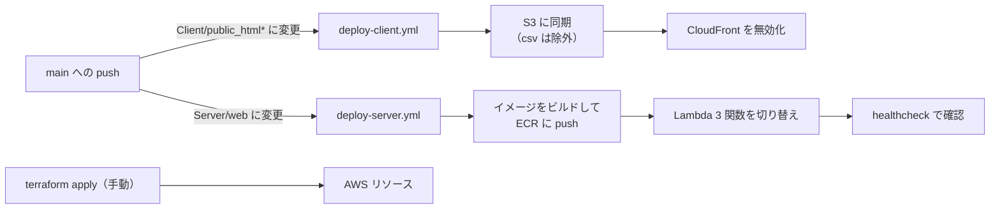
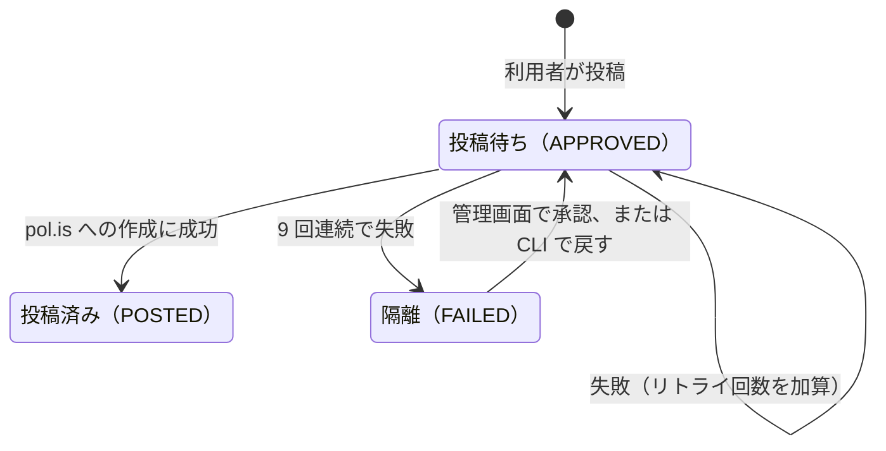
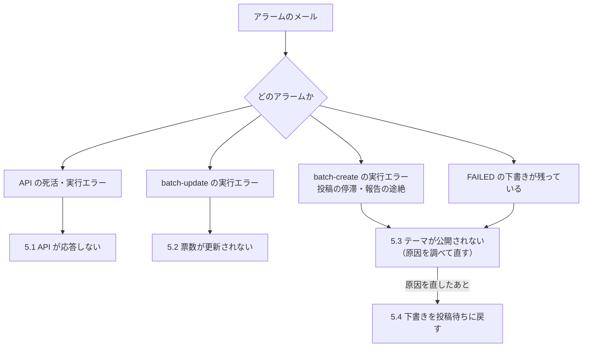

# PolisJAPAN 運用手順書

本番環境への反映、監視、障害対応の手順をまとめる。システムの構成は `docs/アーキテクチャ.md`、AWS のリソースは `docs/インフラ構成.md`、Terraform の構成は `Infra/terraform/README.md` を参照。

## 1. 本番環境の早見表

| 項目 | 値 |
| --- | --- |
| リージョン | ap-northeast-3（大阪）。お問い合わせ・共有の Lambda、ヘルスチェックのアラーム、CloudFront 用の証明書などは us-east-1（一覧は `docs/インフラ構成.md`） |
| AWS CLI プロファイル | `inventory`（読み取り専用。調査はこちら）／`terraform`（管理者。変更と Terraform 実行） |
| Lambda | `polisjapan-api`／`polisjapan-batch-update`／`polisjapan-batch-create` |
| 下書きテーブル | DynamoDB `polisjapan-drafts`（GSI `post_status-index`） |
| CSV の置き場所 | S3 `app.pol-is.jp` の `csv/` 配下（batch-update が管理する本番データ） |
| CloudFront | LP `E1L9GH70CTWAY6`／アプリ `E1VDGUET2Z2OBX`／管理画面 `E2D8XIPYTKLR5Z` |
| ECR | `133078632695.dkr.ecr.ap-northeast-3.amazonaws.com/polisjapan-api`、同 `/polisjapan-batch-create` |
| 通知先 | SNS `polisjapan-alerts`（大阪と us-east-1 の両方にあり、どちらもメール購読） |

## 2. 本番への反映

反映の経路は 3 つある。クライアントとサーバーは `main` への push で自動デプロイされ、インフラだけ手動で Terraform を実行する。

| 対象 | きっかけ | 実行するもの |
| --- | --- | --- |
| クライアント（LP・アプリ・管理画面） | `main` への push で `Client/public_html*/**` が変わった | `.github/workflows/deploy-client.yml` |
| サーバー（API・バッチ） | `main` への push で `Server/web/**` が変わった | `.github/workflows/deploy-server.yml` |
| インフラ | 手動 | `terraform plan` → `apply` |
| 文書の検査 | `main` への push とプルリクエスト | `.github/workflows/check-docs.yml`（本番には何も反映しない。`docs/README.md` 参照） |



GitHub Actions は OIDC で一時的な認証情報を取得する。長期のアクセスキーは GitHub に置いていない。ロールを使えるのは本リポジトリの `main` ブランチのワークフローだけである（定義は `Infra/terraform/environments/production/github_actions.tf`）。

### 2.1 クライアント

1. 3 サイトを `aws s3 sync --delete` で同期する（`csv/*` は除外）。
2. CloudFront の 3 ディストリビューションを無効化し、HTML・CSS・JS をすぐ反映する。

`csv/*` は同期してはならない。S3 上の CSV は batch-update が更新する本番データで、同期すると消える。ワークフローの `--exclude "csv/*"` に加え、デプロイ用ロールの IAM ポリシーでも `app.pol-is.jp/csv/*` への書き込みを拒否している。

Actions が使えないときの手動コマンドは `Client/README.md` にある。

### 2.2 サーバー

1. コンテナイメージを 2 種類ビルドし、コミット SHA をタグにして ECR へ push する。
   - `Server/web/Dockerfile.lambda` → `polisjapan-api`（api と batch-update が共用。起動するハンドラだけ違う）
   - `Server/web/Dockerfile.lambda-chromium` → `polisjapan-batch-create`（Selenium と Chrome for Testing 入り）
2. `aws lambda update-function-code` で 3 関数を新しいイメージに切り替える。
3. `/batch/healthcheck` で疎通を確認する。失敗するとワークフローが失敗になる。

Lambda の `image_uri` は Terraform 側で変更を無視する設定にしてある。イメージの更新は CI、インフラの定義は Terraform という分担で、`terraform apply` が CI のデプロイを巻き戻すことはない。

### 2.3 インフラ（Terraform）

```sh
cd Infra/terraform/environments/production
terraform plan     # 差分を確認
terraform apply
```

- 実行には `terraform` プロファイルを使う（backend とプロバイダに指定済み）。
- シークレットの値は Terraform に書かない。変更手順は §5.5。
- データを持つリソース（S3・Route53 ゾーン・DynamoDB）は `prevent_destroy` で削除を防いでいる。

### 2.4 反映後の確認

- GitHub Actions のワークフローが成功していること（サーバーは healthcheck まで）。
- 変更内容に応じて、画面の表示、AI テーマ生成、管理画面の一覧、CSV が 5 分以内に更新されることを確認する。確認してよい操作と禁止操作は `docs/本番定期テストケース.md` に従う。
- アラームが鳴っていないこと（§4）。

batch-create は、イメージを切り替えた直後の 1 回目だけ Chrome の起動がタイムアウトし、`polisjapan-batch-create-errors` が一度鳴ることがある。Lambda の自動リトライで回復するので、次の起動で投稿できていれば対応は要らない。

### 2.5 手動デプロイ（Actions が使えないとき）

```sh
# ECR ログイン
aws ecr get-login-password --region ap-northeast-3 --profile terraform \
  | docker login --username AWS --password-stdin 133078632695.dkr.ecr.ap-northeast-3.amazonaws.com

# ビルドと push（Server/web で実行）。Lambda はマルチプラットフォームのマニフェストを
# 扱えないため --provenance=false --sbom=false が必須
docker buildx build --platform linux/amd64 --provenance=false --sbom=false --push \
  -f Dockerfile.lambda -t 133078632695.dkr.ecr.ap-northeast-3.amazonaws.com/polisjapan-api:manual-YYYYMMDD .

# Lambda の切り替え（batch-update、batch-create も同様）
aws lambda update-function-code --region ap-northeast-3 --profile terraform \
  --function-name polisjapan-api \
  --image-uri 133078632695.dkr.ecr.ap-northeast-3.amazonaws.com/polisjapan-api:manual-YYYYMMDD
```

### 2.6 切り戻し

- **サーバー**: 直前のコミット SHA のイメージに `update-function-code` で戻す（ECR は直近 5 イメージを残している）。その後、`main` を `git revert` して状態をそろえる。
- **クライアント**: `git revert` して `main` に push する。
- **インフラ**: `.tf` を戻して `terraform apply` する。

## 3. 定期実行

EventBridge Scheduler が専用の Lambda を直接起動する。

| ジョブ | 間隔 | 内容 |
| --- | --- | --- |
| batch-update | 5 分 | pol.is からレポート CSV を取得し、S3 の `themes.csv` とレポート CSV を更新する |
| batch-create | 15 分 | 承認済み（APPROVED）の下書きを Selenium で pol.is に作成する。1 回の起動で 1 件だけ処理する |

batch-create は、同じ下書きが 9 回連続で失敗すると FAILED に隔離し、次の下書きへ進む。




## 4. 監視と通知

アラームはすべて SNS `polisjapan-alerts` からメールで届く。

| アラーム | 鳴る条件 | 最初に見るところ |
| --- | --- | --- |
| `polisjapan-api-healthcheck-failed` | `/batch/healthcheck` が 3 回連続で失敗（証明書の失効も含む） | §5.1 |
| `polisjapan-api-errors` | api Lambda が実行エラー | §5.1 |
| `polisjapan-batch-update-errors` | batch-update が実行エラー | §5.2 |
| `polisjapan-batch-create-errors` | batch-create が実行エラー | §5.3 |
| `polisjapan-batch-create-failed-drafts` | FAILED の下書きが 1 件以上ある間ずっと | §5.3、§5.4 |
| `polisjapan-batch-create-stalled` | 投稿待ちがあるのに 2 時間 1 件も投稿できていない | §5.3 |
| `polisjapan-batch-create-no-report` | batch-create からの報告が 1 時間途絶えた | §5.3 |

アラームが鳴ったときに、どの節を見るかを示す。



- FAILED が残っている間は、毎朝 9 時台（JST）に下書きのタイトル一覧がメールで届く。
- API は例外を捕捉して 500 を返すため、Lambda の Errors には数えられない。API の 5xx を直接監視するアラームは無い。
- `…-errors` のアラームは、失敗した下書きが隔離されると正常終了に戻ってすぐ OK になる。投稿が止まっていないかは `failed-drafts` と `stalled` で判断する。

## 5. 障害対応

### 5.1 API が応答しない・エラーになる

```sh
curl -s -o /dev/null -w "%{http_code}\n" https://api.pol-is.jp/batch/healthcheck
aws logs tail /aws/lambda/polisjapan-api --since 30m --region ap-northeast-3 --profile inventory
```

直前にデプロイしていれば、§2.6 で切り戻す。

### 5.2 テーマ一覧の票数・意見数が更新されない

```sh
aws logs tail /aws/lambda/polisjapan-batch-update --since 30m --region ap-northeast-3 --profile inventory
curl -sI "https://app.pol-is.jp/csv/themes.csv" | grep -i last-modified
```

票数や意見数に変化が無いテーマの CSV は書き換えないので、更新時刻が古いだけでは異常ではない。

### 5.3 テーマが公開されない（batch-create の失敗）

1. 状態ごとの件数を確認する。

   ```sh
   for s in 2 102; do
     aws dynamodb query --region ap-northeast-3 --profile inventory \
       --table-name polisjapan-drafts --index-name post_status-index \
       --key-condition-expression "post_status = :s" \
       --expression-attribute-values "{\":s\":{\"N\":\"$s\"}}" \
       --select COUNT --query Count --output text
   done   # 2 = 投稿待ち（APPROVED）、102 = 隔離（FAILED）
   ```

2. ログで失敗の理由を確認する。

   ```sh
   aws logs tail /aws/lambda/polisjapan-batch-create --since 2h --region ap-northeast-3 --profile inventory
   ```

3. 原因ごとに対応する。
   - **Chrome が起動しない**（`session not created`、`DevToolsActivePort` など）: Chrome のバージョンを確認する（§5.6）。
   - **pol.is の画面が変わった**（要素が見つからない）: `Server/web/api/services/batch.py` の Selenium 操作を直す。
   - **pol.is にログインできない**: SSM の `polis-login-user`／`polis-login-password` を確認する（§5.5）。
   - **特定の下書きだけ失敗する**: 内容（文字種・長さ）を確認する。直せなければ隔離したままにし、管理画面で却下する。
4. 原因を直して反映したあと、隔離された下書きを投稿待ちに戻す（§5.4）。

### 5.4 隔離された下書きを投稿待ちに戻す

管理画面（admin.pol-is.jp）で対象の下書きを「承認」すると、APPROVED に戻りリトライ回数が 0 になる。次の batch-create の起動から 1 件ずつ投稿される。

管理画面を使えないとき、または件数が多いときは CLI で戻す。

```sh
# FAILED の id を列挙
aws dynamodb query --region ap-northeast-3 --profile inventory \
  --table-name polisjapan-drafts --index-name post_status-index \
  --key-condition-expression "post_status = :s" \
  --expression-attribute-values '{":s":{"N":"102"}}' \
  --query 'Items[].id.N' --output text

# 1 件を投稿待ちに戻す（FAILED のときだけ更新される）
id=<下書きの id>
aws dynamodb update-item --region ap-northeast-3 --profile terraform \
  --table-name polisjapan-drafts --key "{\"id\":{\"N\":\"$id\"}}" \
  --update-expression "SET post_status = :a, publish_retry_count = :z" \
  --condition-expression "post_status = :f" \
  --expression-attribute-values '{":a":{"N":"2"},":z":{"N":"0"},":f":{"N":"102"}}'
```

投稿は 15 分に 1 件なので、N 件の消化には N × 15 分かかる。原因が直っていないまま戻すと、再び 9 回連続で失敗して隔離される。

### 5.5 シークレットを変更する

シークレットは SSM Parameter Store の SecureString で持つ（`/polisjapan/` 配下の `openai-api-key`、`langsmith-api-key`、`batch-access-key`、`user-access-key`、`encrypt-salt`、`polis-login-user`、`polis-login-password`）。

```sh
aws ssm put-parameter --region ap-northeast-3 --profile terraform \
  --name /polisjapan/<名前> --type SecureString --value '<新しい値>' --overwrite
cd Infra/terraform/environments/production && terraform apply
```

Lambda は実行中に SSM を読まない。Terraform が apply のときに SSM の値を読み、Lambda の環境変数へ入れる。そのため、値を変えたあと `terraform apply` をしないと反映されない。

- `user-access-key` はクライアントの JS にも埋め込まれているので、クライアント側の値も同時に変える。
- `batch-access-key` は管理画面のログインで入力する値でもある。
- tfstate には復号した値が含まれる。tfstate のバケットは非公開のままにする。

### 5.6 Chrome のバージョンを上げる

batch-create のイメージは Chrome for Testing を 150.0.7871.115 に固定している（`Server/web/Dockerfile.lambda-chromium` の `CHROME_VERSION`）。155 系は現在の起動オプションでは Lambda 上で起動できないことが分かっている。

1. `CHROME_VERSION` を変える。Chrome と chromedriver は同じバージョンが取得され、ビルド時に一致を検証する。
2. `main` に反映する（§2.2）。
3. 実際の Lambda で投稿が 1 件通ることを確認する。ローカルのビルドが通っても、Lambda 上で起動できるとは限らない。
4. 通らなければ、元のバージョンに戻して反映する。失敗した下書きは §5.4 で戻す。

### 5.7 管理画面・管理 API に入れない（403 または 482）

管理画面は CloudFront Function、管理 API（`/admin/*`）は Lambda で、どちらも同じ IP 許可リストを検査する。許可されていない回線からは、管理画面は 403、管理 API は 482 になる。

1. `Infra/terraform/environments/production/terraform.tfvars` の `admin_allow_ips` に接続元の IP（CIDR）を足す。
2. `terraform apply` する。CloudFront Function と api Lambda の環境変数 `ADMIN_ALLOW_IPS` の両方が更新される。

IPv6 の接続は常に拒否される。

### 5.8 通知メールの宛先を変える

`terraform.tfvars` の `alert_email` を変えて `terraform apply` する。SNS から新しい宛先に確認メールが届くので、承認する（大阪と us-east-1 の 2 通）。

## 6. 本番でやってはいけないこと

- `/theme/post_draft` にテスト送信しない。アクセスキーを照合しておらず、送ると審査なしで実際のテーマが公開される。
- S3 の `csv/` 配下を手で同期・上書きしない。
- 画面からのテストでは、`docs/本番定期テストケース.md` の禁止操作（投票・意見投稿・AI 生成・テーマ投稿・お問い合わせ送信・管理画面の操作）を行わない。
- 本番への反映（`main` へのマージ、`terraform apply`）は、内容を確認してから行う。
